# Rovinos AI Harness

An open source, TypeScript, container-native **agent harness**. It runs LLM agents as durable, resumable state machines over an append-only event log. Tool calls are decided by code-evaluated policy and human approvals, never by the model. Sensitive values are tokenized at every trust boundary. Telemetry is metadata-only by construction.

> **Status: specification stage.** This repository holds the complete build specification (23 epics, 187 tasks) and the agent instructions used to implement it. No runtime code exists yet. This README describes the harness the specs define. Implementation starts at task 1.1 in [`docs/engineering/tasks/epic-01-foundation.md`](docs/engineering/tasks/epic-01-foundation.md). License: [Apache-2.0](LICENSE).

## Contents

1. [What makes it different](#what-makes-it-different)
2. [System overview](#system-overview)
3. [Package architecture](#package-architecture)
4. [The run: event log and state machine](#the-run-event-log-and-state-machine)
5. [Tool calls: the boundary pipeline](#tool-calls-the-boundary-pipeline)
6. [Model gateway](#model-gateway)
7. [Context strategies](#context-strategies)
8. [Privacy: PII tokenization and the token vault](#privacy-pii-tokenization-and-the-token-vault)
9. [Policy and human-in-the-loop approvals](#policy-and-human-in-the-loop-approvals)
10. [MCP integration: servers, apps, and the control plane](#mcp-integration-servers-apps-and-the-control-plane)
11. [Telemetry: metadata-only, defended in depth](#telemetry-metadata-only-defended-in-depth)
12. [Sandbox and deployment topology](#sandbox-and-deployment-topology)
13. [Durability: checkpoints, resume, shutdown, cancel](#durability-checkpoints-resume-shutdown-cancel)
14. [Subagents and model roles](#subagents-and-model-roles)
15. [Replay and regression gates](#replay-and-regression-gates)
16. [Evaluations](#evaluations)
17. [Configuration, secrets, and keys](#configuration-secrets-and-keys)
18. [CLI](#cli)
19. [Security hardening and supply chain](#security-hardening-and-supply-chain)
20. [CI/CD](#cicd)
21. [Guarantees, best-effort measures, and known gaps](#guarantees-best-effort-measures-and-known-gaps)
22. [Build plan](#build-plan)
23. [Repository layout and contributing](#repository-layout-and-contributing)

---

## What makes it different

| Property | How the specs achieve it |
|---|---|
| **Event-sourced resumability** | Every model call, tool intent, tool result, approval, and checkpoint is an immutable event. State is a pure fold over the log. Any process can resume any run. A crash-injection suite kills the run at every append boundary and proves that non-idempotent tools execute exactly once. |
| **The model never decides authority** | A deterministic policy engine evaluates every tool call on tokenized arguments: `allow`, `ask`, or `deny`, where the most restrictive decision wins. `ask` suspends the run durably until a human decides. |
| **PII tokenization at every boundary** | Detected values become run-scoped tokens (`EMAIL_1` style placeholders) before they reach a model, a tool, the store, or a UI. Raw values exist only in an encrypted, separate vault and in memory at allowlisted tool arguments. |
| **Metadata-only telemetry** | Spans and logs come only from a closed registry of typed attributes (ids, codes, enums, numbers, booleans). Three independent layers enforce it: an in-process allowlist, an exact-match leak sentinel, and an allowlisting OpenTelemetry Collector. |
| **MCP-native human-in-the-loop** | A reference approval UI ships as an MCP App rendered in a sandboxed iframe. The control plane is itself an MCP server, so any MCP client can act as an approval console. Elicitation and CLI fallbacks cover clients without UI support. |
| **Default-deny execution** | Agent commands run in a separate, non-root, read-only, capability-dropped sandbox container with no network. Egress goes only through an allowlisting proxy. The harness never touches `docker.sock`. |
| **Reproducible and measurable** | Recorded runs replay offline with content-free behavioral diffs that gate CI. An eval runner provides graders, trajectory and privacy assertions, simulated humans, pass@k, and A/B statistics. |

---

## System overview

The harness is one process (the **runtime**) built by a composition root (`createRuntime`) from validated config. It talks to models through a gateway, to tools through MCP and a sandbox, to humans through MCP Apps, elicitation, or the CLI, and to observability backends only through a collector.

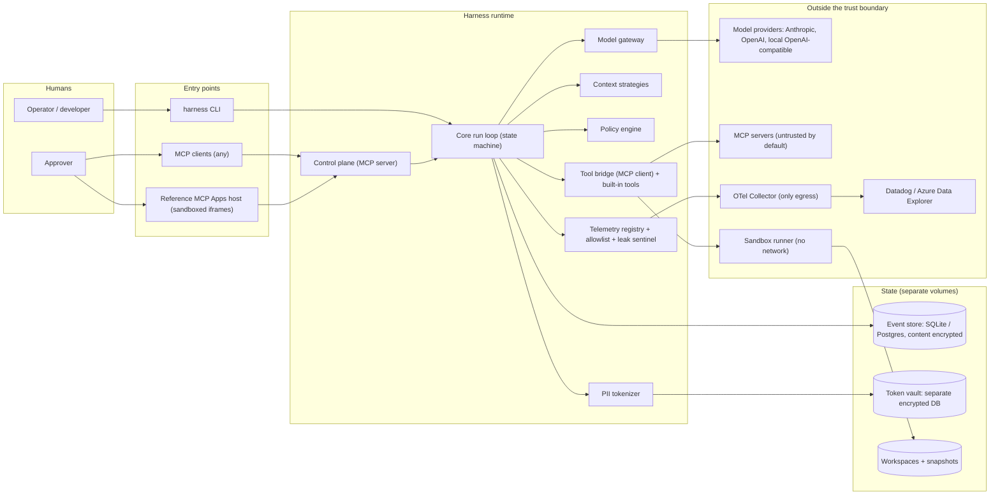

---

## Package architecture

All code lives in a pnpm workspace of ESM TypeScript packages under the `@harness/` scope. The import direction is fixed. The canonical allowlist is [`docs/engineering/layers.json`](docs/engineering/layers.json), and a lint rule (task 1.2) enforces it. There are no cycles.

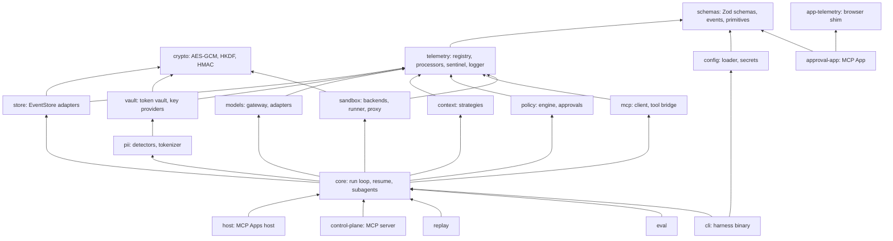

| Package | Responsibility | Epics |
|---|---|---|
| `schemas` | Event envelope and payload schemas, meta/content field classification, primitives (`Id`, `Code`, `Traceparent`), config fragments, messages, browser-safe app schemas | 7, 14, 20 |
| `crypto` | AES-256-GCM, HKDF, HMAC wrappers over `node:crypto` | 12 |
| `telemetry` | `defineSpan` registry, allowlist span/log processors, `SafeEvent` projection, leak sentinel, metrics allowlist, cardinality guard, sanctioned logger | 4, 8, 11, 20 |
| `store` | `EventStore` interface; in-memory, SQLite, and Postgres adapters; conformance suites; snapshots; outbox; retention; migrations | 7 |
| `vault` | Token vault (in-memory, encrypted SQLite), key providers (local, Azure Key Vault), rotation, purge, audit, pseudonyms | 12 |
| `pii` | Detectors (regex + Presidio), policy evaluator, tokenizer/detokenizer, boundary decorators | 13 |
| `models` | Provider-neutral gateway: adapters, structured-output ladder, repair, retries, routing, cost, cassettes | 14 |
| `context` | Context strategies, token counting, offloading, plan tools | 15 |
| `policy` | Policy schema, evaluator, approval payloads, sweeper, lint | 17 |
| `mcp` | MCP client pool, tool registry, trace propagation, result mapping | 6 |
| `sandbox` | Execution backends, runner service, egress proxy, workspace, snapshots | 19 |
| `core` | Run loop, recorder, checkpoints, resume, approvals, budgets, cancel, shutdown, subagents, roles | 2, 23 |
| `host` / `app-telemetry` / `approval-app` | MCP Apps host, browser telemetry shim, reference approval UI | 3, 5 |
| `control-plane` | Run control as an MCP server, with auth and scopes | 18 |
| `replay` / `eval` | Offline replay and diffs; eval runner, graders, statistics | 9, 16 |
| `config` / `cli` | Config loading and secrets; the `harness` command | 20 |

---

## The run: event log and state machine

A **run** is one execution of an agent task, identified by a ULID. Its history is an append-only log of events with contiguous `seq` numbers starting at 0. The store assigns `seq`. Callers pass `expectedSeq`, and a mismatch fails with `seq_conflict` and writes nothing. This optimistic concurrency is also the lease: a worker owns a run only while its appends succeed.

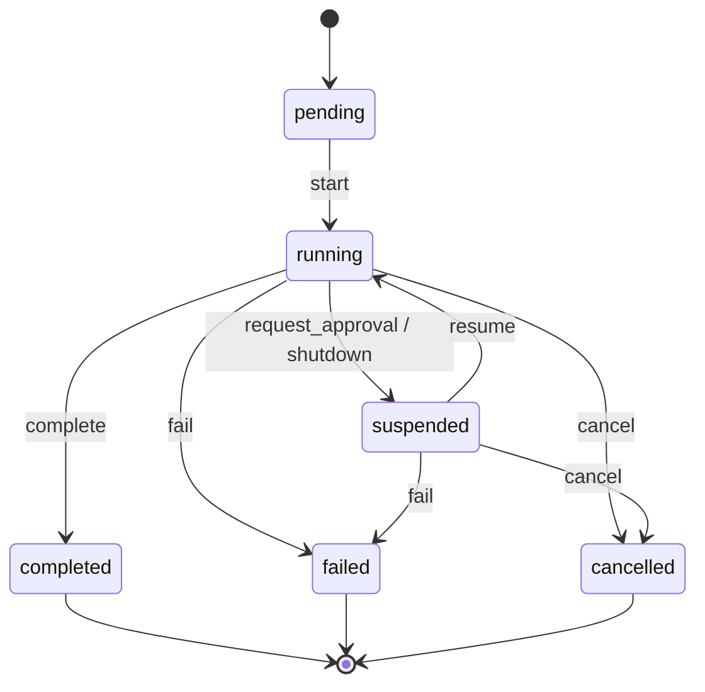

Terminal states absorb every trigger. Transitions and the state fold (`foldRunState`) are pure functions. A log containing an illegal transition is rejected as `corrupt_log`.

### Event vocabulary

Each event field is classified `meta` (safe for telemetry: ids, enums, counts, timings, codes) or `content` (anything user- or model-derived; this is the default for new fields). A compile-time-exhaustive map enforces the classification. The store keeps meta and content separately, encrypts content, and exports only an explicit `SafeEvent` projection.

| Event | Meta fields (examples) | Content fields |
|---|---|---|
| `run_created` | configHash, policyVersion, parentRunId, depth, replayOf | |
| `run_input` | inputKind | input |
| `run_status_changed` | from, to, reason | |
| `model_request` | requestId, provider, model, role, schemaHash | messages |
| `model_response` | tokens, costMicros, latencyMs, finishReason, schemaValid, repairAttempts, rungUsed, fallbackDepth | content, providerBlobs |
| `tool_intent` | callId, toolId, idempotent, policyDecision, ruleId | args (tokenized) |
| `tool_result` | callId, toolId, outcome, errorCode, latencyMs | result (tokenized) |
| `approval_requested` | approvalId, callId, expiresAt | payload |
| `approval_resolved` | approvalId, decision, decidedBy, reason, waitMs | edits |
| `checkpoint_written` | checkpointId, atSeq, traceparent, workspaceRef | |
| `context_compacted` | fromSeq, toSeq, strategy, strategyVersion | summary |
| `pii_action` | boundary, action, entity types and counts | |
| `budget_exceeded` | budget, limit, observed | |
| `subagent_spawned` / `subagent_completed` | childRunId, role, outcome, usage | |

### The loop

`runLoop` records `run_created`, `run_input`, and `pending -> running`. Then it repeats until the run is terminal or suspended:

1. Check budgets (steps, cost, wall clock; suspended time optionally excluded).
2. Compact context if needed (an explicit, recorded step).
3. Build context from the log.
4. Run a model step: record `model_request`, call the gateway, record `model_response`.
5. If the model returned tool calls, run the tool pipeline for each one. Otherwise complete with `final_answer`.
6. Drain sentinel trips into `pii_action` events and checkpoint on cadence.

All events go through one `RunRecorder`, which fills the envelope (`ts`, `traceId`, `spanId`, `segmentId`) and pairs each step with a registered span.

---

## Tool calls: the boundary pipeline

The **durability rule**: a side effect never starts before its `tool_intent` is durably appended, and a result is never assumed until `tool_result` is appended. Tools are wrapped in decorators, with the outermost listed first: `Offloading( Pii( Policy( Tools ) ) )`.

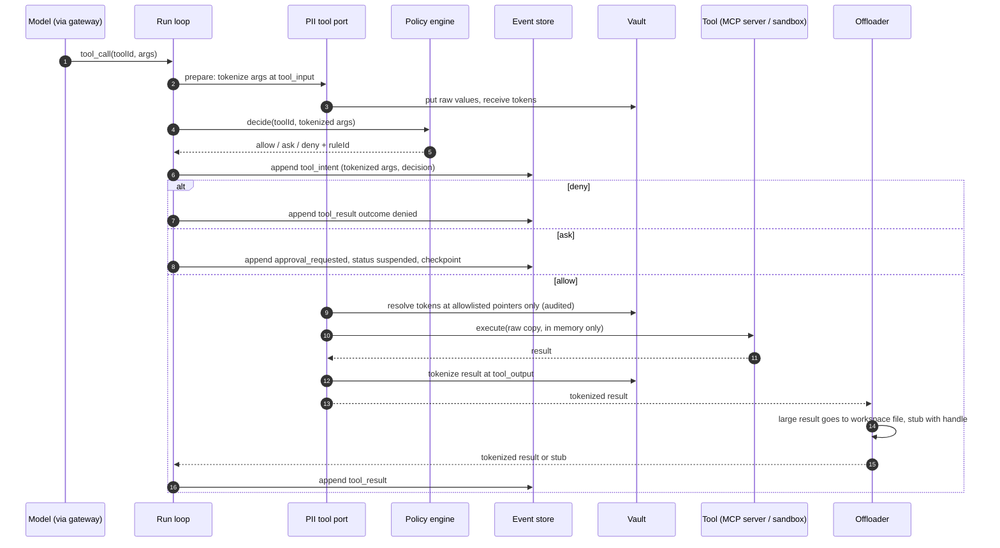

Rules worth knowing:

- Unknown tools are denied without execution (`unknown_tool`). Timeouts and exceptions become typed `tool_result` outcomes carrying an error code and never a message.
- Policy errors fail closed (`policy_error`). PII-blocked entities deny the call (`pii_blocked`).
- On resume, a dangling intent with no result is re-run only if the tool is declared idempotent. Otherwise it is escalated to a human (default) or failed (`resume_ambiguous`).
- Built-in tools include `read_offloaded` (pages offloaded output), `update_plan`/`read_plan`, `sandbox.exec`, `agent.spawn`, and `agent.verify`.

---

## Model gateway

`ModelGateway` implements the loop's `ModelPort`. Adapters only translate wire formats. The gateway owns enforcement, repair, retries, routing, and accounting. Requests are JSON-serializable, so they can be recorded, hashed, and replayed.

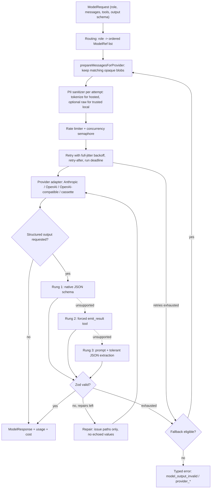

- **Lossless rehydration.** Provider-specific blobs (reasoning blocks, signatures, tool-use ids) are stored as `opaque` parts and re-sent byte-for-byte to the same provider. On a provider switch they are dropped and normalized parts continue the conversation.
- **Schema lowering.** Zod schemas convert to JSON Schema and are lowered per provider. Dropped constraints are recorded and still enforced by the Zod parse afterwards. `schemaHash` is stable across key order.
- **Cost.** Prices come from operator config (none hardcoded) and are computed in integer micros. Cost feeds budgets, spans, and bounded metrics.
- **Cassettes.** A `cassette` provider records and replays responses keyed by a request hash. Replay mode serves them from the event log in order and detects divergence.

---

## Context strategies

Context is a view derived from the immutable log, never mutable state. Strategies are pure: `build(events, budget, model, counter) -> messages`. Side effects such as summarizing or writing files happen in explicit, recorded steps.

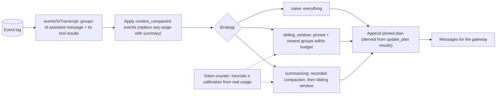

- Tool calls and their results are atomic groups that are kept or dropped together. The goal (`run_input`), summaries, and plan are pinned.
- Large tool outputs are offloaded to `.harness/offload/` (already tokenized) and paged with `read_offloaded`.
- Any output change requires a new strategy `version`; a golden test enforces this. Every model-call span records the strategy id and version, and `harness context --compare a,b` compares strategies offline.

---

## Privacy: PII tokenization and the token vault

Detection plus policy decides, per entity, **boundary**, and **destination**, whether a value is `tokenize`d, `redact`ed, `block`ed, or `allow`ed. Detection fails closed: if a detector or the vault fails, the operation fails.

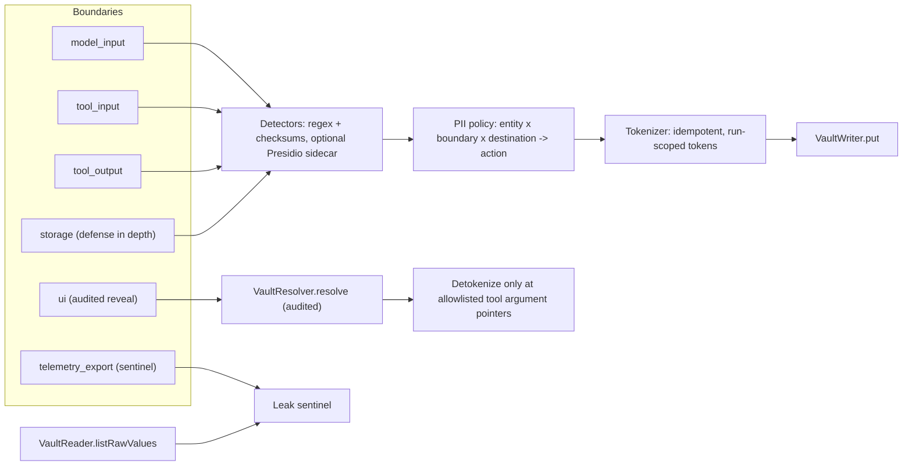

- **Tokens** use the `TYPE_N` form inside angle brackets (for example email number 1). They are numbered per run (per scope, for subagent trees) and per entity type. The same value always maps to the same token within a scope.
- **The vault** is a separate SQLite file with AES-256-GCM values bound by AAD to `(run, token)`, keyed-HMAC lookups (never unkeyed hashes), and `secure_delete`. It exposes four least-privilege interfaces: `VaultWriter`, `VaultResolver`, `VaultReader`, `VaultAdmin`.
- **Policy safety rails.** `allow` is invalid at `storage`. Secrets and cards can be `allow`ed only to an explicit tool destination. Raw values reach a local model only with an explicit opt-in.
- **Structured outputs** with format constraints (such as `email`) validate tokenized values by resolving them in memory only.
- **Every detokenization** (tool argument or human reveal) is recorded as a metadata-only `pii_action` audit event.
- **Keys** come from local secret references or Azure Key Vault. They rotate online with a resumable re-encryption job and can be retired only when no row uses them. Vault entries are purged after a grace period or with run retention.
- **Quality** is measured on a deterministic synthetic corpus (precision, recall, and F1 per entity), and CI fails on regressions.

---

## Policy and human-in-the-loop approvals

Policies are versioned YAML/JSON documents. `defaultDecision` can only be `ask` or `deny`. Rules match tool patterns, argument matchers on tokenized args (`equals`, `in`, `startsWith`, `matches` (ReDoS-screened), `exists`, `tokenType`), and context (subagent, server). Among matching rules **deny > ask > allow**, regardless of order. Property tests check that adding a deny never loosens a decision.

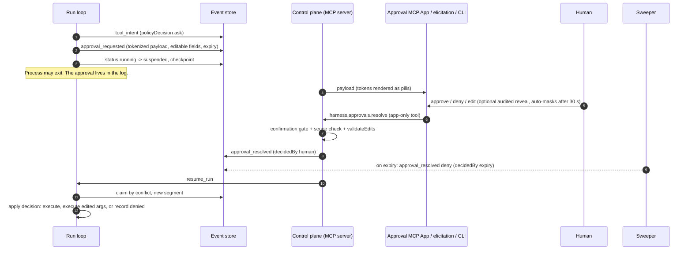

- **Edits** are limited to pointers the rule marks `editable`, validated against the tool's input schema, and re-tokenized.
- **Self-approval is blocked.** Decision tools are app-only, or else they require an out-of-band human elicitation. Without either, the call fails closed.
- **Approval paths**: MCP Apps UI, MCP elicitation (text clients), or `harness approvals list|show|approve|deny`. Approvals can expire and escalate to webhook notifications that carry metadata only.
- **Invariants run on every eval trial and the golden replay.** They check that `ask` executions are preceded by a human approve or edit, that `deny` never executes, that resolutions are single, that approvals stay scoped to their run, and that edits stay within editable fields.
- **Tooling**: `harness policy test` (expectation fixtures) and `harness policy lint` (shadowed and over-broad rules).

---

## MCP integration: servers, apps, and the control plane

### MCP servers as tool providers

- **Servers are untrusted by default.** Tool names are normalized to codes. Collisions fail startup. Descriptions are sanitized and capped. Server error text never enters codes, spans, or logs. Arguments are validated against the tool's JSON Schema before any network I/O.
- **Trace context goes only to `trust: internal` servers** with `propagateTrace: true`, only in `params._meta`, and never as baggage.
- **Stdio servers do not inherit the parent environment.** Secrets are injected only through `SecretRef`.
- `harness servers check` shows connectivity, registered and rejected tools, and propagation behavior without calling any tool.

### MCP Apps host and the telemetry door

Apps are untrusted code. The host renders them in `sandbox="allow-scripts"` iframes (never `allow-same-origin`) with a deny-all CSP and no network. App telemetry has exactly one way in:

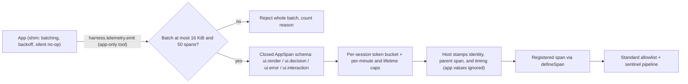

The reference **approval app** builds to a single HTML file with no external URLs. It renders the DOM with `textContent` only, passes axe accessibility checks, and falls back to CLI instructions when the bridge is unavailable.

### Control plane

`harness serve --stdio | --http` exposes `list_runs`, `get_run`, `approve`, `deny`, `resume_run`, `cancel_run`, `review_approval` (elicitation), a `ui://harness/runs/v1` run console, and the app-only `harness.approvals.resolve` and `harness.approvals.reveal`. Security defaults:

- loopback binding, and TLS required for anything else
- bearer tokens with scopes `read | approve | run | reveal | admin` and optional run filters
- Host and Origin checks, per-token rate limits
- metadata-only audit logs
- reveal off by default
- app-only tools hidden from clients without UI support

---

## Telemetry: metadata-only, defended in depth

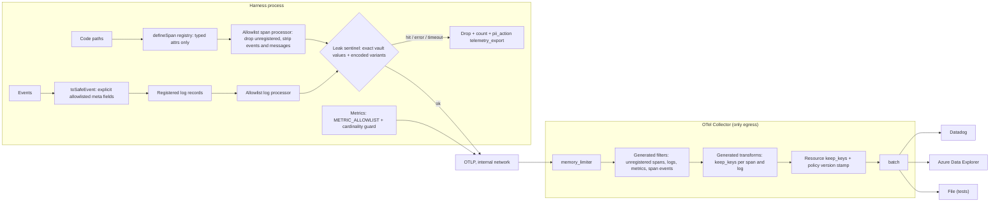

- **Layer 1, registry and processors.** Attributes are limited to `Id`, `Code`, `enum`, int, finite number, and bool. Exception events, status messages, and non-allowlisted resource keys are stripped. Raw tracer use is a lint error. Content-capture env flags abort startup.
- **Layer 2, leak sentinel.** An Aho-Corasick automaton (linear time, no regex) matches the exact raw values the vault holds for the run and their variants: case, whitespace, digits-only, percent, base64 at all alignments, hex, and HTML entities. It is fail closed and mandatory in production.
- **Layer 3, collector.** The collector's allowlist is generated from the same registry, and drift fails CI. A single `policyVersion` (a hash of the allowlist) is stamped on every record and checked against the harness at startup.
- **Backends** get validated sink policies, a Kusto schema and queries with emulator contract tests, a Datadog dashboard as code, and alerts with runbooks. A leak-sentinel trip pages on any non-zero count. Metric labels are bounded, and series per metric are capped at runtime.
- **Debugging content** means replaying from the event store, never searching a backend.

---

## Sandbox and deployment topology

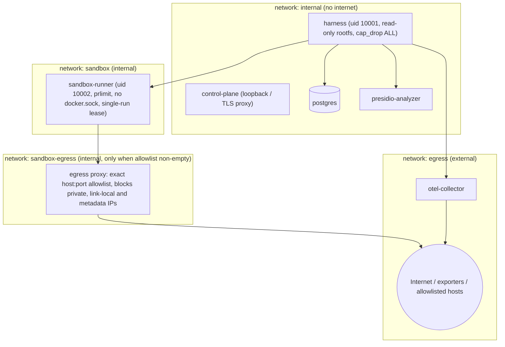

- **`SandboxBackend.exec`** takes argv only, never shell strings. Every exec gets a timeout, memory, pid, CPU, and output limits, and the whole process group is killed on timeout. A development-only in-process backend refuses production use.
- **Workspaces** live at `/workspaces/<runId>/`. A safe path resolver rejects traversal, symlinks, and absolute paths. Quotas apply. A single-run lease per runner and scratch wiping between runs prevent cross-run access.
- **Snapshots** are checksummed tar archives, optionally encrypted, restored through a safe extraction filter with an atomic swap. They are taken at each checkpoint so a crashed run resumes with its workspace.
- **Images** are multi-stage, non-root, digest-pinned, read-only, and contain no setuid binaries, no package manager, and no docker CLI.
- **Compose profiles** (`dev`, `test`, `prod-like`) are checked by a security linter that rejects `privileged`, `docker.sock`, host networking, and literal secrets, and requires dropped caps and read-only rootfs.
- **A threat catalog** (`T-01` container escape through `T-19` runner Host abuse) maps each threat to a mitigation task and test. CI fails if an active threat has no test citing it.

---

## Durability: checkpoints, resume, shutdown, cancel

- **Checkpoints.** A snapshot (context calibration, plan, workspace ref, `traceparent`) is written atomically with `checkpoint_written`, on a cadence (default every 20 events) and always before suspending.
- **Resume.** The worker claims the run by appending a status change with `expectedSeq = head`. Exactly one of two concurrent resumers wins. It rebuilds state from the latest snapshot plus subsequent events, starts a new segment whose root span links to the previous one, applies the dangling-intent plan and resolved approvals, and continues.
- **Graceful shutdown.** SIGTERM/SIGINT aborts in-flight work, reaches a safe point, suspends with a checkpoint, and exits with 143/130. Compose `stop_grace_period` exceeds the harness grace period.
- **Cancel.** Cancelling from another process uses the same conflict mechanism. The live worker sees `lease_lost`, inspects the log tail, and stops within one step. Cancellation propagates through subagent trees.
- **Crash injection.** For every append boundary `k` and both modes (crash before commit, or after commit with a lost acknowledgement), the scenario is resumed from a fresh process. It must reach the reference outcome with each non-idempotent tool executed exactly once.

---

## Subagents and model roles

**Roles** (`planner`, `worker`, `judge`, `summarizer`, plus custom ones) bind a model route, system prompt, tool subset, budgets, context strategy, and optional result schema. A subagent is a **separate run** linked to its parent:

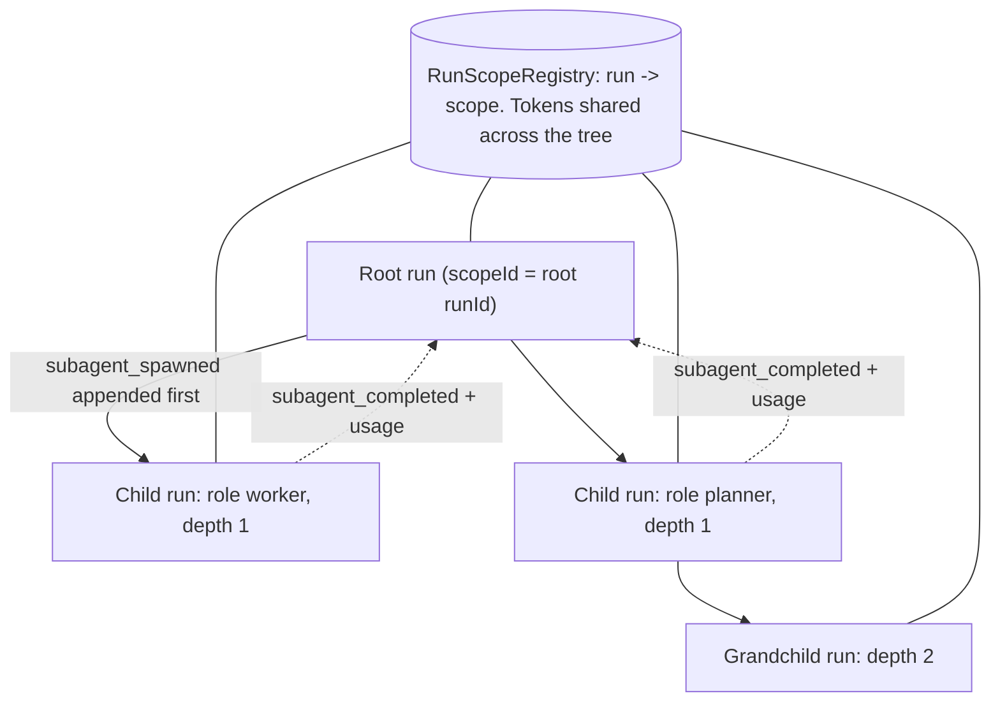

- **Children cannot widen authority.** Their tools are the intersection of the parent's registry and the role's tools. Their budgets are capped by the parent's remaining budget. Depth and child counts are limited (global depth ceiling 4).
- **Results** are validated against the role's Zod `resultSchema` through the enforcement ladder and stay tokenized.
- **Resume** handles every crash point with no duplicate or lost children: spawn never started, child terminal, child still running or suspended, or child log missing.
- **`agent.verify`** is a runtime self-check: a single schema-enforced judge call returns a content-free verdict and shares its schema with the eval judge.

---

## Replay and regression gates

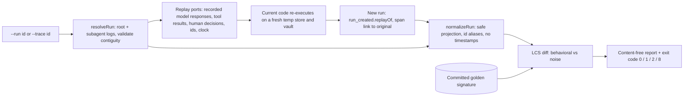

Replay never calls a real model, tool, or human. Config and policy drift are reported explicitly. A committed golden run covers idempotent and non-idempotent tools, an `ask` with an edit, a checkpoint, a compaction, a crash-and-resume, a deny, and a final answer, and it gates every PR. A mutation check proves the gate can fail. Baselines are updated only explicitly, and updates are refused in CI.

---

## Evaluations

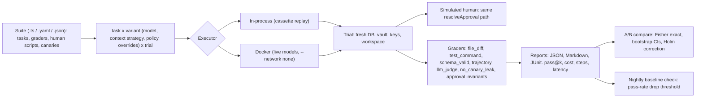

Reports hold scores, counts, codes, and costs only, never transcripts. Trajectory assertions check privacy at both the stored view and what the provider actually received. A red-team suite drives a perfectly obedient adversarial model through self-approval, edit smuggling, token confusion, tool-name aliasing, and subagent escalation. Every attack must end blocked or in a safe state.

---

## Configuration, secrets, and keys

- **One config file**: `harness.config.yaml`, found via `--config`, then `HARNESS_CONFIG`, then the working directory. It is composed from fragments owned by each package, strictly validated, and deep-frozen. `HARNESS__RUN__BUDGETS__MAXSTEPS=50`-style env vars override values. Validation errors list paths and expected types, never the submitted values.
- **Secrets are references only**: `env:NAME`, `file:/path`, `akv:<vault>/<secret>[#version]`. A literal value in a secret-looking key fails validation. Resolved values are `Secret` objects that print `[REDACTED]` through `toString`, `toJSON`, and `inspect`.
- **Encryption keys** are 32-byte keys from a `KeyProvider` (local secret refs or Azure Key Vault), versioned, rotatable online, and retired only when unused. Production refuses to start without configured keys.
- **Logging** goes through a sanctioned logger whose API takes an event code plus typed fields and has no free-text message parameter. `console.*` is banned by lint.

---

## CLI

| Command | Purpose |
|---|---|
| `harness run`, `resume`, `inspect`, `cancel` | Start, resume, inspect (content hidden unless `--show-content`), and cancel runs |
| `harness approvals list/show/approve/deny/sweep` | Terminal approval workflow; `--reveal` is explicit and audited |
| `harness serve --stdio / --http` | Run the control-plane MCP server |
| `harness servers check` | MCP server diagnostics without calling tools |
| `harness context` | Inspect or compare context strategies for a stored run, read-only |
| `harness replay` | Replay a run or trace, diff, golden compare |
| `harness eval run/compare/check-baseline/baseline update` | Evaluations |
| `harness policy test/lint` | Policy regression tests and lint |
| `harness pii explain` | Print the PII policy decision or full matrix |
| `harness keys generate/rotate/retire` | Key lifecycle |
| `harness store migrate`, `doctor`, `healthcheck` | Schema migrations, environment diagnostics, container health |

Global flags: `--config`, `--json` (exactly one JSON document on stdout), `--log-level`. Errors print codes, never messages.

| Exit code | Meaning |
|---|---|
| 0 | OK |
| 1 | Failure (replay: behavioral difference) |
| 2 | Usage error |
| 3 | Invalid config |
| 4 | Denied by policy |
| 5 | Run suspended, waiting for approval |
| 6 | Budget exceeded |
| 7 | Approval not found or already resolved |
| 8 | Replay failure (divergence, missing result, corrupt log) |

---

## Security hardening and supply chain

- **Secret scanning.** gitleaks runs on PR diffs and nightly on full history with redacted output, alongside GitHub push protection.
- **Dependency gate.** `pnpm audit` plus osv-scanner fail on high and critical findings. Exceptions carry an owner and an expiry date, and expired exceptions fail the build.
- **Semgrep.** Project-specific rules cover shell exec, `eval`, `innerHTML`, `fetch` without an abort signal, `Math.random` for secrets, deprecated crypto, unvalidated `JSON.parse`, hard-coded `http://`, and stray `process.env` secrets. Suppressions require a written reason.
- **Images and releases.** CycloneDX SBOMs, image scans, and cosign signing by digest with SBOM attestations.
- **License allowlist.** GPL, AGPL, LGPL, SSPL, BUSL, and non-commercial licenses are denied.
- **Repository hygiene.** SPDX headers on every file and DCO sign-off on every commit.
- **Prompt-injection suite.** A perfectly obedient model is attacked through tool results, files, MCP server descriptions and errors, hidden page text, and subagent results. Policy decisions must match the no-injection baseline.
- **Positive controls.** Every gate ships with a negative control (a seeded problem it must catch), so a misconfigured gate cannot pass silently.

---

## CI/CD

Azure Pipelines runs the stages below. Results are published as JUnit and coverage as Cobertura. Secrets come only from variable groups or Key Vault.

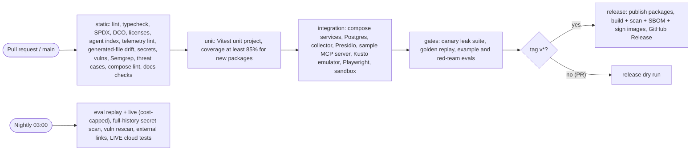

---

## Guarantees, best-effort measures, and known gaps

The project states guarantees with their evidence and assumptions, and does not make absolute claims. Task 21.8 writes the authoritative version at `docs/guarantees.md`.

- **Structural (enforced by construction and tested):**
  - closed telemetry schemas at three layers
  - vault separate from the event log
  - content encrypted at rest
  - app telemetry validated and host-stamped
  - default-deny sandbox
  - policy evaluated in code
  - approvals recorded in the log

  The evidence comes from the canary suite (8.5), the collector fixture test (10.6), the hostile-app suite (3.7), sandbox hardening (19.7), and crash injection (2.11).
- **Best effort:** PII detection (with a published precision/recall report), the sentinel's variant matching, and prompt-injection resistance beyond policy enforcement.
- **Known gaps:**
  - encrypted, compressed, steganographic, translated, or split values
  - side channels
  - kernel-level sandbox escapes
  - provider-side logging at third-party model APIs
  - user-supplied workspace files
  - what a human does after a reveal
  - a compromised host
- **Operator responsibilities:** key management and rotation, retention, provider trust settings, network policy, control-plane access, backups, and monitoring.
- **Non-claims:** no certification of GDPR, HIPAA, or other compliance regimes.

---

## Build plan

There are 23 epics and 187 tasks. Each task is sized for one PR (about a developer-day) with explicit inputs, outputs, tests, and acceptance criteria. Task ids are `<epic>.<n>`. The diagram groups epics by their longest dependency chain, derived from each task's "Items it depends on". Tasks interleave across epics, so an epic can start before an earlier wave fully finishes.

```mermaid
flowchart LR
  W0["1 Foundation"] --> W1["20 Config + CLI core"]
  W1 --> W2["7 Event store"]
  W2 --> W3["4 Span allowlist"]
  W3 --> W4["2 Run loop / 10 OTel Collector"]
  W4 --> W5["12 Token vault / 14 Model gateway"]
  W5 --> W6["6 MCP servers / 15 Context strategy"]
  W6 --> W7["13 PII tokenizer / 19 Sandbox"]
  W7 --> W8["8 Leak sentinel / 17 Policy + approvals"]
  W8 --> W9["3 Host bridge / 9 Replay / 11 Backends / 16 Eval runner"]
  W9 --> W10["5 MCP App / 23 Subagents + roles"]
  W10 --> W11["18 Control-plane MCP server"]
  W11 --> W12["21 Docs, examples, release"]
  W12 --> W13["22 Security hardening"]
```

| # | Epic | Tasks | Spec |
|---|---|---|---|
| 1 | Foundation (monorepo, CI) | 10 | [epic-01](docs/engineering/tasks/epic-01-foundation.md) |
| 2 | Run loop (resumable state machine) | 13 | [epic-02](packages/core/epic-02-run-loop.md) |
| 3 | Host bridge (validating app telemetry) | 7 | [epic-03](packages/host/epic-03-host-bridge.md) |
| 4 | Span allowlist | 7 | [epic-04](packages/telemetry/epic-04-span-allowlist.md) |
| 5 | MCP App (approval app, telemetry shim) | 6 | [epic-05](packages/approval-app/epic-05-mcp-app.md) |
| 6 | MCP servers (client, tool bridge) | 7 | [epic-06](packages/mcp/epic-06-mcp-servers.md) |
| 7 | Event store | 12 | [epic-07](packages/store/epic-07-event-store.md) |
| 8 | Leak sentinel | 6 | [epic-08](packages/telemetry/epic-08-leak-sentinel.md) |
| 9 | Replay | 6 | [epic-09](packages/replay/epic-09-replay.md) |
| 10 | OTel Collector (isolated gateway) | 6 | [epic-10](infra/collector/epic-10-otel-collector.md) |
| 11 | Backends (sinks, dashboards, alerts) | 6 | [epic-11](infra/epic-11-backends.md) |
| 12 | Token vault | 8 | [epic-12](packages/vault/epic-12-token-vault.md) |
| 13 | PII tokenizer | 11 | [epic-13](packages/pii/epic-13-pii-tokenizer.md) |
| 14 | Model gateway | 15 | [epic-14](packages/models/epic-14-model-gateway.md) |
| 15 | Context strategy | 8 | [epic-15](packages/context/epic-15-context-strategy.md) |
| 16 | Eval runner | 11 | [epic-16](packages/eval/epic-16-eval-runner.md) |
| 17 | Policy engine and approvals | 8 | [epic-17](packages/policy/epic-17-policy-engine-and-approvals.md) |
| 18 | Control-plane MCP server | 7 | [epic-18](packages/control-plane/epic-18-control-plane-mcp-server.md) |
| 19 | Sandbox and container execution | 8 | [epic-19](packages/sandbox/epic-19-sandbox-and-container-execution.md) |
| 20 | Config and CLI core | 5 | [epic-20](packages/config/epic-20-config-and-cli-core.md) |
| 21 | Docs, examples, release | 8 | [epic-21](docs/epic-21-docs-examples-release.md) |
| 22 | Security hardening | 6 | [epic-22](security/epic-22-security-hardening.md) |
| 23 | Subagents and model roles | 6 | [epic-23](packages/core/epic-23-subagents-and-model-roles.md) |

The full index is [`docs/engineering/tasks/README.md`](docs/engineering/tasks/README.md), and the shared rules are in [`docs/engineering/CONVENTIONS.md`](docs/engineering/CONVENTIONS.md). Completed task ids are tracked in [`docs/progress.json`](docs/progress.json).

---

## Repository layout and contributing

```text
packages/        @harness/* libraries and apps (specs live next to the code: epic-*.md)
infra/           compose, collector, Kusto, dashboards, alerts, k8s examples
security/        scanner rules and policies
pipelines/       Azure Pipelines templates
scripts/         CI checks and generators
test/            cross-package, canary, replay, and security tests
examples/        runnable examples (synthetic data only)
docs/            documentation; docs/engineering holds CONVENTIONS, task index, layers.json
tools/           custom ESLint plugin
```

Work happens one task per PR. The title is `[<task id>] <task name>`, commits are signed off (`git commit -s`), and the PR lists the tests the spec requires. Before you start, read [`AGENTS.md`](AGENTS.md), the nearest folder `AGENTS.md`, CONVENTIONS, and the task spec. This applies to coding agents too, which load [`CLAUDE.md`](CLAUDE.md) and `AGENTS.md`. `node scripts/gen-agents-index.mjs --check` keeps the agent index, task ids, and import boundaries in sync.

Licensed under the [Apache License 2.0](LICENSE).
