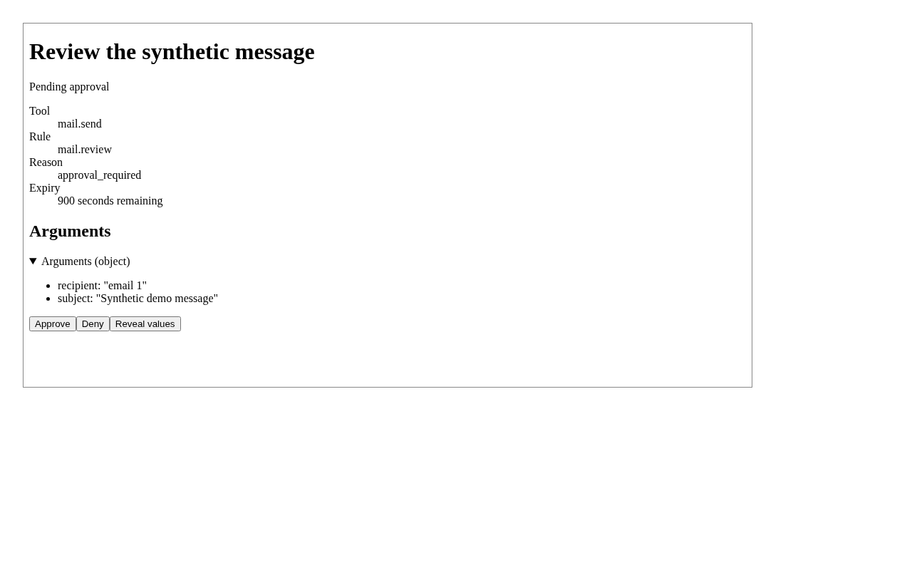
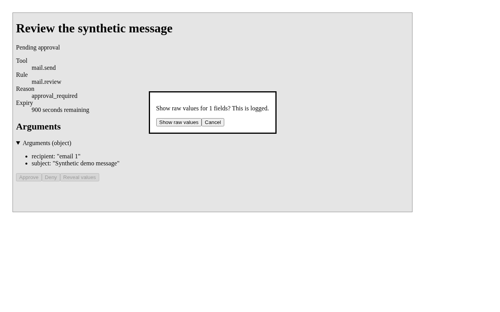
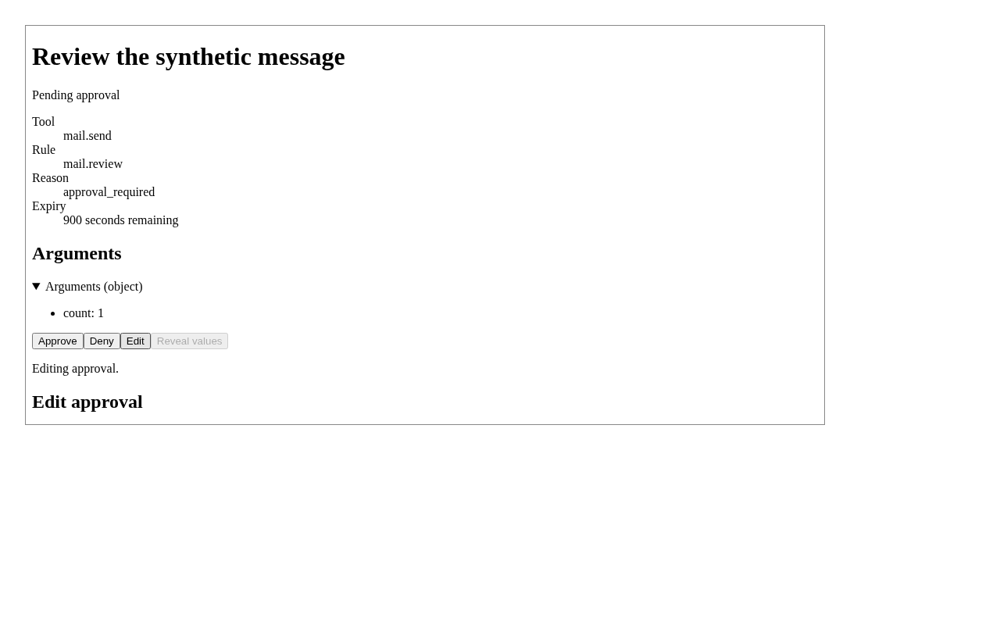
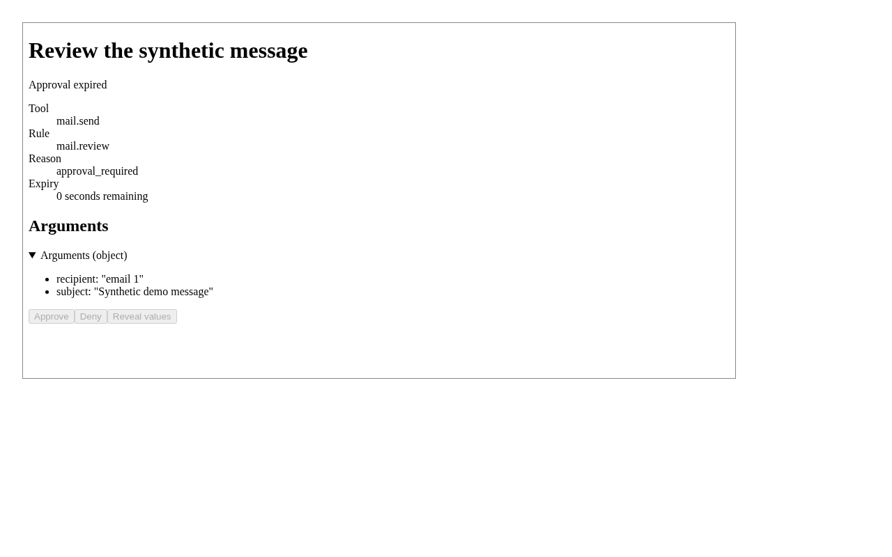
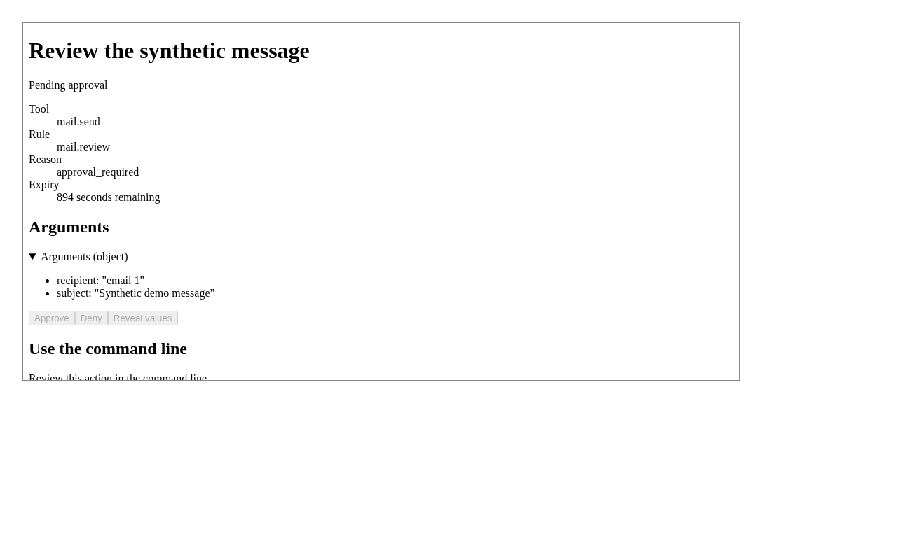

# Approval app

The approval app is one of the ways a person can resolve a tool call held by an `ask` policy rule.
This walkthrough uses synthetic input and the scripted fake model; it does not need a provider key.

## How it works

The runtime records an `approval_requested` event containing the prepared, tokenized arguments and
suspends the run before the tool executes. The app displays that pending request and sends an
approve, deny, or edit decision through the host's allowlisted approval tool. The control plane
records the decision as an `approval_resolved` event. Resolution and execution are separate: resume
the run to continue, and policy is evaluated again before the tool executes.

## Use the reference host

From the repository root, run `examples/approval-demo/run.sh`. It builds the harness, starts a
loopback-only control-plane listener, and creates a suspended run with the fake model and the sample
`ask` rule. The script prints the control-plane URL, run ID, and approval ID, then starts the local
reference-host app and prints its URL. Open that URL in a browser. Use `Ctrl+C` to stop the local
servers. Demo state is written under `.tmp/`; remove that directory when you are finished.

The approval screen shows tokenized arguments by default. If the demo does not open automatically,
use the printed command `harness approvals show <approval-id> --view` with the same demo
configuration and data directory.

## Use an MCP Apps-capable client

Connect an MCP Apps-capable client to the control-plane URL printed by the demo and use a token
authorized for reading and approving that run. Select the pending approval app when the client
offers it, review the tokenized arguments, then make an explicit decision. Configure the token and
endpoint in the client using that client's own MCP connection instructions.

The [control-plane compatibility matrix](control-plane-clients.md) describes the client profiles
covered by repository tests. The reference host and SDK profiles in that matrix are exercised by
tests; behavior of other third-party clients, including how they display the app and preserve
confirmation prompts, is **unverified**.

## Use elicitation

Clients without the approval app may call `review_approval`. When the client supports form
elicitation, the control plane asks the person to confirm the proposed decision; a declined or
unavailable confirmation does not resolve the approval. Clients without the needed elicitation
capability receive CLI instructions instead. Elicitation provides a user-interface request; it is
not proof that an automated client represents a person.

## Use the CLI fallback

Use the printed approval ID with `harness approvals show <approval-id>` to inspect the request,
`harness approvals approve <approval-id> --yes` to approve it, or
`harness approvals deny <approval-id> --yes` to deny it. For policy-approved edits, provide a JSON
file with `harness approvals approve <approval-id> --edit <json-file> --yes`. After resolving the
approval, resume the run with `harness resume <run-id> --fake-model
examples/quickstart/resume-model.script.json`.

The CLI operations require the same demo configuration and data directory as the script. The CLI
is also the documented fallback when the MCP client cannot open an app or request elicitation.

## Reveal tokenized values

Reveal is disabled by default. An operator must enable it in the control-plane configuration and
grant the `reveal` scope to the human's token. The app asks for confirmation before requesting
selected values; successful reveals are audited, kept in browser memory, and masked again after
30 seconds. Avoid screenshots or recordings while a value is revealed. The confirmation dialog
shown below is part of the approval app.

## Edit arguments

The app offers an edit form only for fields named by the policy's editable JSON pointers. Review
each changed value before submitting it. The runtime validates the edit and evaluates policy again
before execution; a rejected edit leaves the approval pending so it can be corrected or denied.

An approval whose deadline has elapsed is shown as expired and its decision buttons are disabled.

If the host bridge is unavailable, the app displays copyable CLI instructions rather than sending
a decision.

## Troubleshooting

| Error code | Meaning | What to try |
| --- | --- | --- |
| `approval_not_found` | The ID is unknown to this run or is not visible to this token. | Check the run and approval IDs and the token's run scope. |
| `approval_already_resolved` | Another decision has already resolved this approval. | Refresh the run and inspect its recorded status. |
| `approval_expired` | The approval expired before execution resumed. | Start a new run and review the new request. |
| `edit_invalid` | An edited value or pointer did not pass validation. | Use only the fields exposed by the edit form and correct their values. |
| `human_confirmation_unavailable` | The client could not provide the required human confirmation. | Use a human-facing client with form elicitation or the CLI fallback. |
| `app_call_requires_approval` | The host cannot connect an app call to the durable approval path. | Use the configured reference host or resolve the request through the control plane. |
| `app_run_unavailable` | The bound run cannot accept a new approval in its current state. | Inspect the run state and reopen only while it is pending. |
| `ui_session_expired` | The host ended an expired UI session. | Reopen the pending approval in a new session. |

## Security notes

Approval authentication, loopback binding, TLS requirements, scopes, confirmation assumptions, and
known gaps are described in [Control-plane security](control-plane-security.md) (task 18.5).
Review the evidence, assumptions, and known gaps in [Guarantees and limits](guarantees.md)
(task 21.8) before relying on this flow in a deployment.

## Regenerate the screenshots

The screenshots use deterministic IDs, a fixed browser clock, and synthetic fixture values. After
building the host and approval app, run
`node --experimental-strip-types --disable-warning=ExperimentalWarning scripts/docs/screenshots.ts`.
The generated PNGs are checked in as illustrations; CI checks that the referenced images exist and
smoke-tests their dimensions, but does not compare pixels. The nightly screenshot workflow
regenerates them and uploads an artifact for manual comparison.
