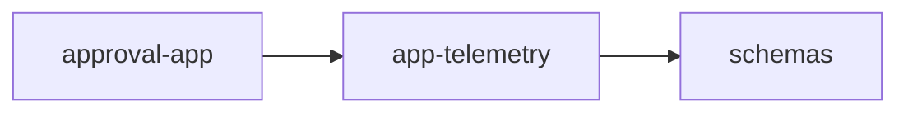
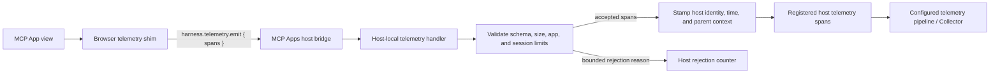

<!-- package-readme: v1 -->

# `@rovinos/app-telemetry`

## Purpose

`@rovinos/app-telemetry` is a small browser-safe shim that lets an MCP App report a fixed set of metadata-only spans through its host. The app chooses which span names its manifest allows and can record render, decision, error, interaction, and input metadata; the shim does not collect UI activity automatically or make network requests.

## Where it fits

<!-- BEGIN GENERATED: readme-deps (yarn gen:readmes) -->

<!-- END GENERATED: readme-deps -->

This package is a private internal dependency of `@rovinos/approval-app`. Its code is inlined into the app's built HTML views, which the published `@rovinos/cli` bundles as application assets; it is not a standalone public API. The package stays in the browser layer because its only internal dependency is the browser-safe `@rovinos/schemas` contract, and its transport uses only the supplied MCP Apps bridge.

## How it works

The app's manifest limits span names before they enter the queue. Calls go through the host-local `harness.telemetry.emit` tool, not directly to an exporter. The host checks the batch and each span, enforces app/session limits, then stamps accepted data with host-controlled identity and time before creating registered telemetry spans.



The transport starts inactive. If a bridge is supplied, it waits for `hostReady` if provided, then probes the host with an empty batch. A successful response activates it; a rejected call, error response, missing bridge, or two-second activation timeout leaves it inactive. Inactive methods do nothing. `traceContext.traceId` may expose the trace ID from valid host `traceparent` metadata for display or local correlation; it is never attached to the emitted app spans.

```mermaid
stateDiagram-v2
  [*] --> Inactive
  Inactive --> Active: host bridge confirms empty batch
  Inactive --> Inactive: no bridge, error, or activation timeout
  Active --> Buffering: record validated manifest span
  Buffering --> Sending: 20 pending spans, 2 s timer, explicit flush, or page lifecycle
  Sending --> Buffering: batch succeeds; reset backoff
  Sending --> Backoff: bridge rejects or call fails
  Backoff --> Sending: retry after jittered exponential delay
  Active --> Disposed: dispose
  Buffering --> Disposed: final flush, then count abandoned spans
  Backoff --> Disposed: clear retry timer and final flush
  Disposed --> [*]
```



The shim sends when 20 spans are queued, every two seconds, on `pagehide`, when the document becomes hidden, or when `flush()` is called. Each batch is limited to 50 spans and 14 KiB of JSON; the pending queue holds at most 100 spans and drops the oldest entries when full. A failed or error-result send restores its batch and retries with exponential backoff from 500 ms to an 8-second cap, with up to 20% jitter. Success resets the delay. `dispose()` removes listeners and timers, attempts a final drain, counts any abandoned spans as dropped, and disables the transport.

The host independently accepts at most 50 spans and 16 KiB per batch. It validates each span against the strict shared schema, applies per-session batch and span rate limits, and stamps accepted spans; app-provided offsets do not control the final host timestamps. The default limits are documented in the configuration section below.

For implementation details, start with [`src/index.ts`](./src/index.ts), [`src/transport.ts`](./src/transport.ts), and [`src/types.ts`](./src/types.ts). The host boundary is implemented in [`packages/host/src/server/app-telemetry.ts`](../host/src/server/app-telemetry.ts) and [`packages/host/src/server/stamp.ts`](../host/src/server/stamp.ts); the shared span contract is [`packages/schemas/src/app-span.ts`](../schemas/src/app-span.ts).

## Public API

This is a private workspace package rather than a published, semver-stable API. It exports `createAppTelemetry`, `APP_TELEMETRY_TOOL_NAME`, and the span, manifest, bridge, options, stats, trace-context, and attribute types. `createAppTelemetry` is the app-facing API.

```ts
import { createAppTelemetry } from "@rovinos/app-telemetry";

const telemetry = createAppTelemetry({
  bridge,
  hostReady: appConnection,
  manifest: { spans: ["ui.render", "ui.error"] },
});

telemetry.record("ui.error", { code: "view_unavailable" }, 12);
await telemetry.flush();
const dropped = telemetry.stats().dropped;
await telemetry.dispose();
```

The exported span names are `ui.render`, `ui.decision`, `ui.error`, `ui.interaction`, and `ui.input`. Attributes are closed and name-specific: for example `ui.decision` accepts only `approve`, `deny`, or `edit`, and `ui.interaction` accepts a `click`, `focus`, or `edit` kind with an integer count from 0 to 1000. Timing values are integer milliseconds; the duration is limited to one hour. Unknown names, extra attributes, or invalid values are ignored.

`start(name).end(attrs)` measures duration; `record(name, attrs, durationMs?)` records a measured span. `active` indicates host activation. `setHostMetadata()` updates the informational trace context. `flush()` sends queued spans, `stats()` reports the local dropped-span count, and `dispose()` cleans up the transport. These methods are designed not to throw into app code.

## Inputs and outputs

| Boundary data | Comes in | Goes out | Tokenized at this boundary |
| --- | --- | --- | --- |
| Span request | Manifest-declared name, bounded enum/code attributes, and measured duration | A schema-shaped span with a shim-relative offset and integer timing values | No tokenization is performed. The closed span fields exclude free text, URLs, prompts, and tool arguments. |
| Host connection | Optional host bridge and readiness promise | Calls to `harness.telemetry.emit` through that bridge | No app content is sent during activation; the probe is `{ spans: [] }`. |
| Host metadata | Host tool-result `_meta`, if provided | A read-only trace ID only when `traceparent` is valid | The trace ID is correlation metadata, not content; it is not included in spans. |
| Host response | Bridge result or error | Acknowledgment is not exposed by the shim; failures remain silent and are retried. `stats().dropped` stays local. | No payload is returned to the app through the telemetry API. |
| Host ingestion | Untrusted batch arguments received by the host | Integer `{ accepted, dropped }` acknowledgment; accepted spans are stamped into host telemetry | The default host ingestion path does not retain or log the app payload. It uses host-owned app, run, session, timing, and trace context. |

These are metadata-only event measurements, not tokenized user content. The host validates its input again and drops invalid spans independently; see the [host-side validation and stamping implementation](../host/src/server/app-telemetry.ts).

## Configuration, telemetry and errors

The shim has no environment variables or config-file keys. `createAppTelemetry` accepts a host `bridge`, optional `hostReady` promise, required manifest span names, and optional `now` and retry `random` functions. The `now` and `random` hooks support deterministic timing and retry behavior; production defaults use `performance.now()` and `Math.random()`.

Host configuration controls whether an app may emit telemetry and the server-side limits. `host.apps[].telemetry` defaults to `false`. Under `host.limits`, defaults are `batchesPerSecond: 10`, `batchBurst: 20`, `spansPerMinute: 200`, and `spansPerSessionLifetime: 2000`. The host also enforces a 50-span and 16 KiB batch limit. These limits can be configured within the ranges in [`HostConfigSchema`](../schemas/src/config/host.ts); see the [reference host documentation](../../docs/host.md).

The shim defines no OpenTelemetry spans, metrics, or typed error codes. Its bridge calls are silent; host-created spans are named `harness.ui.render`, `harness.ui.decision`, `harness.ui.error`, `harness.ui.interaction`, and `harness.ui.input`. For app telemetry rejections, the host increments `harness.host.app_rejected` with a bounded reason of `schema`, `size`, `rate`, `unknown_app`, `unknown_span`, or `session_cap`. Host app-call errors are host-owned; the shim sees an error result only as a failed send and does not expose its text to the app.

## Security and privacy

- The shim has no direct network transport and does not call `fetch`, `XMLHttpRequest`, `WebSocket`, or `sendBeacon`. It sends only through the host bridge.
- The manifest and runtime checks restrict span names, attributes, and values. The shared strict schema is checked again by the default host handler, which bounds batch size and rate, stamps accepted data with host-owned context, and returns counts rather than span payloads. A custom host telemetry handler must preserve these validation and privacy properties.
- App-supplied offsets are not authoritative: the host derives accepted span timestamps from its session clock and bounds durations to the active session.
- Only metadata fields are accepted. The package does not tokenize content; callers must not try to encode sensitive content in error codes or other metadata.
- Without an enabled host integration, telemetry stays inactive and is a no-op. The shim's bounded queue and local dropped count are best-effort delivery, not durable storage; spans may be dropped due to limits, failure, or app shutdown.
- The host validation protects only telemetry sent through this bridge. It does not constrain telemetry an app emits through another path, nor does the iframe sandbox prove resistance to browser vulnerabilities.

See the [harness guarantees and limits](../../docs/guarantees.md#app-telemetry-validation-and-host-stamping) for assumptions and evidence.

## Testing

The package's type, behavior, and browser-bundle tests run in the GitHub Actions `unit` job. From the repository root, run:

```sh
yarn test:unit packages/app-telemetry
```

The tests cover span typing and runtime validation, inactive behavior without a host, batching and backoff, lifecycle cleanup, and the bundle's size and forbidden network identifiers. The full harness unit suite also exercises host-side span validation and stamping.

## Related docs

- [Reference MCP Apps host](../../docs/host.md)
- [MCP App views and UX](../../docs/apps-ux.md)
- [Host telemetry validation guarantees](../../docs/guarantees.md#app-telemetry-validation-and-host-stamping)
- [Rejected app spans runbook](../../docs/runbooks/rejected-app-spans.md)
- [Shared app span schema](../schemas/src/app-span.ts)
