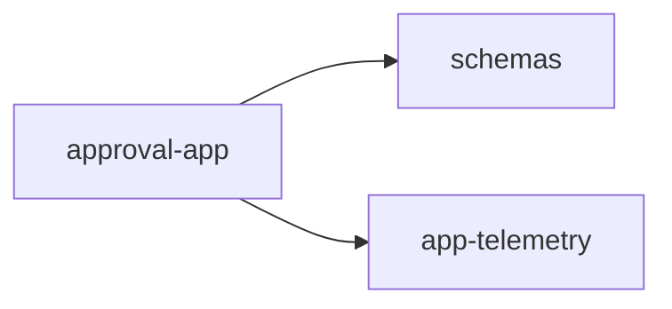
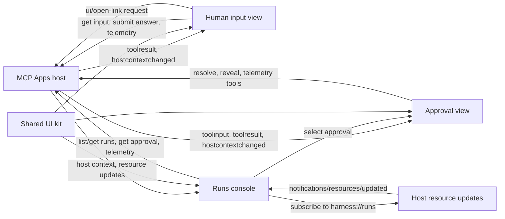
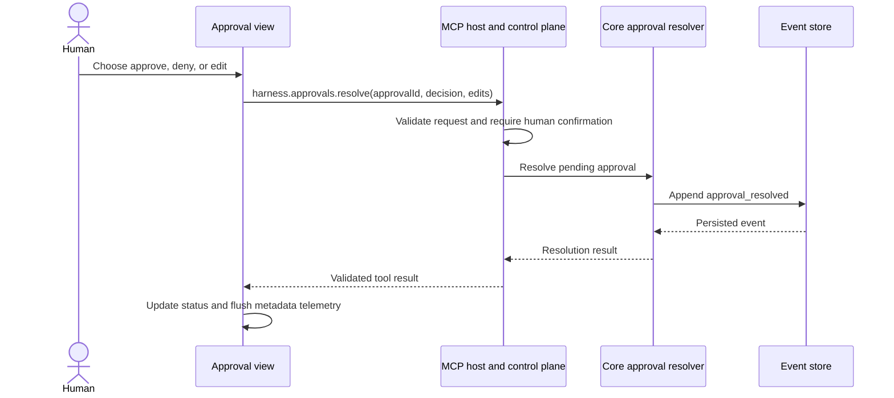

<!-- package-readme: v1 -->

# @rovinos/approval-app

## Purpose

`@rovinos/approval-app` contains the browser views used by the harness for human approvals, human input, and run metadata. Each view is a self-contained MCP App document that uses the host bridge for validated tool calls and renders tokenized data through a shared UI kit.

## Where it fits

<!-- BEGIN GENERATED: readme-deps (yarn gen:readmes) -->

<!-- END GENERATED: readme-deps -->

The package sits at the browser presentation layer: it depends only on browser-safe contracts from `@rovinos/schemas` and the metadata-only telemetry shim in `@rovinos/app-telemetry`. It is private and has no supported package-level import API. The control plane serves its generated HTML resources; the user-facing published distribution is `@rovinos/cli`.

The builder discovers the current `approval`, `input`, and `runs-console` entrypoints. Run-inspector and reports views are part of the broader harness UI plan, but this source tree has no entrypoints for them and does not emit their resources.

## How it works

The views connect with the MCP Apps `App` bridge, receive host context and tool results, then call only the host tools or UI requests each view needs. The run console can open a pending approval in the same app session.

| View | Host messages and calls |
| --- | --- |
| Approval (`ui://harness/approval/v1`) | Receives `toolinput`, `toolresult`, and `hostcontextchanged`; calls `harness.approvals.resolve`, `harness.approvals.reveal`, and `harness.telemetry.emit`. |
| Human input (`ui://harness/input/v1`) | Receives `toolresult` and `hostcontextchanged`; calls `get_input`, `harness.inputs.answer`, and `harness.telemetry.emit`; requests `ui/open-link` for a person-approved link. |
| Runs console (`ui://harness/runs/v1`) | Calls `harness.runs.list` and `harness.runs.get`, subscribes to `harness://runs` updates when supported, and calls `harness.approvals.get` to open an approval. It also uses `hostcontextchanged` and `harness.telemetry.emit`. |



An approval decision is sent to the control plane, where the validated request is resolved by the core runtime and persisted before the result is returned to the view.



The shared kit in `src/kit/` supplies safe text rendering, token pills, forms, tables, timelines, status badges, meters, confirmation dialogs, URL display, empty/error states, localized strings, and host theme adaptation. `build.mjs` discovers `src/views/*/index.ts` and produces one HTML file per entrypoint, embedding the script and stylesheet, checking for external URLs, and adding a content hash.

## Public API

This is an internal workspace package and does not publish an importable module API. Its source exports are implementation helpers, including `createApprovalView`, `mountApprovalActions`, `mountRevealFlow`, `createInputView`, `createRunsConsoleView`, and the components in `src/kit/components.ts`. The published `@rovinos/cli` distribution provides the end-user harness; use its MCP tools and linked resources rather than importing these helpers.

For example, the approval view uses the host tool with a schema-validated synthetic approval ID:

```ts
await app.callServerTool({
  name: "harness.approvals.resolve",
  arguments: {
    approvalId: "01J00000000000000000000000",
    decision: "approve",
  },
});
```

The corresponding input-answer tool accepts an action and, only for acceptance, an optional answer:

```ts
await app.callServerTool({
  name: "harness.inputs.answer",
  arguments: {
    requestId: "01J00000000000000000000000",
    action: "accept",
    answer: { confirmation: "synthetic" },
  },
});
```

## Inputs and outputs

| Boundary | Comes in | Goes out | Tokenization at the boundary |
| --- | --- | --- | --- |
| Approval view | `toolinput`/`toolresult` containing an approval ID and payload | `harness.approvals.resolve` decisions and edits; `harness.approvals.reveal` requests | Approval payload arguments are tokenized before display. Reveal returns only requested values after explicit confirmation and host-side auditing. |
| Human input view | `toolresult` containing tokenized request details or pending-input summaries; `get_input` returns a selected request | `harness.inputs.answer` action and optional answer; `ui/open-link` request | Request messages, defaults, URLs, and schemas are tokenized before the view receives them. Accepted answers are tokenized by the host before they are recorded. |
| Runs console | Run list/detail results and `harness://runs` resource updates | Run-list/detail and approval-get tool calls | Shows run metadata only; it does not request event content. |
| App telemetry | Locally measured view events | `harness.telemetry.emit` with bounded spans | Emits span names, timing, enum attributes, counts, and error codes, never view payloads. |

The schemas in `@rovinos/schemas` validate host payloads and tool results before the views use them. The package does not tokenize values itself; tokenization and auditing belong to the control plane and runtime boundary.

## Configuration, telemetry and errors

The package defines no configuration keys or environment variables. Theme, locale, time zone, and layout information arrive as MCP Apps host context; telemetry availability and limits are controlled by the host.

Views record only these app spans: `ui.render`, `ui.decision`, `ui.error`, and `ui.interaction`; the input view also records `ui.input`. The app telemetry shim sends them through `harness.telemetry.emit`. This package defines no metrics.

The approval view's closed `ApprovalUiErrorCode` values are `payload_invalid`, `bridge_unavailable`, `resolve_failed`, `reveal_failed`, `csp_blocked`, and `render_failed`. The input view reports `input_payload_invalid` and `bridge_unavailable`; the runs console reports `bridge_unavailable` through `ui.error`. Local `runs_console_*` failures are not a package-wide error API.

## Security and privacy

Views validate payloads against shared schemas and create DOM nodes with text APIs rather than interpreting payload strings as HTML. The build rejects external HTTP(S) references and emits each view as a self-contained document. The host supplies the iframe sandbox and CSP; the build check alone is not a network security boundary.

Approval and input content is tokenized before it reaches the views. Run-console views use metadata-only results. Raw approval values are fetched only after a person confirms reveal, returned for requested pointers through the audited host tool, held in memory, and masked after 30 seconds. Decisions still require host-side authorization and confirmation; the view is not an authority boundary. These protections assume a trusted host and a browser enforcing its sandbox and CSP, and do not protect against browser vulnerabilities.

## Testing

DOM, hostile-text, accessibility, action, reveal, and bundle tests run in the `unit` job. Playwright coverage of the reference-host flow runs in the `integration` job. Run the package unit tests with:

<!-- test:run -->
```sh
yarn test:unit packages/approval-app
```

The package build can be checked with `yarn workspace @rovinos/approval-app build`.

## Related docs

- [MCP App UI kit](../../docs/apps-ux.md)
- [MCP Apps reference host](../../docs/host.md)
- [Human input](../../docs/human-input.md)
- [Control-plane client compatibility](../../docs/control-plane-clients.md)
- [Control-plane security](../../docs/control-plane-security.md)
- [Harness guarantees and limits](../../docs/guarantees.md)
