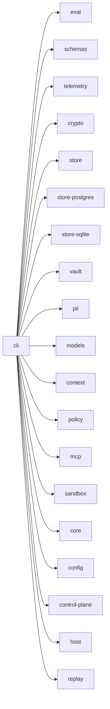
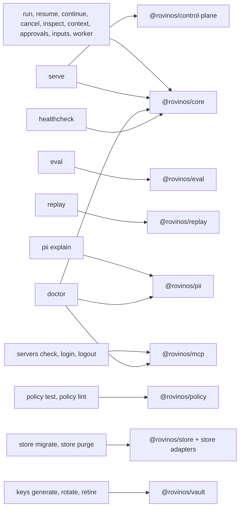
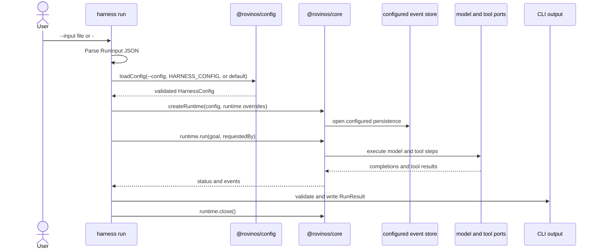

<!-- package-readme: v1 -->

# `@rovinos/cli`

## Purpose

`@rovinos/cli` provides the `harness` executable for running, inspecting, maintaining, and diagnosing a Rovinos harness. It parses command-line input, loads validated configuration, composes the runtime when needed, and presents safe text or schema-validated JSON results.

## Where it fits

<!-- BEGIN GENERATED: readme-deps (yarn gen:readmes) -->

<!-- END GENERATED: readme-deps -->

The CLI sits at the outer application layer: it coordinates configuration and the lower-level harness packages without owning their run loop, storage, policy, or model behavior. Its command modules register against a shared context, and heavy runtime packages are loaded only when a command needs them. Start with [`src/main.ts`](./src/main.ts), [`src/command.ts`](./src/command.ts), and [`docs/engineering/layers.json`](../../docs/engineering/layers.json).

## How it works

The root command registry maps user operations to the package that owns their behavior. Commands that need a composed runtime use `@rovinos/core`; specialized commands delegate to the corresponding package.

Global options are `--config <path>`, `--log-level <level>`, `--json`, `--help`, and `--version`. On `inputs answer`, `--json <file>` supplies the answer file instead of selecting JSON output. The command synopsis below covers every root command and subcommand; [`docs/cli.md`](../../docs/cli.md) has their detailed behavior.

| Command | Main flags and subcommands |
| --- | --- |
| `serve` | `--stdio`, `--http`, `--port <port>` |
| `run` | `--input <file>` or `--input -` for stdin; `--fake-model <script.json>`, `--as <name>`, `--interactive` |
| `resume <runId>` | `--fake-model <script.json>` |
| `continue <runId>` | `--input <file>` or `--input -` for stdin |
| `approvals` | `list [--run <id>]`; `show <id> [--show-args] [--reveal] [--view]`; `approve <id> [--edit <file>] [--yes] [--resume]`; `deny <id> [--yes] [--resume]`; `sweep` |
| `inputs` | `list [--run <id>]`; `show <id> [--show-message]`; `answer <id> [--json <file>] [--as <name>]`; `decline <id> [--as <name>]` |
| `inspect <runId>` | `--show-content` |
| `cancel <runId>` | — |
| `context <runId>` | `--strategy`, `--max-tokens`, `--reserve-output`, `--model`, `--show-content`, `--compare` |
| `doctor` | — |
| `keys` | `generate`; `rotate --to <keyId> [--vault] [--store]`; `retire <keyId>` |
| `policy` | `test --policy <file> --calls <jsonl> [--expect <jsonl>] [--explain]`; `lint --policy <file>` |
| `pii explain` | `--boundary`, `--destination`, `--entity`, or `--matrix` |
| `servers` | `check [--server <id>]`; `login <id> [--open]`; `logout <id>` |
| `store` | `migrate [--dry-run]`; `purge [--dry-run]` |
| `replay` | `--run <id>` or `--trace <id-or-traceparent>`, `--strict`, `--golden`, `--update-baseline`, `--force-in-ci`, `--report` |
| `healthcheck` | — |
| `worker` | `--concurrency <n>` |
| `eval` | `run <suite> [--model] [--variants] [--trials] [--filter] [--isolation] [--cassette] [--concurrency] [--seed] [--out] [--fail-under] [--max-cost-usd] [--live] [--max-model-calls] [--export-telemetry]`; `compare <report-a> <report-b> [--variant-a] [--variant-b] [--seed]` |
| `help [command]` | Built-in command help |



`harness run` validates its JSON input, loads configuration, composes the runtime from that configuration, runs the goal, writes a validated result, and closes the runtime even when execution fails.



The command list and detailed behavior are in [`docs/cli.md`](../../docs/cli.md). Command registration lives under [`src/commands/`](./src/commands/); runtime composition starts in [`src/command.ts`](./src/command.ts).

## Public API

The package is distributed as `@rovinos/cli`; its `harness` binary is the primary interface. The `@rovinos/cli/programmatic` subpath exports `main`, `createDefaultContext`, `createOutput`, `createControlPlaneOperations`, `ExitCode`, and the `CliContext` type. Only `@rovinos/sdk` is the semver-stable programmatic harness API.

```ts
import { ExitCode, main } from "@rovinos/cli/programmatic";

const code = await main(["--help"]);
if (code !== ExitCode.ok) {
  throw new Error(`CLI returned ${String(code)}`);
}
```

The CLI's integration tests inject a `CliContext` into `main` to replace configuration, runtime ports, clock, interaction, and output. See [`src/programmatic.ts`](./src/programmatic.ts) and [`src/main.test.ts`](./src/main.test.ts).

## Inputs and outputs

| Boundary | Input | Output | Tokenization and exposure |
| --- | --- | --- | --- |
| Command line and config | Arguments; YAML or JSON config; `HARNESS__...` overrides | Strictly validated, frozen `HarnessConfig` | Config accepts secret references, not inline secret values. Configuration errors report paths and codes, not submitted values. |
| `harness run` | `RunInput` JSON from `--input <file>` or stdin (`-`); optionally a fake-model script | Run ID and status; events are written through the configured runtime | The CLI currently passes the input goal to `runtime.run` without tokenizing it first. Do not assume run goals or resulting event content are tokenized. |
| Other command data | Run IDs, policy fixtures, approval edits, input answers, eval suites and reports | Package operations and command-specific result schemas | Commands pass data to the owning package. Content-oriented output is opt-in for commands that support `--show-content`, `--show-args`, or `--show-message`; approval `--reveal` is audited. |
| Output | Command results and safe error codes | Human-readable text or one schema-validated JSON document | In `--json` mode human output is routed to stderr; JSON results go to stdout. Error output contains codes and safe hints, not exception messages. |

## Configuration, telemetry and errors

Configuration is loaded by `@rovinos/config` from `--config <path>`, then `HARNESS_CONFIG`, then `harness.config.yaml` in the working directory. `HARNESS__...` environment variables override individual non-array config values. The strict top-level config keys are `run`, `roles`, `quotas`, `store`, optional `keys`, `models`, `servers`, `policy`, `pii`, `vault`, `telemetry`, `sandbox`, `elicitation`, optional `controlPlane`, `deployment`, and optional `cli`. Refer to [`docs/configuration.md`](../../docs/configuration.md) for their schemas and secret-reference rules.

CLI-specific environment variables include `HARNESS_DATA_DIR` and `HARNESS_VAULT_DATA_DIR` for local state, `HARNESS_EVAL_MODEL_SOCKET`, `HARNESS_EVAL_METADATA`, and `HARNESS_EVAL_IMAGE` for eval execution, `DOCKER_HOST` and `DOCKER_CONTEXT` for the eval Docker target, and `CI` or `GITHUB_ACTIONS` for replay baseline-update protection. `OTEL_EXPORTER_OTLP_TRACES_ENDPOINT` or `OTEL_EXPORTER_OTLP_ENDPOINT` configures the collector check in `doctor`. `HARNESS__...` variables override individual non-array config values. Refer to [`docs/doctor.md`](../../docs/doctor.md) and [`docs/cli.md`](../../docs/cli.md) for command behavior.

`harness doctor` checks the Node.js version, configuration, configured secret references, data-directory write access, encryption keys, and worker queue. It also checks the collector when an OTLP endpoint is configured, Presidio when configured, and configured MCP server authorization and reachability. Failed checks return exit code `1`; warnings do not fail the command. Use global `--json` for a schema-validated results array.

The CLI package defines no spans or metrics. Runtime telemetry is provided by the owning packages; key rotation emits the registered metadata-only `harness.keys.rotated` log record with processed row counts. The process exit codes are closed in [`src/exit-codes.ts`](./src/exit-codes.ts): `0` success, `1` failure, `2` usage, `3` invalid configuration, `4` policy denied, `5` suspended, `6` budget exceeded, `7` not found or resolved, `8` replay failed, and `9` quota exceeded. Known error codes map through that table; unlisted codes fall back to `1`. See [`docs/cli.md`](../../docs/cli.md#exit-codes) for meanings and the error-code mapping.

## Security and privacy

Configuration validation rejects inline secrets, and secret resolution is delegated to the configured resolvers. The output router validates JSON results and emits safe error codes instead of exception messages. Commands that display tokenized stored content require explicit flags; `--reveal` uses the auditing vault resolver and records a metadata-only audit event. `doctor` performs configured health and reachability checks; `healthcheck` checks local directory access without network calls.

The CLI does not tokenize `harness run` goals before handing them to the runtime, so user-provided goals and resulting event content may remain raw. Explicit content-display options can expose stored values, and `doctor` or `servers check` may contact configured services. See [`docs/cli.md`](../../docs/cli.md), [`docs/doctor.md`](../../docs/doctor.md), and [`docs/security/secrets.md`](../../docs/security/secrets.md) for the applicable limits and operational guidance.

## Testing

Unit tests use `*.test.ts` and run in the GitHub Actions `unit` job. Run the package unit tests with:

```sh
yarn test:unit packages/cli
```

The package also has server and store integration tests (`*.int.test.ts`), a server canary test (`*.canary.test.ts`), and an eval replay test (`*.replay.test.ts`); the corresponding CI jobs are `integration` and `gates` (canary and replay). The four CI jobs are `static`, `unit`, `integration`, and `gates`.

## Related docs

- [CLI command reference](../../docs/cli.md)
- [Configuration](../../docs/configuration.md)
- [Environment diagnostics](../../docs/doctor.md)
- [Control-plane security](../../docs/control-plane-security.md)
- [Secrets](../../docs/secrets.md)
- [Security guidance](../../docs/security/secrets.md)
- [Telemetry guarantees](../../docs/telemetry/guarantees.md)
- [CLI package source](./src/)
- [Programmatic API export](./src/programmatic.ts)
