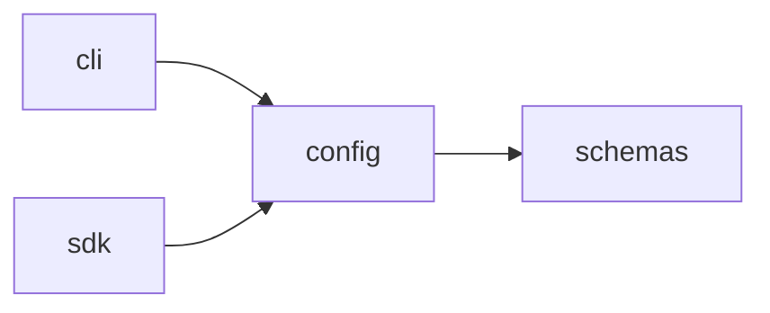
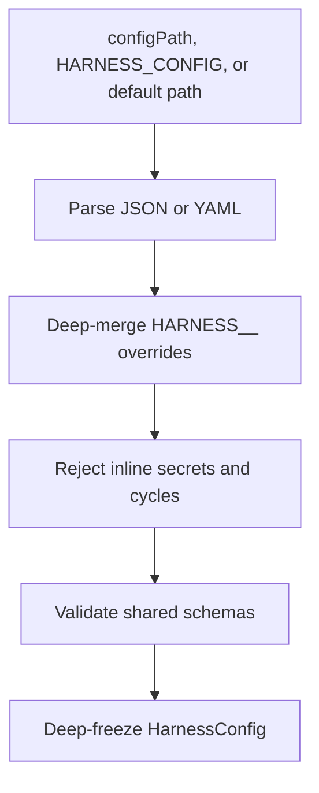
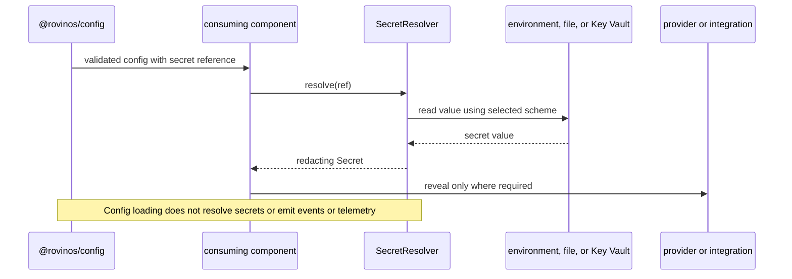

<!-- package-readme: v1 -->

# `@rovinos/config`

## Purpose

`@rovinos/config` loads a harness configuration from YAML or JSON, merges supported environment overrides, validates it against the shared configuration schemas, and provides secret-reference resolvers. It returns validated settings without embedding secret values or coupling configuration loading to a particular secret provider.

## Where it fits

<!-- BEGIN GENERATED: readme-deps (yarn gen:readmes) -->

<!-- END GENERATED: readme-deps -->

The package sits below the CLI and runtime composition layers: it depends only on `@rovinos/schemas` for shared contracts and does not own runtime behavior or secret-provider integrations. It is an internal package; `@rovinos/sdk` bundles it into the published SDK, and the CLI uses it directly. Start with [`src/index.ts`](./src/index.ts), [`src/load.ts`](./src/load.ts), and [`docs/engineering/layers.json`](../../docs/engineering/layers.json).

## How it works

`loadConfig` selects `configPath`, then `HARNESS_CONFIG`, then `harness.config.yaml` in the current working directory. It parses JSON when the selected path ends in `.json`, otherwise YAML. A missing default file means an empty config; an explicitly selected missing file is an error. Environment variables beginning `HARNESS__` override non-array paths in the parsed file. The merged value is checked for inline secrets, validated by the strict `HarnessConfigSchema`, and deeply frozen.



Loading leaves secret references unchanged. A consuming component resolves a reference through `SecretResolver`; `CompositeSecretResolver` handles `env:` and `file:` itself and accepts an injected resolver for `akv:`. For example, the CLI supplies the Azure Key Vault resolver from `@rovinos/vault`. Some credentials are resolved while a runtime is being constructed, while other consumers resolve them when establishing or using their integration. `Secret.reveal()` is the explicit point where a consumer obtains the value.



## Public API

This package is private and is not a semver-stable import surface. It exports the loader and its `ConfigError`, `HarnessConfigSchema` and type, `getConfigSecretRefs`, and the `Secret`, `SecretResolutionError`, and resolver classes and types from [`src/index.ts`](./src/index.ts). The supported published programmatic API is `@rovinos/sdk`, which bundles this package.

```ts
import { getConfigSecretRefs, loadConfig } from "@rovinos/config";

const config = await loadConfig({ configPath: "harness.config.yaml" });
const references = getConfigSecretRefs(config);
```

```yaml
models:
  providers:
    - id: local-model
      apiKey: env:MODEL_API_KEY
```

`references` contains validated secret references from schema-declared secret fields, not arbitrary strings. The example uses a synthetic variable name; the actual value stays outside the configuration file.

## Inputs and outputs

| Boundary | Input | Output | Tokenization and exposure |
| --- | --- | --- | --- |
| Config loading | YAML or JSON file; `configPath`, `HARNESS_CONFIG`, `cwd`, injected environment and file reader | Deeply frozen `HarnessConfig` | Secret-bearing fields accept references, not inline values. Ordinary config values are not tokenized by this package. |
| Environment overrides | `HARNESS__PATH__KEY` strings | Values merged before schema validation | Values are not tokenized here; validation errors omit submitted values. Arrays cannot be overridden. |
| Reference collection | Validated `HarnessConfig` | References in known secret fields | Does not resolve or reveal referenced values. |
| Secret resolution | Validated `env:`, `file:`, or `akv:` reference and optional cancellation signal | Redacting `Secret`, whose value can be explicitly obtained with `reveal()` | The resolver returns the secret in process memory; this package emits no events or telemetry. |
| Errors and warnings | Invalid configuration, unavailable references, or readable secret files | `ConfigError`, `SecretResolutionError`, or a warning code | Messages and warning codes do not include submitted config values, resolved secret values, or file paths. |

## Configuration, telemetry and errors

The strict top-level configuration keys are `run`, `toolProfiles`, `roles`, `quotas`, `store`, optional `keys`, `models`, `servers`, `policy`, `pii`, `vault`, `telemetry`, `sandbox`, `elicitation`, optional `controlPlane`, `rateLimits`, `deployment`, and optional `cli`. The detailed fields and defaults belong to their shared schemas and are described in [Configuration](../../docs/configuration.md).

The loader uses `HARNESS_CONFIG` for file selection and `HARNESS__...` for nested overrides. The `env:` secret resolver reads the referenced variable from its injected environment (by default, `process.env`). `file:` takes an absolute path, and `akv:` is handled only when an Azure Key Vault resolver is injected. See [Secret references](../../docs/secrets.md) for accepted forms.

This package defines no spans or metrics and does not write logs or events. `ConfigError` has the closed code `config_invalid`; its issues include paths and validation codes such as `config_env_invalid`, `config_file_unavailable`, and `secret_inline`, without submitted values. `SecretResolutionError` uses `secret_access_denied`, `secret_not_found`, `secret_ref_invalid`, `secret_resolver_unavailable`, or `secret_resolution_cancelled`. A POSIX world-readable file triggers the `secret_file_permissions` warning code and resolution continues.

## Security and privacy

Configuration schemas require secret references in declared secret fields; the loader also rejects inline secrets under secret-looking keys. Parsing and validation errors describe paths and expected values, never the received values. `Secret.toString()`, JSON serialization, and Node inspection return `[REDACTED]`; file warnings expose only a warning code.

The package does not persist, tokenize, or transmit config or resolved secret values, and does not emit events or telemetry. Resolved secrets necessarily exist in process memory and are available to callers that invoke `reveal()`. This package cannot prevent a consuming integration from misusing a revealed value; callers must keep it out of events, logs, and telemetry. See [Telemetry guarantees](../../docs/telemetry/guarantees.md) and [Secrets security guidance](../../docs/security/secrets.md).

## Testing

Loader, schema, and resolver unit tests use injected file and environment dependencies. They run in the GitHub Actions `unit` job; run them with:

```sh
yarn test:unit packages/config
```

## Related docs

- [Configuration](../../docs/configuration.md)
- [Secret references](../../docs/secrets.md)
- [Azure Key Vault secrets](../../docs/secrets-azure.md)
- [Secrets security guidance](../../docs/security/secrets.md)
- [Telemetry guarantees](../../docs/telemetry/guarantees.md)
- [Shared secret-reference schema](../schemas/src/secret-ref.ts)
- [Config loader tests](./src/load.test.ts)
- [Secret resolver tests](./src/secrets.test.ts)
