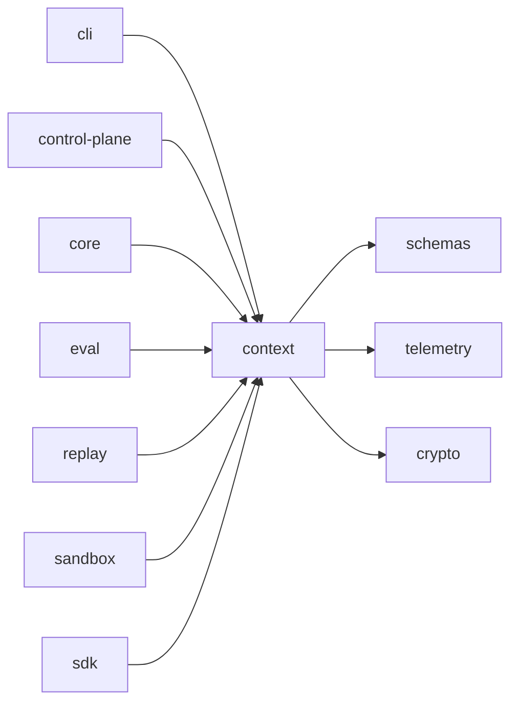
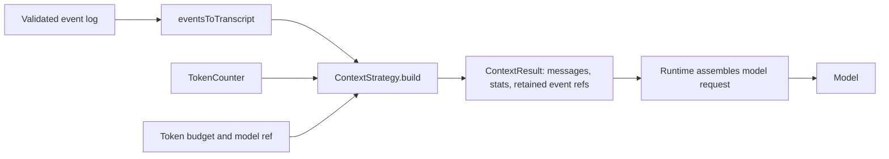
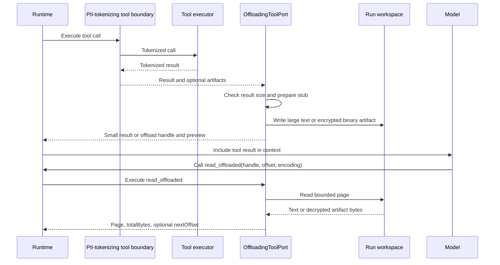

# @rovinos/context

<!-- package-readme: v1 -->

<!-- BEGIN GENERATED: readme-deps (yarn gen:readmes) -->

<!-- END GENERATED: readme-deps -->

## Purpose

`@rovinos/context` turns a run's validated event history into a bounded, provider-neutral view for a model request. It provides deterministic context strategies, token estimates, event-derived plan tools, and workspace offloading for oversized tool results; it does not own the event log or send model requests.

## Where it fits

The package sits between the event history and the runtime that assembles model requests. Its strategies are pure views over logged events, so the event store remains the source of truth and rebuilding context does not mutate a run. It depends on shared schemas and crypto for artifact handling, and its allowed package layer is shown in the generated diagram above.

`@rovinos/context` is an internal workspace package, not a separately published API. Its implementation is bundled into the published `@rovinos/sdk` and `@rovinos/cli` packages.

## How it works

A strategy reconstructs transcript groups from the current log (and optional earlier logs in a continuation), then applies its policy and token counter. The runtime can use the resulting messages and retained-event references to assemble a model request; the strategy itself does not call the model.



The built-in naive strategy retains all reconstructed groups. The sliding-window strategy keeps pinned groups and the newest groups that fit the budget. The summarizing strategy exposes a compaction threshold and rebuilds through the sliding-window strategy; compaction side effects are performed separately and recorded as events.



Text results are stored beneath `.harness/offload/` and returned as validated stubs when they exceed the configured threshold. `read_offloaded` returns bounded text or base64 pages. Binary MCP artifacts are encrypted at rest and require a key provider to offload and reload.

## Public API

Internal workspace callers import the supported surface from `@rovinos/context`. It exports the `ContextStrategy` and `TokenCounter` contracts, transcript and result schemas, the `NaiveStrategy`, `SlidingWindowStrategy`, and `SummarizingStrategy` implementations, strategy registry and comparison helpers, plan schemas and tools, token counters, and offloading/workspace interfaces. This package is not published for direct application imports; use the SDK or CLI package surfaces instead.

For example, an internal caller can build a view from an empty synthetic event log:

```ts
import { HeuristicTokenCounter, SlidingWindowStrategy } from "@rovinos/context";
import { ModelRefSchema } from "@rovinos/schemas";

const model = ModelRefSchema.parse({ provider: "synthetic", model: "example" });
const result = await new SlidingWindowStrategy().build({
  events: [],
  budget: { maxTokens: 1024, reserveOutputTokens: 128 },
  model,
  counter: new HeuristicTokenCounter(),
});
```

Plan state is reconstructed from successful `update_plan` tool events; `PlanToolPort` also exposes the model-visible `update_plan` and `read_plan` specifications.

## Inputs and outputs

| Boundary | Comes in | Goes out | Tokenization |
| --- | --- | --- | --- |
| Strategy build | Validated events, optional earlier event logs, model reference, token budget, and counter | Provider-neutral messages, estimated-token and compaction statistics, and retained/pinned event references | The package expects event content to have passed through the runtime's PII boundary; it reconstructs a view and does not tokenize it. |
| Plan tools | Schema-validated plan updates and prior tool events | Current plan or plan tool result | Plan text is not tokenized here; callers must preserve the runtime's tokenized-content boundary. |
| Offloaded tool result | Result from an inner tool executor, workspace port, and optional artifact key provider | Original small result or a stub with handle, byte count, and preview | The inner executor must tokenize before this decorator. Text previews contain that tokenized content; binary artifacts are encrypted, not tokenized. |
| Offloaded read | Valid handle, optional byte offset/length and text/base64 encoding | A bounded page, total byte count, and optional next offset | Returned text remains tokenized as stored; binary pages are decrypted for the run and handle that own the artifact. |

## Configuration, telemetry and errors

This package defines no environment variables or standalone config-file keys. Strategy and utility options are constructor inputs: `SlidingWindowStrategy` accepts `cacheAware` and `dropChunkGroups` (default `4`); `SummarizingStrategy` accepts `triggerRatio` (default `0.75`) and a model reference; `HeuristicTokenCounter` accepts a safety factor (default `1.15`); `OffloadingToolPort` accepts `thresholdBytes` (default `8192`) and `previewChars` (default `400`). The runtime selects strategy identifiers such as `naive`, `sliding_window`, and `summarizing` in role configuration.

The package defines no spans or metrics. Context result statistics are consumed by `@rovinos/core`, which emits the `harness.context.estimated_tokens`, `harness.context.message_count`, `harness.context.strategy`, and `harness.context.strategy_version` attributes. See the [telemetry attribute catalog](../../docs/telemetry/attribute-catalog.md).

Package-owned error codes include `context_pinned_exceeds_budget`, `context_marker_exceeds_budget`, `workspace_path_invalid`, and `workspace_file_not_found`. Plan/offload tool results use closed codes including `invalid_plan`, `invalid_arguments`, `handle_not_found`, `invalid_offset`, `pii_input_invalid`, `mcp_result_invalid`, `result_too_large`, `artifact_encrypt_failed`, `artifact_decrypt_failed`, `artifact_legacy_unsupported`, and `artifact_write_failed`. Codes from a wrapped tool executor are forwarded and remain that executor's responsibility. Invalid constructor values can also fail schema or range validation.

## Security and privacy

Context strategies only read event data and do not alter the log. Offload paths are restricted to `.harness/offload/`; workspace implementations must reject traversal, absolute paths, and symlinks. Reads are paged and text pages respect UTF-8 boundaries. Binary artifacts are bound to their run and handle during authenticated encryption.

The context package does not perform PII detection or tokenization. The wrapped tool executor must apply tokenization before offloading, and deployments must provide a workspace implementation that enforces the documented path restrictions. Detection and tokenization are not guarantees that every sensitive value will be identified; in-memory workspaces are intended for tests and embedded use rather than filesystem isolation.

## Testing

Run the package's unit tests, including transcript goldens and strategy-purity tests, with `yarn test:unit packages/context`. They run in GitHub Actions' `unit` job; the package does not define separate integration or gate test files.

## Related docs

- [Model roles and context strategy selection](../../docs/roles.md)
- [Sandbox workspace and offload layout](../../docs/sandbox-workspace.md)
- [CLI context comparison](../../docs/cli.md)
- [Telemetry attribute catalog](../../docs/telemetry/attribute-catalog.md)
- [Harness guarantees](../../docs/guarantees.md)
- [Published package boundaries](../../docs/decisions/0001-publish-surface.md)
