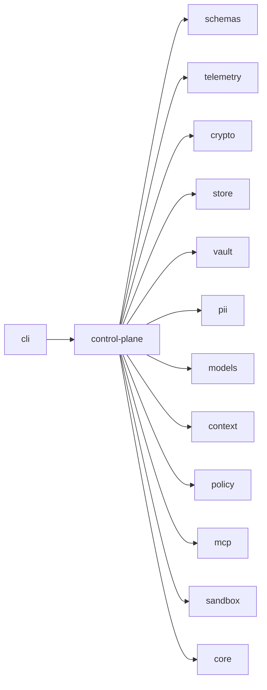
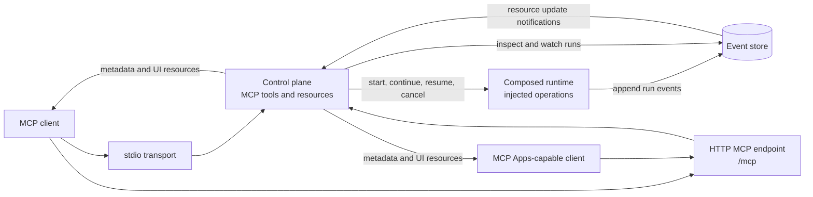
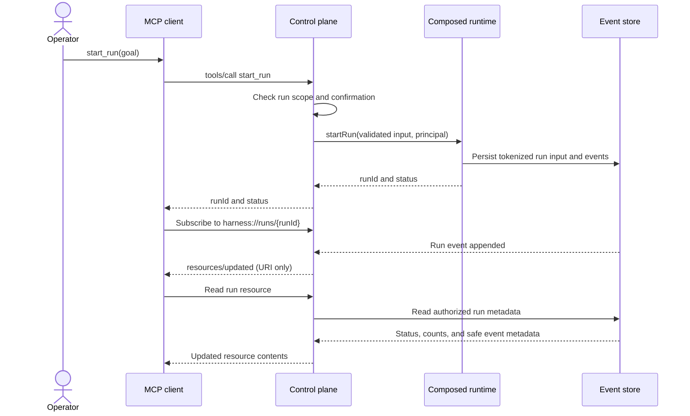

<!-- package-readme: v1 -->

# `@rovinos/control-plane`

## Purpose

`@rovinos/control-plane` exposes run inspection and human-operated run control through an MCP server. MCP clients can inspect metadata, review approvals and human inputs, and start, continue, resume, or cancel runs; MCP Apps-capable clients also get the runs console, approval, and input views.

## Where it fits

<!-- BEGIN GENERATED: readme-deps (yarn gen:readmes) -->

<!-- END GENERATED: readme-deps -->

The control plane sits at the application boundary: it translates authenticated MCP requests into reads from the event store and operations supplied by the composed runtime. It does not own run execution or persistence. Its allowed imports and dependents are defined in [`layers.json`](../../docs/engineering/layers.json); start with [`src/server.ts`](./src/server.ts), [`src/http-server.ts`](./src/http-server.ts), and [`src/server-types.ts`](./src/server-types.ts).

## How it works

The same MCP server can be served over local stdio or authenticated HTTP. Read tools and resources expose metadata by default; mutation tools delegate to the runtime operations provided by the caller and require the configured authorization and human-confirmation path.



The server registers these tools:

| Area | Tools |
| --- | --- |
| Run inspection | `list_runs`, `get_run`; app-only copies `harness.runs.list` and `harness.runs.get` |
| Human input | `list_pending_inputs`, `get_input`, `review_input`; app-only `answer_input` and `harness.inputs.answer` |
| Approvals | `review_approval`; app-only `approve`, `deny`, `harness.approvals.get`, `harness.approvals.resolve`, and `harness.approvals.reveal` |
| Run control | `start_run`, `continue_run`, `resume_run`, `cancel_run`, `resolve_uncertain_spend` |

Run-list and per-run resources are `harness://runs` and `harness://runs/{runId}`. MCP App resources are `ui://harness/runs/v1`, `ui://harness/approval/v1`, and `ui://harness/input/v1`. The server watches store changes and sends `notifications/resources/updated` with resource URIs only; it does not put event payloads in those notifications. Watchers stop for terminal runs and are bounded to 100 active run watchers by default. See [`src/resources/runs.ts`](./src/resources/runs.ts) and [`src/resources/run-updates.ts`](./src/resources/run-updates.ts).



`tools/list` omits app-only tools from clients without the MCP Apps UI capability, and filters listed tools by the authenticated token's scopes. `review_approval` and `review_input` use MCP elicitation when available; without a usable human-confirmation path, protected actions fail closed. See [`docs/control-plane-clients.md`](../../docs/control-plane-clients.md).

## Public API

This is a private workspace package, not a separately published or semver-stable API. Its implementation is bundled into the published `@rovinos/cli` distribution. The workspace entry point exports `createControlPlaneServer`, `startControlPlaneHttp`, `startControlPlaneStdio`, authentication helpers, `RunSupervisor`, tool/resource registration functions, and the Zod schemas and inferred types; see [`src/index.ts`](./src/index.ts). The supported end-user entry point is `harness serve`; the `@rovinos/sdk` package is the semver-stable programmatic harness API.

For workspace composition and tests, `createControlPlaneServer` can be given an `EventStore` and optional runtime operations:

```ts
import { createControlPlaneServer } from "@rovinos/control-plane";
import type { EventStore } from "@rovinos/store";

declare const eventStore: EventStore;
const server = createControlPlaneServer(eventStore);
```

Here, `eventStore` is the application's configured store. Without injected mutation operations, tools that need the runtime return coded unavailable results.

## Inputs and outputs

| Boundary | Input | Output | Tokenization and exposure |
| --- | --- | --- | --- |
| HTTP transport | MCP requests with a bearer credential | MCP responses from the matching authenticated principal | The configured token secret is resolved at startup and retained only as a SHA-256 digest for fixed-size timing-safe comparison. The bearer value is not audited or returned. |
| Run inspection | Filters, cursors, and run IDs | Status, timestamps, usage/count summaries, pending-item metadata, and safe event projections | Run resources and `list_runs`/`get_run` are metadata-only. Per-token `runIds` filters also apply to resources. |
| Run creation | `start_run` or `continue_run` goal (up to 8,000 characters); optional metadata, role, and a `start_run` idempotency key | Run ID and status, or a coded result | The control plane passes the goal to the injected runtime; the runtime's PII event-store boundary tokenizes it before persistence. The control plane does not tokenize the raw request itself. |
| Approval and human input | Approval/input IDs, decisions, edits, or human answers | Decision/status codes; authorized input details are returned tokenized | Approval payloads and input details are tokenized before this package serves them. Raw approval values are available only through the separately authorized, audited reveal flow. |
| Store updates | Run summaries and appended events from `EventStore` watches | Resource URIs in update notifications | Update notifications contain no run content or event payload. Clients read the resource separately under their scope and run filter. |

Tool arguments and outputs are validated against schemas in [`src/schemas.ts`](./src/schemas.ts). MCP resources and tool outputs can contain authorized tokenized input/approval details, while run-inspection output remains metadata-only.

## Configuration, telemetry and errors

The `controlPlane` config section is validated by `ControlPlaneConfigSchema` in [`packages/schemas/src/config/control-plane.ts`](../schemas/src/config/control-plane.ts). Its keys are:

| Key | Behavior |
| --- | --- |
| `allowReveal` | Enables the approval-app reveal path; defaults to `false`. |
| `allowAgentStartedRuns` | Allows agent-started runs to bypass the human confirmation gate; defaults to `false`. |
| `auth.tokens[]` | Token `id`, `secret` `SecretRef`, non-empty `scopes`, and optional non-empty `runIds`; HTTP requires at least one token, and resolved secrets must be at least 32 characters. |
| `listen.host`, `listen.port` | Bind address and port; defaults to `127.0.0.1:3000`. Port `0` requests an ephemeral port. |
| `tls.certFile`, `tls.keyFile` | Certificate and private-key `SecretRef`s. A non-loopback bind requires TLS. |
| `allowedHosts` | Host allowlist; defaults to `127.0.0.1`, `localhost`, and `::1`. |
| `rateLimitPerMinute` | Per-token authenticated request limit; defaults to 120 per minute. |

Configuration can be supplied in the harness config file or with the generic `HARNESS__...` nested configuration overrides. This package defines no additional standalone environment variables.

HTTP bearer tokens carry one or more scopes. `read` permits run and pending-input metadata inspection; `approve` permits approval and human-input review or resolution; `run` permits run creation and lifecycle actions; `reveal` permits the app-only approval reveal; and `admin` grants all scopes, including uncertain-spend resolution. Optional `runIds` further restrict which runs a token may access. `read_content` is accepted as a configured scope, but no current control-plane tool uses it.

The package defines no spans. It emits the metadata-only `harness.control_plane.operation` audit log with token ID, tool code, and outcome code, and uses the shared `harness.rate_limit.denied` counter with the bounded `control_plane` key kind. Neither carries credentials, tool arguments, content, or request addresses. The audit definition is in [`packages/telemetry/src/control-plane-audit.ts`](../telemetry/src/control-plane-audit.ts); the shared metric is in [`packages/telemetry/src/metrics.ts`](../telemetry/src/metrics.ts).

Typed local errors use closed codes: `control_plane_auth_required`, `control_plane_auth_invalid`, `control_plane_token_secret_too_short`, `control_plane_tokens_required`, `control_plane_secret_resolver_missing`, `control_plane_scope_required`, `run_not_found`, `control_plane_rate_limited`, `control_plane_remote_tls_required`, `control_plane_host_invalid`, `control_plane_listen_failed`, `run_update_watch_limit_exceeded`, `approval_resource_unavailable`, `input_resource_unavailable`, and `runs_console_resource_unavailable`. Tool results also use coded outcomes from the runtime and policy operations, such as `human_confirmation_unavailable`, `control_plane_runtime_unavailable`, `resume_conflict`, and `capacity_exceeded`.

## Security and privacy

HTTP requests require bearer authentication, scope checks, optional run-ID filtering, Host allowlisting, same-host Origin validation when an Origin is present, and rate limiting. The default listener is loopback-only. A non-loopback listener requires TLS certificate and key references; the HTTP server itself serves HTTPS when those are configured. A deployment using an external TLS-terminating proxy must keep its backend private and account for the control plane's Host/Origin checks: this server does not trust forwarded host or scheme headers. Stdio mode is unauthenticated and intended for trusted local access.

Decision and run-start operations require an accepted human confirmation unless a trusted embedding host supplies app provenance or the corresponding agent-start setting is enabled. MCP app-visibility metadata is enforced by the client host, not by the MCP server, so connect only trusted human-facing clients. A client that advertises elicitation can submit an accepted answer; that protocol capability alone does not prove a human reviewed it. Approval reveal is disabled by default, restricted to configured access, rate-limited, and audited.

The control plane does not expose raw bearer tokens in telemetry or audit records and keeps run-inspection tools metadata-only. It relies on the composed runtime to tokenize run goals before persistence and on the upstream approval/input pipeline to tokenize content before delivery. Stdio is a trusted-local boundary; per-process rate limits and in-memory/default confirmation-key behavior are not shared across instances. See [`docs/control-plane-security.md`](../../docs/control-plane-security.md) for deployment assumptions and limits.

## Testing

Unit tests (`*.test.ts`) run in the GitHub Actions `unit` job; HTTP and MCP server integration tests (`*.int.test.ts`) run in `integration`. The integration job is the current GitHub Actions counterpart for the compatibility integration suite. Run the package suites with:

```sh
yarn test:unit packages/control-plane
yarn test:integration packages/control-plane
```

## Related docs

- [Control-plane security](../../docs/control-plane-security.md)
- [MCP client compatibility](../../docs/control-plane-clients.md)
- [Configuration](../../docs/configuration.md)
- [MCP Apps UX](../../docs/apps-ux.md)
- [CLI commands](../../docs/cli.md)
- [Repository layers](../../docs/engineering/layers.json)
- [Control-plane server](./src/server.ts)
- [HTTP transport](./src/http-server.ts)
- [Authentication and scopes](./src/auth.ts)
- [Tool definitions](./src/tool-definitions.ts)
