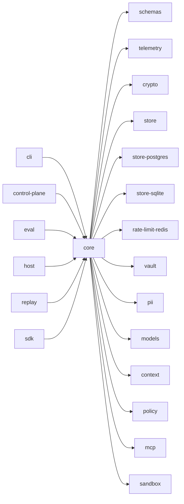
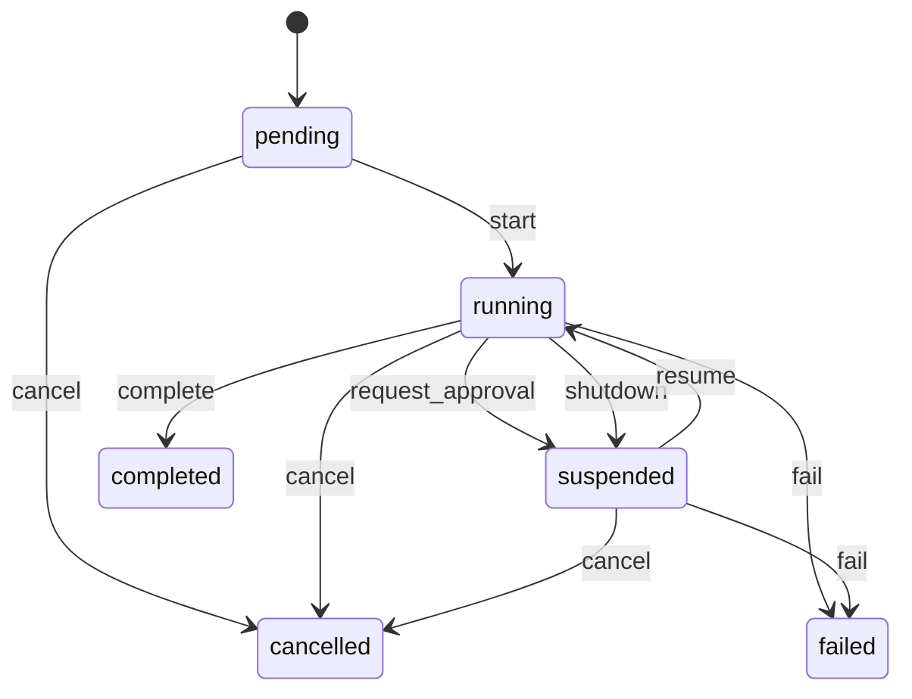

# @rovinos/core

<!-- package-readme: v1 -->

<!-- BEGIN GENERATED: readme-deps (yarn gen:readmes) -->

<!-- END GENERATED: readme-deps -->

## Purpose

`@rovinos/core` is the harness orchestration layer: it runs model-driven jobs, enforces policy and budgets around tool use, and records each durable state change so runs can be inspected, resumed, or safely stopped.

## Where it fits

The generated dependency graph below is derived from the repository's package-layer rules. Core sits above storage and the model, context, policy, privacy, and telemetry ports because it coordinates those capabilities without making the run loop depend on their concrete implementations. It is an internal package; applications should use the published [`@rovinos/sdk`](../sdk/README.md), which bundles core.

## How it works

The lifecycle state machine accepts only the transitions shown here. Approval resolution is recorded while a run is suspended; the run becomes active again only when a worker resumes it.



For each step, the loop assembles context and checks the applicable budget before calling the model. A returned tool call is evaluated by policy: an allowed call has a durable intent before execution; an `ask` decision records an approval request and suspension instead; a denied call records its decision and result without dispatching the tool.

```mermaid
sequenceDiagram
  participant Loop as Run loop
  participant Context as Context port
  participant Model as Model port
  participant Recorder as RunRecorder
  participant Policy as Policy port
  participant Tool as Tool port
  participant Host as Runtime API
  actor Human
  Loop->>Context: build messages and tool context
  Loop->>Recorder: append model_request
  Loop->>Model: complete(messages, tools)
  Model-->>Loop: response with tool call
  Loop->>Recorder: append model_response
  Loop->>Policy: decide(tool ID, tokenized arguments)
  alt allow
    Loop->>Recorder: append tool_intent
    Loop->>Tool: execute call
    Tool-->>Loop: result
    Loop->>Recorder: append tool_result
  else ask
    Loop->>Recorder: append tool_intent, approval_requested, suspended status and checkpoint
    Recorder-->>Loop: suspended run and approval ID
    Human->>Host: approve or deny
    Host->>Loop: resolveApproval(id, decision)
    Loop->>Recorder: append approval_resolved
  else deny
    Loop->>Recorder: append denied tool_intent and tool_result
  end
```

`runLoop` returns the folded state, events produced by the invocation, and pending approval IDs. `RunRecorder` is the only event-construction path: it validates events, assigns their sequence and segment envelope, and appends them to the store. A sequence conflict is treated as lease loss, not as permission to retry the same append.

`Checkpointer` atomically writes a checkpoint event with its state snapshot, on the configured event cadence (20 events by default) and when a run suspends. `resumeRun` claims the run, restores its history and snapshot, and starts a new segment linked to the prior trace. A dangling tool intent is reconciled according to the resume policy; non-idempotent tools are not blindly repeated.

Policy `ask` decisions suspend for a human approval. Approval resolution validates the run state and approver, records the decision, and allows a later resume to apply it to the pending tool call. `HumanInputBroker` similarly presents only previously recorded pending requests to available channels, validates the first eligible response, and resolves it durably. Durable input requests are recorded before channel presentation.

`BudgetTracker` checks step count, optional cost, and wall-clock limits before model and tool work; suspended time can be excluded. `QuotaService` enforces configured cross-run cost and start-rate limits, and checks concurrency when queue workers claim jobs. Optional strict spend reservations account for uncertain provider dispatch. Child runs receive allocations bounded by the parent's remaining budgets.

`cancelRun` durably cancels a run and its announced open descendants. On `SIGINT` or `SIGTERM`, the runtime aborts active work so it can suspend at a safe point and checkpoint within the configured grace period. A continuation starts a new linked run rather than appending to the terminal source run; inherited budgets are available through the continuation configuration.

`Worker` claims durable queue jobs under leases, runs them with cancellation signals, and stops claiming work before it settles active jobs. `SubagentSupervisor` records the parent spawn before starting a child, restricts child tools to the selected role, and allocates child budgets. `RoleRegistry` resolves role routing, tools, prompts, result schemas, budgets, and context strategy at startup; built-in planner and worker roles have tools by default, while judge and summarizer roles do not.

`createRuntime` is the composition root. It validates runtime preconditions and composes the configured store, vault and keys, PII handling, model and tool ports, policy, context, sandbox, workers' queue integration, and lifecycle operations into one `Runtime`.

The main implementation entry points are [`src/loop.ts`](src/loop.ts), [`src/recorder.ts`](src/recorder.ts), [`src/run-state.ts`](src/run-state.ts), [`src/resume.ts`](src/resume.ts), [`src/approvals.ts`](src/approvals.ts), [`src/human-input/broker.ts`](src/human-input/broker.ts), [`src/worker.ts`](src/worker.ts), [`src/subagent/supervisor.ts`](src/subagent/supervisor.ts), [`src/roles.ts`](src/roles.ts), and [`src/runtime.ts`](src/runtime.ts).

## Public API

This package is private and is not a supported application dependency. The published package that bundles it is `@rovinos/sdk`; applications should use that SDK. The internal exports in [`src/index.ts`](src/index.ts) include:

- `createRuntime`, `Runtime`, and runtime configuration and override types for composing a runtime.
- `runLoop`, `resumeRun`, `continueRun`, and `cancelRun` for run lifecycle operations.
- `RunRecorder`, `Checkpointer`, `foldRunState`, and lifecycle `transition` helpers.
- Approval and human-input brokers/resolvers, `BudgetTracker`, `QuotaService`, and `Worker`.
- Model, context, policy, and tool port types; `RoleRegistry`; and subagent supervision utilities.

For example, the runtime consumes a validated configuration and exposes run lifecycle methods:

```ts
import { loadConfig } from "@rovinos/config";
import { createRuntime } from "@rovinos/core";

const config = await loadConfig({ configPath: "harness.config.yaml" });
const runtime = await createRuntime(config);
const result = await runtime.run({ task: "Summarize the synthetic status report." });
await runtime.close();
```

The pure state-machine helper can also be used to inspect an allowed transition:

```ts
import { transition } from "@rovinos/core";

const started = transition("pending", "start");
// { ok: true, to: "running" }
```

## Inputs and outputs

| Boundary | Comes in | Goes out | Tokenization |
| --- | --- | --- | --- |
| Runtime composition | Validated `RuntimeConfig` and optional injected ports, clock, IDs, stores, and channels | A `Runtime` with run, resume, continuation, cancellation, approval, input, and shutdown operations | Configuration and secrets are handled by the configuration and secret-resolver boundaries; secret values do not belong in config files. |
| Run loop | Goal, run metadata, model/context/policy/tool ports, signal, and configured budgets | Ordered run events, folded state, usage, status, and pending approval IDs | When PII is enabled and the runtime adapters are used, model and tool content is tokenized at those boundaries. Direct use of `runLoop` requires callers to supply appropriately wrapped ports and tokenized content. |
| Policy and tool dispatch | Proposed tool ID and arguments from a model completion | Allow/ask/deny decision, durable intent, and (when allowed) tool result | Policy receives the prepared, tokenized tool arguments. Tool adapters own any narrowly authorized detokenization needed for execution. |
| Event recorder and store | Validated event payloads, snapshots, usage updates, and workspace references | Sequenced, timestamped events and atomic checkpoint/snapshot writes | The recorder validates and envelopes events; it does not tokenize content itself. Runtime callers must tokenize content before it is recorded. |
| Human input | Recorded request, available channels, validated human response, and principal | Durable input resolution and optional queued resume | The runtime validates answers and tokenizes accepted content before recording and returning it to the model. |
| Telemetry | Lifecycle, policy, usage, and queue outcomes | Spans and bounded counters/histograms | Attributes are identifiers, codes, enums, booleans, and measurements; prompts, tool arguments, results, and error messages are not telemetry attributes. |

## Configuration, telemetry and errors

`RuntimeConfig` consumes the validated `run`, `telemetry`, `deployment`, `pii`, `store`, `vault`, `models`, `roles`, `policy`, `quotas`, `keys`, `sandbox`, `servers`, `toolProfiles`, `elicitation`, `controlPlane`, and `rateLimits` sections. Run settings include `run.budgets.maxSteps`, `maxCostUsd`, `maxWallClockMs`, `unknownCostPolicy`, and `countSuspendedTime`; `run.checkpointEveryEvents`; `run.shutdownGraceMs`; `run.resume.onNonIdempotent`; `run.continuations`; `run.subagents`; and `run.strictSpendReservations`. See the [configuration guide](../../docs/configuration.md) for accepted values and defaults.

Core reads `HARNESS_DATA_DIR`, `HARNESS_VAULT_DATA_DIR`, and `HARNESS_COLLECTOR_CONFIG_DIR` for runtime data and collector paths. The `@rovinos/config` loader, not core, selects `HARNESS_CONFIG` and applies `HARNESS__...` configuration overrides. Secret values are supplied through secret references. `NODE_ENV=production` also affects runtime validation, including transient-vault and PII requirements.

Core defines spans through `defineSpan` in [`src/spans.ts`](src/spans.ts): `harness.run`, `harness.model_call`, `harness.tool_call`, `harness.approval_wait`, `harness.input_wait`, `harness.app_content`, `harness.checkpoint`, and `harness.compaction`. Through `@rovinos/telemetry`, it records the `harness.run.completed`, `harness.model.latency_ms`, `harness.approval.wait_ms`, `harness.tool.calls`, `harness.policy.decisions`, `harness.quota.rejections`, `harness.worker.jobs`, `harness.worker.queue_lag_ms`, `harness.rate_limit.degraded`, and `harness.telemetry.dropped` instruments. Their attribute contracts are listed in the [telemetry attribute catalog](../../docs/telemetry/attribute-catalog.md).

Core errors carry stable codes from the closed `Code` contract in `@rovinos/schemas`; transition failures return `invalid_transition`. Examples include `corrupt_log`, `lease_lost`, `span_context_missing`, `no_active_span`, `run_not_resumable`, `resume_conflict`, `run_awaiting_approval`, `approval_not_found`, `approval_resolution_conflict`, `input_answer_invalid`, `quota_exceeded`, `budget_exceeded`, `cancel_conflict`, `continuation_chain_too_long`, `worker_options_invalid`, and `subagent_limit`. Role lookup and subagent operations also expose their typed error-code unions in [`src/roles.ts`](src/roles.ts) and [`src/subagent/supervisor.ts`](src/subagent/supervisor.ts).

## Security and privacy

The run loop asks policy before dispatch, fails closed if policy evaluation or tool preparation fails, and persists each allowed tool intent before the tool executes. Approval authority remains with a human decision, not the model. Recorder sequence conflicts stop the writer rather than retrying blindly; resume reconciliation protects non-idempotent calls from automatic replay. When PII is enabled, runtime-composed PII boundaries tokenize content before model/tool use and before durable human-input recording.

The recorder provides event validation, ordering, and trace context, but is not itself a tokenizer. Direct callers of core ports are responsible for honoring tokenization and authorization boundaries; core is private and application code should use `@rovinos/sdk`. PII detection can miss values, and tokenized content in event storage still requires appropriate access controls. Telemetry uses metadata-only attributes, but this does not remove sensitive content from event storage or from an authorized model/tool request. See the [privacy guarantees and known gaps](../../docs/telemetry/guarantees.md) and [sandbox threat model](../../docs/security/sandbox-threat-model.md).

## Testing

Run package unit tests with `yarn test:unit packages/core`. Integration tests, including resume, subagent, and worker-quota coverage, run with `yarn test:integration packages/core`. GitHub Actions runs those suites in the `unit` and `integration` jobs; repository documentation checks run in the `static` job.

## Related docs

- [Published package boundaries](../../docs/decisions/0001-publish-surface.md)
- [SDK guide](../../docs/sdk.md)
- [Configuration](../../docs/configuration.md)
- [Policy and tool authorization](../../docs/policy.md)
- [Roles and subagents](../../docs/roles.md)
- [Human input](../../docs/human-input.md)
- [Quotas](../../docs/quotas.md)
- [Workers and queues](../../docs/workers.md)
- [Approval-wait runbook](../../docs/runbooks/approval-wait.md)
- [Budget-exceeded runbook](../../docs/runbooks/budget-exceeded.md)
- [Telemetry guarantees](../../docs/telemetry/guarantees.md)
- [Telemetry attribute catalog](../../docs/telemetry/attribute-catalog.md)
- [Sandbox threat model](../../docs/security/sandbox-threat-model.md)
