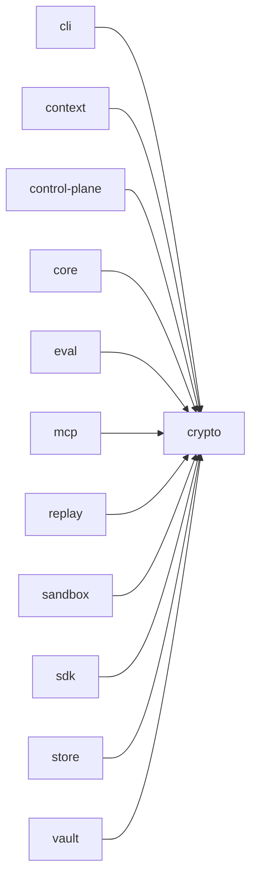
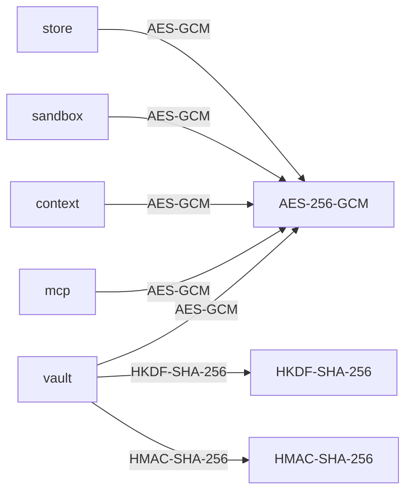
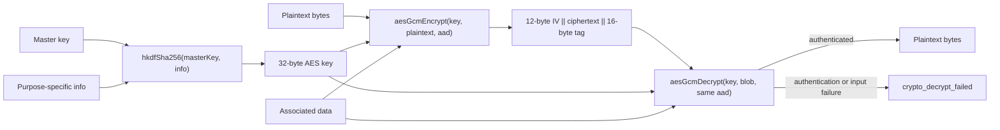

<!-- package-readme: v1 -->

# @rovinos/crypto

## Purpose

`@rovinos/crypto` is a small internal package that gives harness components shared, consistent wrappers for AES-256-GCM encryption, HKDF-SHA-256 key derivation, and HMAC-SHA-256 message authentication. It delegates the cryptographic operations to Node.js `node:crypto` and turns failures into stable, detail-free error codes.

## Where it fits

<!-- BEGIN GENERATED: readme-deps (yarn gen:readmes) -->

<!-- END GENERATED: readme-deps -->

This private leaf package has no internal package dependencies. It is an implementation detail used by runtime packages that are included in the published `@rovinos/sdk`; application code should use the SDK rather than import `@rovinos/crypto` directly.

## How it works

The runtime packages call only the primitives they need. The vault uses all three for encrypted values, key derivation, and lookup or pseudonym digests; the other listed packages use AES-GCM for their encrypted content.



For applications that derive an encryption key, the same master key and HKDF info are used for both encryption and decryption. HKDF uses SHA-256 and an empty salt; callers pass context-specific info. AES-GCM generates a fresh 12-byte IV during encryption and authenticates caller-provided associated data (AAD).



The wrappers are implemented in [`aes-gcm.ts`](./src/aes-gcm.ts), [`hkdf.ts`](./src/hkdf.ts), and [`hmac.ts`](./src/hmac.ts). The caller-to-primitive relationships are visible in [`store`](../store/src/aes-gcm-codec.ts), [`sandbox`](../sandbox/src/snapshot-encryption.ts), [`context`](../context/src/offload-artifact-crypto.ts), [`mcp`](../mcp/src/oauth/token-store.ts), and [`vault`](../vault/src/).

## Public API

The package is private and is not a supported direct-import API. Its runtime functionality is consumed through the published `@rovinos/sdk`. The workspace export in [`index.ts`](./src/index.ts) provides these functions:

- `aesGcmEncrypt(key, plaintext, aad)` and `aesGcmDecrypt(key, encrypted, aad)` use a 32-byte key and return or accept a packed `IV || ciphertext || tag` byte array.
- `hkdfSha256(masterKey, info, length?)` derives key material; `info` may be a string or byte array, and `length` defaults to 32 bytes.
- `hmacSha256(key, data)` returns an HMAC-SHA-256 digest.
- `CryptoError` and `CryptoErrorCode` expose the closed set of operation failure codes.

Synthetic usage:

```ts
import { aesGcmDecrypt, aesGcmEncrypt, hkdfSha256 } from "@rovinos/crypto";

const masterKey = new Uint8Array(32).fill(7);
const key = hkdfSha256(masterKey, "example/content/v1");
const plaintext = new TextEncoder().encode("synthetic example");
const aad = new TextEncoder().encode("run-01:record-02");
const encrypted = aesGcmEncrypt(key, plaintext, aad);
const decrypted = aesGcmDecrypt(key, encrypted, aad);
```

The example shows the internal workspace API; application integrations should use the SDK's supported interfaces.

## Inputs and outputs

| Operation | Inputs | Output | Tokenization at this boundary |
| --- | --- | --- | --- |
| AES-GCM encrypt | 32-byte key, plaintext bytes, caller-supplied AAD bytes | Fresh 12-byte IV, ciphertext, and 16-byte authentication tag concatenated in that order | None; plaintext and AAD are opaque bytes, and encryption is not tokenization. |
| AES-GCM decrypt | 32-byte key, packed encrypted bytes, and the same AAD bytes used for encryption | Authenticated plaintext bytes, or a coded error | None; callers must apply any required tokenization before passing content to this package. |
| HKDF-SHA-256 | Master-key bytes, info as UTF-8 string or bytes, optional output length from 1 to 8160 bytes | Derived bytes; 32 bytes by default | None; the package does not interpret or tokenize key material or info. |
| HMAC-SHA-256 | Key bytes and data bytes | 32-byte digest | None; callers decide whether the data needs tokenization before calculating a digest. |

This package does not parse identifiers or assign meaning to AAD. Callers must bind encrypted data to its intended context, such as a row, run, sequence, or token, and provide matching AAD when decrypting.

## Configuration, telemetry and errors

There are no package-specific configuration keys or environment variables. The package defines no spans or metrics.

`CryptoErrorCode` is closed to `crypto_encrypt_failed`, `crypto_decrypt_failed`, `crypto_hkdf_failed`, and `crypto_hmac_failed`. Wrapper failures discard native error details; see [`errors.ts`](./src/errors.ts).

## Security and privacy

AES-256-GCM authenticates encrypted bytes and the AAD supplied by the caller. Encryption generates a fresh random 12-byte IV for each call; the wrapper does not track IV history or enforce uniqueness across calls. HKDF-SHA-256 separates derived key material by caller-provided info, and HMAC-SHA-256 computes message-authentication digests. The wrapper uses Node.js cryptographic primitives rather than implementing them itself.

The package does not manage, store, rotate, or zero caller-owned keys; callers remain responsible for key lifecycle and clearing their buffers when appropriate. It does not tokenize content, choose or validate AAD semantics, or provide protection for data outside the encrypted operation. HKDF zeroes its temporary copy of the input key, and AES-GCM decryption clears its temporary plaintext buffer after copying the returned plaintext. See [harness guarantees and limits](../../docs/guarantees.md) and [secret references and encryption keys](../../docs/secrets.md).

## Testing

The co-located AES-GCM, HKDF, and HMAC unit tests cover known-answer vectors, authentication failures, and IV generation. Run them with `yarn test:unit packages/crypto`; they run in the GitHub Actions `unit` job.

## Related docs

- [Harness guarantees and limits](../../docs/guarantees.md)
- [Secret references and encryption keys](../../docs/secrets.md)
- [Repository conventions](../../docs/engineering/CONVENTIONS.md)
- [AES-GCM implementation and tests](./src/aes-gcm.ts)
- [HKDF implementation and tests](./src/hkdf.ts)
- [HMAC implementation and tests](./src/hmac.ts)
