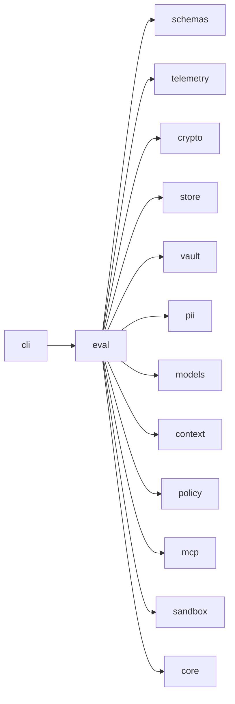
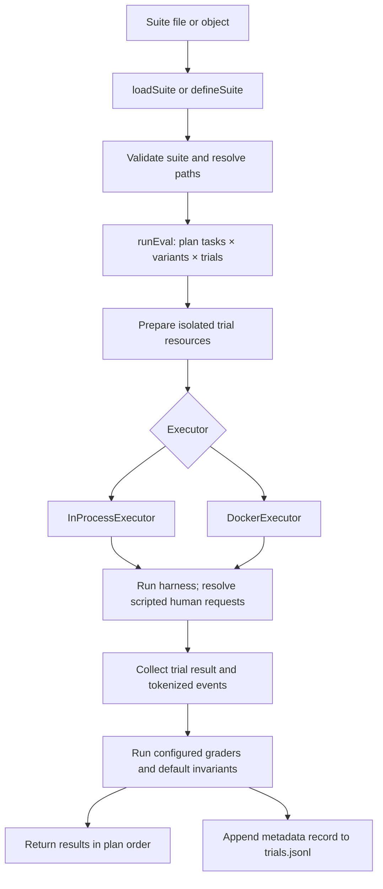
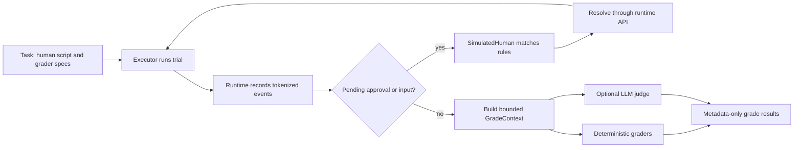

<!-- package-readme: v1 -->

# Eval

## Purpose

`@rovinos/eval` runs repeatable evaluations of harness tasks and variants. It creates isolated
trials, applies deterministic graders and scripted human decisions, then reports outcome and
cost-related statistics without including transcripts in reports.

## Where it fits

<!-- BEGIN GENERATED: readme-deps (yarn gen:readmes) -->

<!-- END GENERATED: readme-deps -->

Eval sits above the runtime and its supporting packages: it coordinates suites, trials, graders,
and reports rather than implementing model, policy, storage, or sandbox behavior. The dependency
diagram is generated from the repository's layer allowlist.

## How it works

`loadSuite` reads a TypeScript, JSON, or YAML suite, validates its schema, and resolves paths
relative to the suite file. `runEval` plans each task/variant/trial combination with a derived
seed, then runs the plan with bounded concurrency. Each executor prepares separate trial
resources. Results are returned in plan order and appended to `trials.jsonl` as trials finish.



Each task can define graders and an optional simulated-human script. Approval-integrity and
no-denied-execution invariants are added by default when suite invariants are enabled. A
simulated human resolves pending approvals and inputs through the runtime's normal resolution
APIs; its default approval decision is deny. Default auto-approval requires the explicit
`unsafeAutoApprove: true` setting.



Grader implementations include file-diff, test-command, schema-valid, trajectory, canary-leak,
approval-integrity, no-denied-execution, and LLM-judge graders. The LLM judge receives a bounded
view derived from tokenized events and returns a schema-validated verdict; its reasoning is not
stored. See `src/runner.ts`, `src/executor.ts`, `src/human.ts`, and `src/graders/` for the
execution path.

## Public API

This is a private workspace package, not a separately published npm package. Its implementation
is bundled into the published `@rovinos/cli` package; the CLI exposes the user-facing `harness
eval` commands.

The package entry point (`src/index.ts`) exports suite schemas and loading, trial execution,
graders, report builders, and statistics. A synthetic suite can be validated in memory:

```ts
import { defineSuite } from "@rovinos/eval";

const suite = defineSuite({
  schemaVersion: 1,
  tasks: [
    {
      id: "greeting",
      input: { goal: "Write a greeting to a fictional reader." },
      graders: [{ type: "file_diff", path: "greeting.txt", expectedContains: "Hello" }],
      tags: ["example"],
      trials: 2,
    },
  ],
});
```

Pass the validated suite, named variants, a configured `TrialExecutor`, and an output directory
to `runEval`:

```ts
import { runEval } from "@rovinos/eval";

const results = await runEval(
  suite,
  [{ id: "baseline" }],
  executor,
  { outDir: "./.tmp/eval-output", seed: 41 },
);
```

`executor` is an `InProcessExecutor` or `DockerExecutor` configured for the caller's model and
tool ports. Suite and variant shapes are defined by the exported Zod schemas; the complete
configuration options are documented in [Evaluation suites](../../docs/evals.md).

## Inputs and outputs

| Boundary | Comes in | Goes out | Tokenization and content handling |
| --- | --- | --- | --- |
| Suite loading | Suite tasks, goals, grader specs, human scripts, and optional workspace/policy files | Validated suite with suite-relative paths resolved | Goals and fixture content go through runtime privacy boundaries when used. Grader expectations are local grading inputs; they are not automatically tokenized. TypeScript suites execute as trusted code. |
| Trial execution | Suite, variants, seed, runner options, and executor ports | One result per trial and `trials.jsonl` records | Run events use the harness's tokenized event path. Raw secrets are resolved at the executor boundary and are not written into the generated trial configuration. |
| Grading | Trial result, tokenized events, and trial-scoped artifacts | Grade pass/score, codes, optional bounded counts and usage | Grade results contain metadata only; captured logs and telemetry are scanned for configured canaries, not copied into results. |
| Reporting | Trial records and grade results | JSON, Markdown, JUnit, aggregates, and comparisons | Reports contain identifiers, scores, counts, codes, usage, and statistics—not prompts, completions, or grader reasoning. Trial records also contain local database/workspace paths; keep them in the local output directory. |
| Simulated human | Approval/input rules and pending runtime requests | Durable decisions and action counts | Input answers go through normal runtime validation and tokenization. Reports include action counts, not questions or answers. |

The runner reports pass rate, standard error, pass@k, cost, input/output/total tokens, steps,
latency, repair and fallback counts, approval/input counts, denied calls, and budget outcomes.
Aggregates summarize cost, tokens, steps, and latency with mean, median, and nearest-rank p95.
Variant comparisons include mean differences with seeded bootstrap 95% confidence intervals,
Fisher exact pass-rate tests, and Holm-Bonferroni adjusted p-values.

## Configuration, telemetry and errors

`runEval` accepts `outDir`, optional `concurrency` (default `2`), `trials`, `seed` (default
`0`), and `maxCostUsd`. Suite configuration includes `schemaVersion`, `invariants`, and tasks;
tasks select models, context strategy, policy, budgets, graders, and trial count. Variants select
models, context strategy, policy, budgets, cassette mode, and supported config overrides. The
generated trial config contains a reference to `HARNESS_EVAL_KEY`; the executor supplies a fresh
per-trial key. The CLI's `HARNESS_EVAL_IMAGE` environment variable selects a Docker image and is
read by the CLI, not by this package.

Eval does not define its own span or metric instruments. Trial execution captures runtime spans
and logs for canary scanning. In-process telemetry defaults to an in-memory provider; callers
must opt into their configured export pipeline with `exportTelemetry: true`. Eval report
statistics are evaluation outputs, not OpenTelemetry metrics.

Typed failures use closed codes. Runner codes are `eval_variant_id_duplicate`,
`trial_workdir_outside_output`, and `eval_result_missing`; trial setup codes are
`trial_workdir_invalid`, `trial_random_source_invalid`, and `live_model_config_override`.
Docker execution codes are `docker_mount_path_invalid`, `docker_process_failed`, and
`docker_process_cancelled`. Simulated-human codes are `human_approval_payload_invalid` and
`human_input_runtime_unavailable`; trajectory privacy checks use `raw_pii_at_model_input`.
Report comparison codes are `eval_compare_variant_required`, `eval_compare_variant_missing`,
`eval_compare_tasks_mismatch`, and `eval_compare_no_trials`.

The live-model boundary exposes `LiveModelError` with these codes:
`eval_live_config_invalid`, `eval_live_provider_unsupported`, `eval_live_egress_denied`,
`eval_live_redirect_denied`, `eval_live_call_limit_exceeded`, `eval_live_cancelled`,
`eval_live_request_invalid`, `eval_live_response_invalid`, `eval_live_provider_failed`, and
`eval_live_transport_failed`. Invalid suites and report contracts raise `ContractError` with
paths and codes; trial execution failures are represented in results by codes, not exception
messages. See `src/runner.ts`, `src/executor.ts`, `src/executors/`, `src/live-model-contract.ts`,
and `src/report/compare.ts`.

## Security and privacy

Each trial gets its own database, vault, keys, and workspace; generated configuration stores a
secret reference rather than key material. Events are tokenized before persistence, and
telemetry export is opt-in. Reports omit transcripts and content. Canary-leak grading can scan
captured telemetry, process output, event/vault database bytes, and workspace files for
configured canary values.

`DockerExecutor` runs with networking disabled by default and uses the sandbox's container
restrictions. `InProcessExecutor` is not an isolation boundary for untrusted suites; TypeScript
suites are executable code and should be loaded only from trusted sources. Canary checks detect
configured sentinel values and are not a general-purpose guarantee that arbitrary sensitive
content cannot leak. See `src/executors/`, `src/graders/no-canary-leak.ts`, and
`src/canary.ts`.

## Testing

Unit tests (`*.test.ts`) run in the `unit` job; run the eval package's unit suite with
`yarn test:unit packages/eval`. Docker executor tests (`*.int.test.ts`) run in the
`integration` job and need Docker. Canary and replay tests run in the `gates` job; run the
package-scoped checks with `yarn test:canary packages/eval` and
`yarn test:replay packages/eval`. See `src/runner.test.ts`, `src/executors/docker.int.test.ts`,
`src/canary.test.ts`, and `src/invariants.replay.test.ts`.

## Related docs

- [Evaluation suite and CLI guide](../../docs/evals.md)
- [Eval suite tutorial](../../docs/evals-tutorial.md)
- [Red-team evaluation](../../docs/security/redteam.md)
- [Live eval model gateway decision](../../docs/decisions/0006-live-eval-model-gateway.md)
