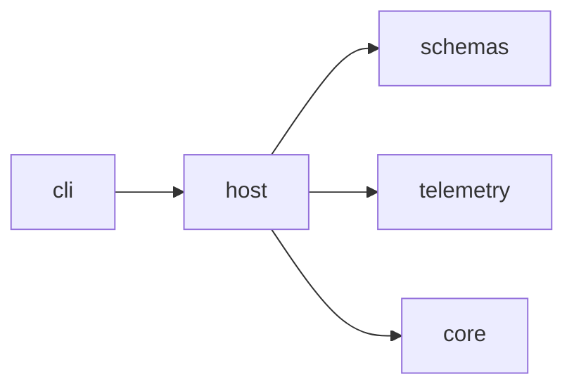
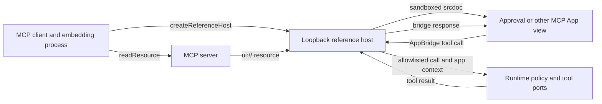
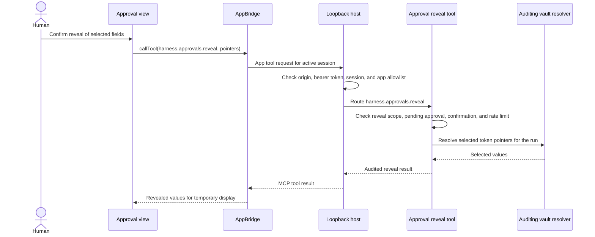

<!-- package-readme: v1 -->

# @rovinos/host

## Purpose

`@rovinos/host` provides the reference MCP Apps host that loads UI resources from an MCP server into sandboxed browser iframes. It connects the MCP Apps `AppBridge` to a loopback-only browser host, routes app calls through a session-scoped allowlist, and accepts app telemetry through a validated, bounded ingestion path. Approval views use it to display tokenized approval details and invoke app-only approval tools without giving the model access to those tools.

## Where it fits

<!-- BEGIN GENERATED: readme-deps (yarn gen:readmes) -->

<!-- END GENERATED: readme-deps -->

The package sits above `@rovinos/core`: it needs runtime policy and tool ports to route app calls, but the runtime does not depend on browser or MCP Apps code. It is an internal workspace package included in the published `@rovinos/cli` distribution, not a separately supported package.

## How it works

The embedding MCP client provides a resource reader and app tool-call dependencies to `createReferenceHost`. The host validates resources and serves them to an isolated iframe; calls from the view return through the SDK bridge and are checked against that app's configured tool allowlist before reaching the runtime.



An approval view can reveal selected tokenized values only through an explicitly authorized request. The control-plane tool owns scope checks, confirmation, reveal policy, and vault access; the host checks the app session and routes the app-only call.



The view masks values again after its short display interval. See the [host implementation](src/server/index.ts), [iframe and bridge implementation](src/web/host.ts), and [approval app tool registration](../control-plane/src/tools/approvals-app.ts) for the corresponding flows.

## Public API

The package entry point is `@rovinos/host`; its supported exports are declared in [`src/server/index.ts`](src/server/index.ts). The main entry point is `createReferenceHost`, with `ReferenceHost` and `ReferenceHostError` for lifecycle and typed lifecycle failures. Other exports include `AppCallRouter`, `AppRequestRouter`, `AppRateLimiter`, `ingestBatch`, the host-context builder, telemetry schemas and span definitions, and the MCP Apps CSP constant.

```ts
import { createReferenceHost } from "@rovinos/host";

const host = await createReferenceHost(
  {
    apps: [
      {
        id: "approval",
        resourceUri: "ui://harness/approval/v1",
        telemetry: true,
        allowedTools: [
          "harness.approvals.get",
          "harness.approvals.resolve",
          "harness.approvals.reveal",
        ],
      },
    ],
  },
  {
    readResource: (resourceUri) => mcp.readResource({ uri: resourceUri }),
    onCode: (code) => reportSafeHostDiagnostic(code),
    onAppToolsList: (appId, allowedTools, cursor) =>
      listToolsForApp(appId, allowedTools, cursor),
    onAppCall: (call, context) => dispatchAppTool(call, context),
  },
);

openLocalBrowser(host.url);
```

The example's `mcp`, `reportSafeHostDiagnostic`, `listToolsForApp`, and `dispatchAppTool` are embedding-process adapters. Prefer the policy-checked call handler by supplying `policy` and `tool` instead of `onAppCall`; its `ask` decisions require an `onAppCallApproval` adapter that persists, suspends, and resumes the run. The host validates its configuration with `HostConfigSchema` from `@rovinos/schemas` and generates a per-process bearer token; the embedding process should display the returned URL locally and not log it.

## Inputs and outputs

| Boundary | Input | Output | Tokenization |
| --- | --- | --- | --- |
| MCP resource read | Configured `ui://` URI and untrusted resource response | Validated HTML and filtered CSP/permissions for the iframe | The host does not tokenize resource HTML; it enforces MIME type, size, CSP and permission allowlists. |
| App tool call | Session, tool name, and untrusted JSON arguments | Allowlisted tool result or bounded rejection | The host checks run-scoped IDs and routes calls through the configured preparation/policy path. The embedding runtime must prepare/tokenize tool arguments as required by its tool port. |
| App message or model-context request | App-provided text or structured JSON | Minimal allow/deny result; if accepted, a tokenized, labeled content envelope is passed to the recorder | Requires the `model_input` tokenizer and recorder callbacks; without them the request fails closed. |
| App telemetry | Untrusted UI span batch | Integer-only `{ accepted, dropped }` acknowledgment | Strict schemas discard unapproved fields; the host stamps identity, time, duration, and parent context. Raw batch payloads are not retained or logged by the default handler. |
| Approval reveal | Explicitly selected JSON pointers into tokenized approval arguments | Selected values in the app tool result | The control-plane reveal tool resolves tokens only after authorization and confirmation. Raw values are transiently delivered to the requesting view and are not added to host telemetry. |

For app content requests, `openLink`, `message`, and `modelContext` are individually disabled by default. Accepted model content is labeled `App-provided`; it does not resolve approvals or supply tool input. The embedding process is responsible for preserving the tokenization guarantees when it replaces the default handlers.

## Configuration, telemetry and errors

Host settings are passed as `HostConfig` and validated by [`HostConfigSchema`](../schemas/src/config/host.ts); this package reads no environment variables.

| Config key | Default | Purpose |
| --- | --- | --- |
| `listen.host` / `listen.port` | `127.0.0.1` / `0` | Loopback bind address and ephemeral port. Only `127.0.0.1`, `::1`, and `localhost` are accepted. |
| `apps` | `[]` | App IDs, `ui://` resource URIs, per-app telemetry opt-in, allowed tools, and request permissions. `allowedTools` is explicit; app request permissions default to false. |
| `maxUiSessions` | `32` | Maximum active UI sessions. |
| `uiSessionMaxMs` | `3,600,000` | Active UI-session lifetime in milliseconds. |
| `permissionAllowlist` / `cspAllowlist` | `[]` / `[]` | Browser permissions and exact secure origins permitted by resource metadata. |
| `limits.batchesPerSecond` / `batchBurst` | `10` / `20` | Per-session telemetry batch rate and burst. |
| `limits.spansPerMinute` / `spansPerSessionLifetime` | `200` / `2,000` | Per-session accepted-span limits. |

The host registers `harness.ui_session`, `harness.ui.render`, `harness.ui.decision`, `harness.ui.error`, `harness.ui.interaction`, and `harness.ui.input` spans. App batches accept only `ui.render`, `ui.decision`, `ui.error`, `ui.interaction`, and `ui.input`; the host supplies identity and timing. Metrics are `harness.host.app_rejected` (bounded reason attribute) and `harness.host.app_spans_accepted` (count); neither carries app or session IDs. See [`src/server/stamp.ts`](src/server/stamp.ts) and the [telemetry metric definitions](../telemetry/src/metrics.ts).

Typed lifecycle failures use `app_host_bind_failed`, `app_host_address_unavailable`, and `app_host_close_failed`. App-call routing uses `app_tool_not_allowed`, `app_run_mismatch`, `app_run_unavailable`, `app_telemetry_unavailable`, and `rate_limited`. Telemetry rejection reasons are `schema`, `size`, `rate`, `unknown_app`, `unknown_span`, and `session_cap`. Safe host diagnostics are `app_csp_request_ignored`, `ui_session_expired`, and `ui_trace_unavailable`.

## Security and privacy

- The server binds only to loopback. Protected API requests require the expected host, same-origin checks, and the process bearer token.
- Each app runs in an iframe with `sandbox="allow-scripts"` only, no same-origin access, and a deny-by-default CSP. Resource permissions and origins are filtered through explicit allowlists.
- App calls are filtered to configured tools, run-scoped identifiers are verified, and the default handler prepares arguments and applies runtime policy. If durable approval handling is missing for an `ask` decision, the host fails closed.
- The default telemetry door validates and size/rate-limits batches, drops invalid spans independently, stamps fields from host state, and returns counts rather than app data.
- The process token is shared by reference-host instances in the same Node process. The launch URL and token are sensitive; do not log or export them. A local host and an enforcing browser are trusted assumptions: iframe sandboxing and CSP reduce exposure but do not protect against browser vulnerabilities.
- Custom app-call and telemetry callbacks replace default behavior and must preserve policy, validation, limits, and payload-locality guarantees. Reveal authorization belongs to the approval tool implementation, not to the iframe or model.

## Testing

Unit tests run in the GitHub Actions `unit` job; the browser-backed `reference-host.int.test.ts` runs in `integration` with Chromium. Host tests cover call allowlists and run scoping, telemetry validation and limits, resource and iframe restrictions, app requests, session lifecycle, and hostile app behavior.

```sh
yarn test:unit packages/host
yarn test:integration packages/host
```

## Related docs

- [MCP Apps reference host](../../docs/host.md)
- [MCP Apps and approval UX](../../docs/apps-ux.md)
- [Human input](../../docs/human-input.md)
- [Control-plane security](../../docs/control-plane-security.md)
- [Telemetry guarantees](../../docs/telemetry/guarantees.md)
- [Rejected app-span runbook](../../docs/runbooks/rejected-app-spans.md)
