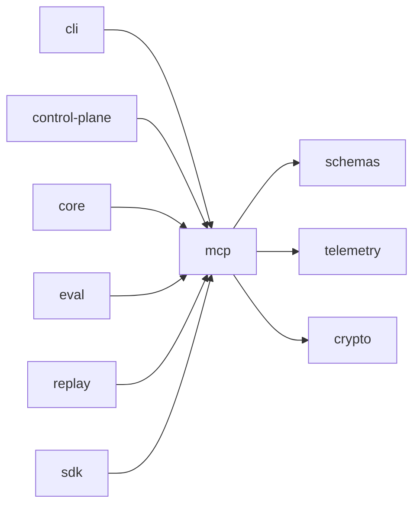
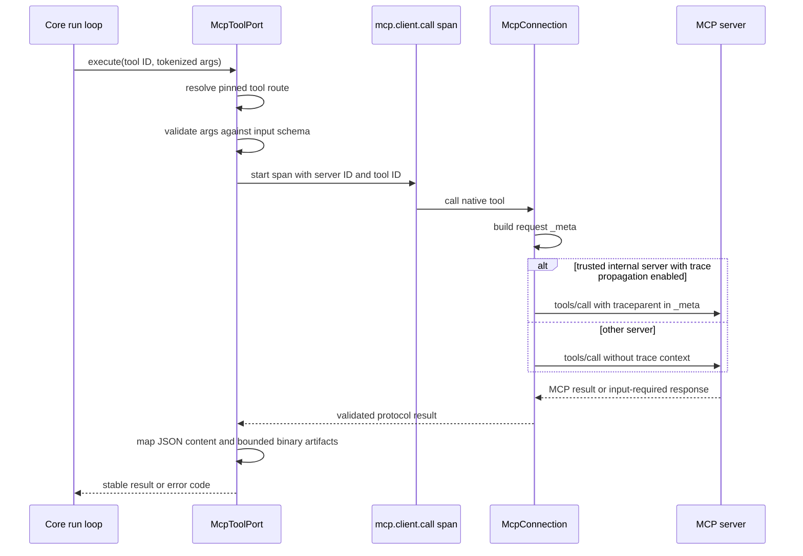

<!-- package-readme: v1 -->

# `@rovinos/mcp`

<!-- BEGIN GENERATED: readme-deps (yarn gen:readmes) -->

<!-- END GENERATED: readme-deps -->

## Purpose

`@rovinos/mcp` connects the harness to configured Model Context Protocol (MCP) servers and makes
their validated, selected tools available to a run. It owns server connections, discovery, tool
registration, trace propagation, result mapping, remote OAuth support, and the MCP side of human
input requests.

## Where it fits

This is an internal implementation package, not a separately supported application dependency.
The published `@rovinos/sdk` bundles it and is the public API for application developers. In the
harness, `@rovinos/core` consumes the MCP tool port; MCP depends only on `@rovinos/schemas`,
`@rovinos/telemetry`, and `@rovinos/crypto`. Keeping policy and run lifecycle in core means that
discovering or selecting an MCP tool does not authorize its execution.

For regular MCP onboarding, use the helpers in `@rovinos/sdk`; no extension package is required.
`@rovinos/extensions` is an optional authoring layer over SDK-owned extension contracts, while
`@rovinos/extension-retrieval` is a separate optional implementation. Neither replaces MCP
configuration, tool policy, or the runtime's trust boundaries. See the [extension guide](../../docs/extensions-authoring.md)
and [SDK extension contract](../../docs/sdk-extensions.md) for those distinct roles.

## How it works

`McpPool` manages one connection per configured server. Each connection discovers tools; the
registry applies each server's native-name allowlist, validates schemas, normalizes tool IDs, and
rejects collisions. The resulting catalog supplies tool definitions and routes to the run loop.
Catalog views can be narrowed for a run and pinned so a changed tool cannot silently replace a
definition already shown to the model.

```mermaid
flowchart LR
  config["Validated server configuration"] --> pool["McpPool"]
  pool --> connection_a["Connection: weather"]
  pool --> connection_b["Connection: calendar"]
  connection_a -->|"tools/list"| registry["ToolRegistry"]
  connection_b -->|"tools/list"| registry
  registry -->|"allowlist, schema checks, normalized IDs"| catalog["Run-pinned tool catalog"]
  catalog -->|"tool definitions"| model["Model through core"]
  model -->|"selected tool call"| policy["Core policy and approval"]
  policy -->|"permitted call"| port["McpToolPort"]
  port -->|"server-specific native name"| connection_a
  port -->|"server-specific native name"| connection_b
```



Every invocation checks arguments against the discovered input schema before network I/O. The
`mcp.client.call` span is active for the outbound MCP call. Trace metadata is added only when the
server is configured with `trust: internal` and `propagateTrace: true`; existing trace headers and
baggage are stripped, and the trace context is sent in MCP request `_meta`, not HTTP headers.



For elicitation, only configured modes are advertised. An input-required response is validated and
handed to core through `ElicitationPort`, bound to the in-flight call, and may suspend the run for a
human response before the same tool call is retried. Secret-seeking forms are declined; URL
elicitation destinations are checked by policy but this package never fetches or opens them.

## Public API

`@rovinos/mcp` is private and should not be imported by applications. The public package is
`@rovinos/sdk`, which includes MCP implementation code and provides `registerMcpServer`,
`inspectMcpServer`, and `selectMcpTools` for configuring, inspecting, and explicitly selecting
server tools. The SDK configures tools and runs them through the model; callers do not need
per-tool routing glue.

```ts
import {
  createHarness,
  inspectMcpServer,
  registerMcpServer,
  selectMcpTools,
} from "@rovinos/sdk";

const registered = registerMcpServer({}, {
  id: "weather",
  transport: { kind: "stdio", command: "node", args: ["./weather-server.mjs"] },
});
const server = registered.servers.find(({ id }) => id === "weather");
if (server === undefined) throw new Error("configured_server_missing");

const inspection = await inspectMcpServer(server, {
  resolveSecret: async () => {
    throw new Error("unexpected_secret_resolution");
  },
});
const reviewed = selectMcpTools(registered, inspection, ["forecast"]);
const harness = await createHarness({ config: reviewed.config });
try {
  await harness.startRun({ goal: "Summarize the synthetic weather forecast." });
} finally {
  await harness.close();
}
```

Registration is configuration-only and defaults to an empty server tool allowlist. Inspect the
candidate catalog, select only intended tools, and keep policy explicit; selection is not execution
authorization. For a remote authorization-code server, configure OAuth and run
`harness servers login <id>`; runtime calls do not launch an interactive login flow. The SDK guide's
[MCP onboarding example](../../docs/sdk.md#mcp-server-onboarding) covers the full flow, including
selection and policy. Resolve a pending policy approval with `resolveApproval`, and a pending MCP
human-input request with `answerInput`. `watch` and `getRun` expose safe events for inspecting
progress; close the harness when finished.

The internal root export contains `McpConnection`, `McpPool`, `ToolRegistry`, `McpToolPort`,
`normalizeToolId`, `buildRequestMeta`, the OAuth provider/login and encrypted token-store
interfaces, transport creation, and elicitation handling types. The `@rovinos/mcp/tool-result`
subpath exports the bounded result mapper and its artifact/result types. These are implementation
surfaces for harness packages, not application entry points.

## Inputs and outputs

| Boundary | Comes in | Goes out | Tokenization and handling |
| --- | --- | --- | --- |
| Server setup | Validated `servers[]` configuration, secret references, and injected secret resolver | Managed connections and safe connection states | Configuration stores references such as `env:` or `file:`, not secret values. Credentials are resolved only at the transport boundary. |
| Tool discovery | Untrusted names, descriptions, input/output schemas, and pagination from `tools/list` | Allowlisted, schema-checked tool specs and normalized IDs | Names are normalized to bounded codes; descriptions are whitespace/control-character sanitized and capped. Server text is not copied into errors or logs. |
| Tool invocation | Registered tool ID, JSON arguments, cancellation signal, and optional resume/input context | MCP request and a stable execution outcome | Core tokenizes sensitive run content before the MCP boundary; arguments are schema-validated before network I/O. |
| MCP result | Text/structured content, metadata, or binary content from a server | JSON-safe result envelope and, when enabled, bounded artifact payloads | Results return to core's privacy boundary before durable storage or model reuse. Binary content is blocked by default; allowed binary bytes are size-bounded and passed through an artifact side channel. |
| Human input | Validated MCP input-required request associated with one in-flight call | Suspend/retry outcome through `ElicitationPort` | The core-owned handler tokenizes accepted human input before durable recording. Secret-seeking forms are declined. |
| Trace and diagnostics | Active span context and safe status codes | Opt-in `_meta` trace context and code/integer-only log events | No baggage or caller-supplied trace headers are propagated; logs contain no server-provided messages or stderr text. |

## Configuration, telemetry and errors

MCP server settings live under `servers[]` in the harness configuration. The main controls are
`id`, `transport` (`stdio` or Streamable HTTP), `protocol`, `trust`, `propagateTrace`,
`toolAllowlist`, `toolPrefix`, `idempotentTools`, `useAnnotations`, `timeouts.connectMs`,
`timeouts.callMs`, `maxResultBytes`, `maxArtifactBytes`, `binaryResults`, and `elicitation`.
HTTP `transport.auth` configures authorization-code or client-credentials OAuth and protected
resource discovery policy. See [MCP server configuration](../../docs/mcp-servers.md) for defaults,
constraints, and examples.

This package defines no MCP-specific environment variables. Harness configuration can be selected
with `HARNESS_CONFIG` and overridden with `HARNESS__...` variables. Stdio starts with an empty
environment; `PATH` is inherited only when `inheritEnv` is enabled, and other variables must be
configured explicitly. Secret values are resolved from references at connection time. The shared
telemetry exporter uses `OTEL_EXPORTER_OTLP_METRICS_ENDPOINT` or `OTEL_EXPORTER_OTLP_ENDPOINT`.

The package defines the `mcp.client.call` span with `mcp.method.name`,
`harness.mcp.server_id`, `harness.tool.id`, `harness.outcome`, and optional
`harness.error.code` attributes. It invokes shared counters for `harness.mcp.discovery_failed` and
`harness.mcp.input_requests`; the latter has only the bounded outcomes `asked`,
`declined_sensitive`, `rejected`, `rounds_exceeded`, and `rate_limited`. These contain no tool
arguments, request content, or server identifiers. See the [telemetry catalog](../../docs/telemetry/attribute-catalog.md)
and [MCP trace propagation guide](../../docs/telemetry/mcp-propagation.md).

Errors use stable codes rather than remote messages. Connection failures are
`mcp_connect_failed`, `mcp_connect_timeout`, `mcp_auth_required`, `mcp_connection_lost`,
`mcp_list_tools_failed`, `mcp_too_many_tools`, `mcp_discovery_page_limit`,
`mcp_discovery_schema_limit`, `mcp_discovery_data_limit`, `mcp_discovery_timeout`,
`mcp_discovery_cancelled`, `mcp_apps_unsupported`, `mcp_tool_arguments_invalid`, and
`mcp_tool_call_failed`. Other typed failures include `mcp_protocol_error`,
`mcp_server_not_found`, `tool_id_collision`, `mcp_catalog_changed`,
`mcp_tool_profile_unknown`, `mcp_tool_profile_tool_missing`, `mcp_oauth_storage_failed`,
`mcp_input_request_invalid`, `mcp_binary_result_blocked`, `mcp_result_invalid`, and
`artifact_too_large`. Tool execution also returns bounded error codes for unavailable catalogs,
timeouts, and result-storage failures.

## Security and privacy

MCP servers are untrusted. Discovery is bounded, external JSON schemas are size- and reference-
bounded, tool inputs are validated before network I/O, and normalized IDs reject collisions rather
than silently routing ambiguously. A tool allowlist controls model exposure, while core policy and
human approval independently control execution. Servers cannot grant themselves trust or policy
permissions.

Stdio child processes do not inherit the parent environment by default. Remote OAuth credentials
are stored in a dedicated SQLite database encrypted with AES-GCM and bound to the configured server
ID. Trace propagation is opt-in for internal servers only and never uses baggage. Elicitation
requests are validated, bounded, and linked to their originating call; the package does not open
server-provided URLs.

MCP is a protocol, not a sandbox: an authorized remote server can still return misleading content,
and in-process callers must apply the harness policy and privacy boundaries. OAuth discovery has
redirect, time, size, DNS, and destination checks, but its DNS pinning does not constrain later
connections made by the MCP HTTP transport. Enforce deployment-level egress controls where needed.
PII detection and tokenization are boundary controls, not a guarantee that every sensitive value is
detected.

## Testing

Run the MCP unit tests with `yarn test:unit packages/mcp`; they cover in-memory transports,
connection lifecycle, registry normalization, results, trace metadata, OAuth, and elicitation.
The MCP sample-server integration suite is run with `yarn test:integration packages/mcp`. GitHub
Actions runs these in the `unit` and `integration` jobs; package README, link, and Mermaid checks
run in `static`. The public MCP onboarding flow is also exercised using packed SDK packages outside
the workspace by the publish-surface smoke test.

## Related docs

- [Public SDK MCP onboarding](../../docs/sdk.md#mcp-server-onboarding)
- [MCP server configuration and OAuth](../../docs/mcp-servers.md)
- [Tool authorization policy](../../docs/policy.md)
- [MCP outbound content boundary](../../docs/mcp-outbound-content.md)
- [MCP result envelope decision](../../docs/decisions/0004-mcp-result-envelope.md)
- [OAuth discovery egress policy](../../docs/decisions/0005-oauth-discovery-egress.md)
- [MCP trace propagation](../../docs/telemetry/mcp-propagation.md)
- [Telemetry guarantees](../../docs/telemetry/guarantees.md)
- [Telemetry attribute catalog](../../docs/telemetry/attribute-catalog.md)
- [SDK extension contracts](../../docs/sdk-extensions.md)
- [Extension authoring](../../docs/extensions-authoring.md)
