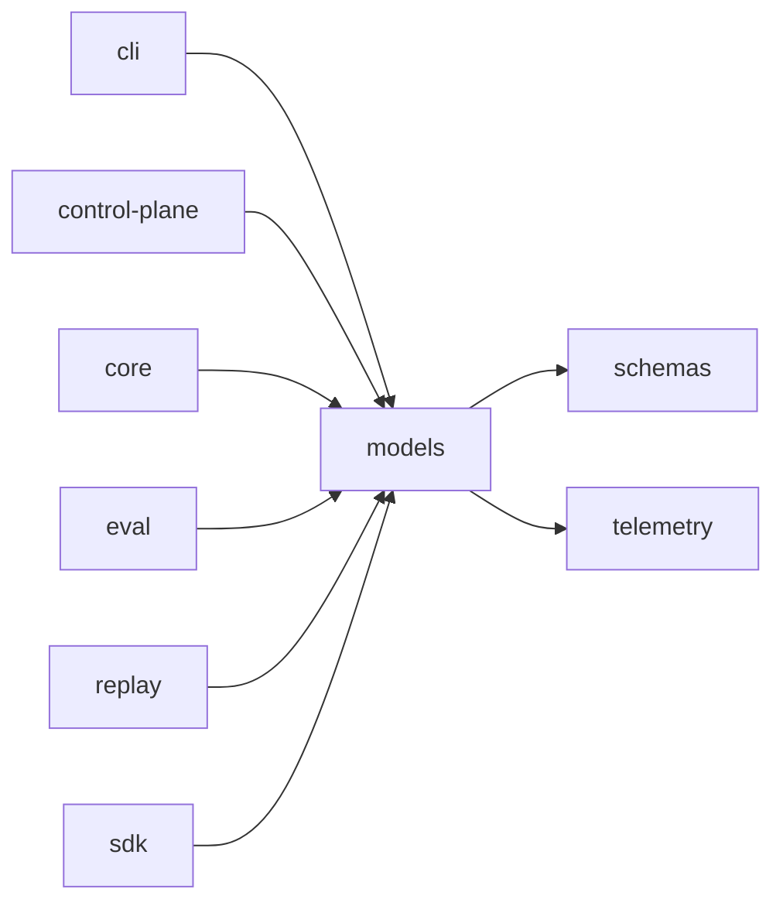
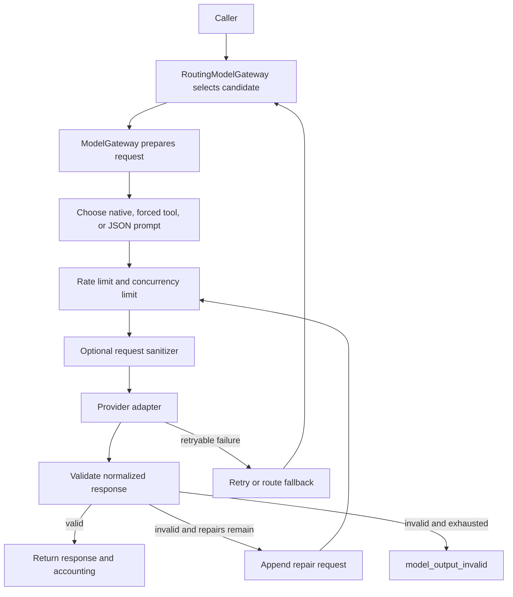
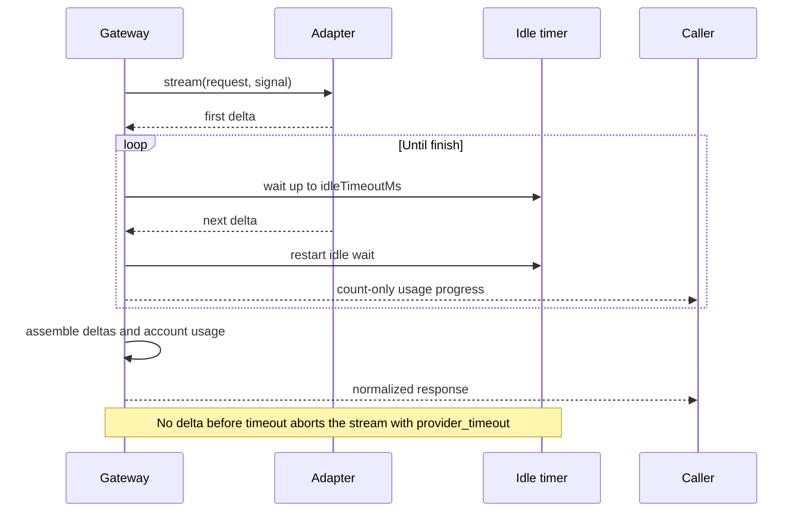

# @rovinos/models

<!-- package-readme: v1 -->
<!-- BEGIN GENERATED: readme-deps (yarn gen:readmes) -->

<!-- END GENERATED: readme-deps -->

## Purpose

`@rovinos/models` is the harness’s provider-neutral model gateway. It turns normalized model
requests into provider calls, applies retry and routing policy, validates optional structured
outputs, accounts for usage and cost, and can record or replay responses without exposing callers
to provider-specific SDK types.

## Where it fits

The generated diagram below is derived from the repository’s package dependency rules. This
package sits between the run-control packages and provider APIs: it depends only on shared schemas
and telemetry, while the PII layer wraps it to handle sensitive content before it crosses a model
boundary.

## How it works

The caller supplies normalized messages and optional output validation. Routing selects an ordered
provider/model candidate list. For each candidate, the gateway selects structured-output
enforcement, sanitizes the provider request if a sanitizer is configured, applies rate and
concurrency limits, and calls the adapter. Invalid structured output may trigger a bounded repair
request; retryable provider errors may trigger another attempt or a configured route fallback.



For structured output, the gateway prefers provider-native schema enforcement, then a forced
`emit_result` tool, then a JSON prompt. The selected rung can be capped with `maxRung`. The gateway
validates the resulting value and retries repair requests up to `models.enforcement.maxRepairs`
(default `2`). Structured output cannot be combined with real tools; unsupported rung
configurations fail with a closed error code rather than silently dropping validation.

Adapters translate provider wire formats only. The gateway owns retries and uses full-jitter
backoff for retryable provider errors. Routing tries role-specific candidates when present,
otherwise the default candidates, and falls back only for codes in `routing.fallbackOn`.
Usage from attempts, repairs, and fallbacks is aggregated before cost accounting.

Streaming adapters emit normalized deltas. The gateway assembles them into the same response shape
as a non-streaming call. After the first delta, each wait for the next delta has an idle timeout;
an idle timeout aborts the stream as a retryable `provider_timeout`. The optional progress callback
receives request IDs and output-token counts, not generated text.



The cassette adapter supports `record`, `replay`, and replay-first `auto` modes. Recorded responses
are sanitized and checked by required privacy hooks before storage; replay looks up responses by a
stable request hash. `HARNESS_CASSETTE_AUTO=0` disables auto mode.

Implementation entry points include [`gateway.ts`](./src/gateway.ts),
[`routing.ts`](./src/routing.ts), [`provider-output.ts`](./src/enforce/provider-output.ts),
[`repair.ts`](./src/enforce/repair.ts), [`streaming.ts`](./src/streaming.ts), and
[`cassette-provider.ts`](./src/cassette/cassette-provider.ts).

## Public API

This is a private workspace package, not a separately published module. The published
`@rovinos/sdk` runtime composes the model gateway and exposes the supported harness API; it
re-exports provider adapter contracts, not `ModelGateway` itself. Contributors working inside the
workspace can import the gateway and adapters from this package.

The entry point exports `ModelGateway` and `RoutingModelGateway`, `AdapterRegistry`, built-in
adapters (`AnthropicAdapter`, `OpenAIAdapter`, `AzureOpenAIAdapter`, `BedrockAdapter`,
`VertexAdapter`, and `OpenAICompatibleAdapter`), cassette providers and stores, normalized provider
types, structured-output helpers, retry/rate-limit utilities, pricing functions, and typed errors.
See [`index.ts`](./src/index.ts) for the complete export list.

Given a configured gateway, IDs, and an abort signal, a caller can request a Zod-validated result:

```ts
import { z } from "zod";
import type { ModelRequest } from "@rovinos/schemas";

const request = {
  requestId: ids.next(),
  model: { provider: "openai", model: "example-model" },
  messages: [
    { role: "user", parts: [{ type: "text", text: "Summarize synthetic item 42." }] },
  ],
} satisfies ModelRequest;
const outputSchema = z.object({ summary: z.string() });
const response = await gateway.complete(request, {
  runId: ids.next(),
  signal,
  outputSchema,
});

if (response.schemaValid) {
  // The response passed the requested output schema.
}
```

## Inputs and outputs

| Boundary data | Comes in | Goes out | Tokenization |
| --- | --- | --- | --- |
| Model request | Normalized messages, tool specs, provider/model reference, and optional output schema | Sanitized provider request and provider call | The caller/PII layer must tokenize message content before the `model_input` boundary. An optional `RequestSanitizer` can further transform each provider-bound request; the gateway does not tokenize content itself. |
| Provider completion | Provider wire response or normalized stream deltas | Normalized response parts, finish reason, usage, latency, schema status, and repair/fallback counts | Generated text and tool arguments may contain sensitive data. The PII layer/caller must handle them before events, telemetry, or storage; the gateway’s validation issues contain paths and codes, not invalid values. |
| Cassette | Request and provider completion | Hashed request key and recorded/replayed normalized response | Recording requires a response sanitizer and real-data detector; unsafe or unsanitized responses are rejected. Use synthetic or tokenized cassette data. |
| Progress and accounting | Usage deltas and configured prices | Output-token counts, cost in integer micros, bounded metadata | Progress contains IDs and counts only; telemetry carries bounded identifiers and numeric usage, never prompt or completion text. |

Messages, requests, responses, and cassette records use schemas from `@rovinos/schemas`.
Provider-specific opaque blobs are retained for provider rehydration, so callers remain responsible
for ensuring those values are appropriate for the applicable trust boundary.

## Configuration, telemetry and errors

The model settings are defined by
[`ModelsConfigSchema`](../schemas/src/config/models.ts) and are normally supplied under `models`
in harness configuration:

| Key | Purpose |
| --- | --- |
| `models.providers` | Provider IDs and kinds, credentials, endpoints, deployments/model IDs, token limits, request rate, streaming, capabilities, quirks, and `hosted`/`local` trust. |
| `models.routing.default`, `models.routing.roles`, `models.routing.fallbackOn` | Ordered model candidates and the closed error codes eligible for fallback. |
| `models.retry` | `maxAttempts` (3), `baseDelayMs` (500), `maxDelayMs` (20,000), `timeoutMs` (120,000), `streamTimeoutMs` (600,000), and `idleTimeoutMs` (60,000). |
| `models.enforcement.maxRepairs` | Maximum structured-output repair calls (2 by default). |
| `models.maxConcurrent` | Concurrent calls allowed per provider (4 by default). |
| `models.pricing`, `models.pricingRevision` | Per-`provider/model` prices in integer micros per million tokens, including optional cached-token rates and revision. |

Provider credentials use secret references such as `env:MODEL_API_KEY`; the config/secret
resolver handles their resolution. The model package itself reads `HARNESS_CASSETTE_AUTO` only
for cassette auto-mode gating.

The gateway adds attempt, repair-attempt, provider/model, token, cache-token, latency, and cost
metadata to the active model-call span. It records the `harness.model.tokens`,
`harness.model.cost_micros`, `harness.model.cache_read_tokens`,
and `harness.model.cache_write_tokens` metrics with bounded provider/model attributes. Missing
model or cached-token prices produce the
`harness.model.pricing_missing` or `harness.model.pricing_cache_missing` diagnostic log.

Errors expose stable codes:

- Provider failures: `provider_rate_limited`, `provider_timeout`, `provider_unavailable`,
  `provider_bad_request`, `provider_auth`, `provider_content_filtered`, and `provider_unknown`.
  Only rate limits, timeouts, and unavailable-provider errors are retryable.
- Gateway and output failures: `provider_not_registered`, `model_usage_out_of_range`,
  `model_output_invalid`, `deadline_exceeded`, `routing_provider_unknown`,
  `output_with_tools_unsupported`, and `rung_unavailable`.
- Schema conversion failures: `schema_conversion_failed`, `schema_provider_unsupported`, and
  `schema_recursive_unsupported`.
- Cassette failures: `cassette_miss`, `cassette_real_data_detected`, `cassette_privacy_required`,
  `cassette_divergence`, `cassette_log_incomplete`, `cassette_auto_disabled`,
  `cassette_inner_required`, and `cassette_store_read_only`.

## Security and privacy

The package normalizes provider APIs and keeps telemetry metadata-only; it does not own PII
detection or tokenization. Callers must pass tokenized content to hosted models through the PII
boundary. The optional request sanitizer receives the selected provider and its configured trust
level, while cassette recording requires explicit sanitization and detection hooks.

These are integration guarantees, not automatic protection from arbitrary adapters or callers:
the gateway cannot establish that caller-provided content is tokenized, and provider SDKs still
receive the content supplied to them. Provider adapters disable their SDK-internal retries so the
gateway controls retry behavior. See the [harness guarantees](../../docs/guarantees.md) for
system-wide boundaries and assumptions.

## Testing

Run the package’s unit tests with:

```sh
yarn test:unit packages/models
```

These `*.test.ts` suites run in the GitHub Actions `unit` job. Static checks include the package
typecheck and documentation validation. Provider live tests are separate, require provider
credentials, and are not part of the ordinary unit command; for example, the Vertex live suite can
be run with `yarn test:live:vertex`.

## Related docs

- [Model routing and fallback](../../docs/models/routing.md)
- [Provider adapter authoring](../../docs/models/adapter-authoring.md)
- [Provider response rehydration](../../docs/models/rehydration.md)
- [Provider configuration](../../docs/configuration.md)
- [Model adapter strategy](../../docs/decisions/0003-model-adapter-strategy.md)
- [Authorized content streaming](../../docs/decisions/0007-authorized-content-streaming.md)
- [Telemetry guarantees](../../docs/telemetry/guarantees.md)
