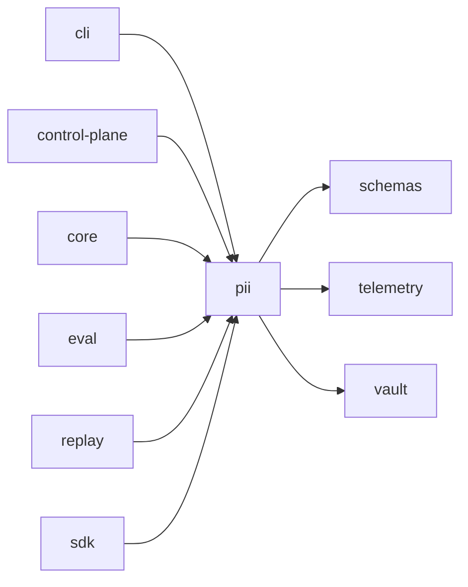
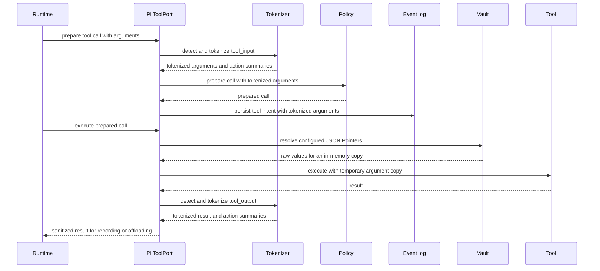
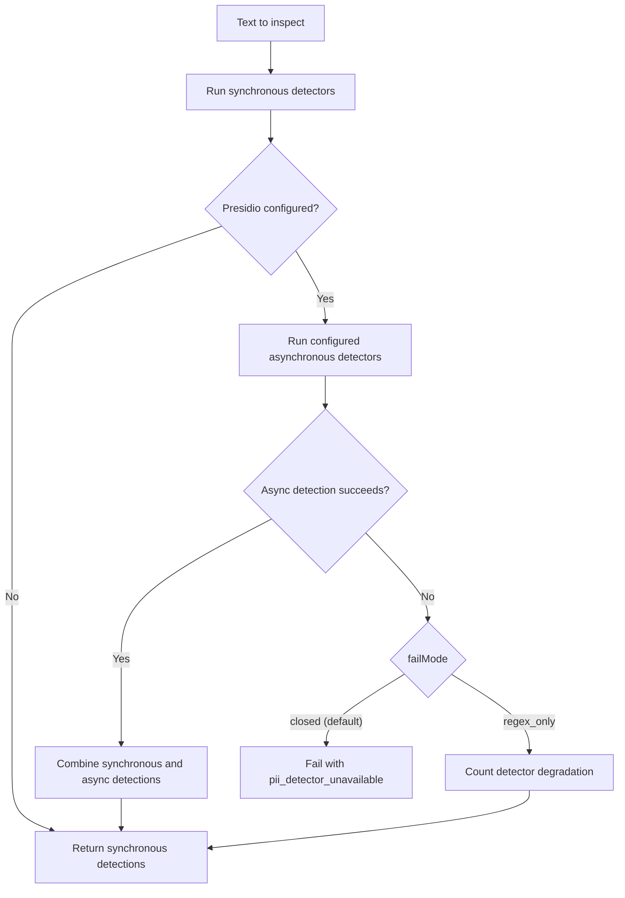

# @rovinos/pii

<!-- package-readme: v1 -->

<!-- BEGIN GENERATED: readme-deps (yarn gen:readmes) -->

<!-- END GENERATED: readme-deps -->

## Purpose

`@rovinos/pii` detects sensitive entities, applies PII policy, and replaces protected values with run-scoped vault tokens at model, tool, storage, and user-interface boundaries. It also provides narrowly allowlisted, audited detokenization for tool arguments. This keeps raw values out of durable run data and provider inputs unless the applicable policy and destination permit them.

## Where it fits

The package sits between the harness runtime and the trust boundaries where text or JSON may be persisted, sent to a model, or passed to a tool. It depends only on `@rovinos/schemas` for contracts, `@rovinos/vault` for token storage and audited resolution, and `@rovinos/telemetry` for bounded privacy metrics. The runtime composes its adapters around model and tool ports; the package does not make authorization decisions on behalf of the runtime.

## How it works

`PiiMessageSanitizer` applies model-input policy to each provider attempt. `PiiToolPort` prepares tokenized arguments for policy and durable recording, resolves only allowlisted pointers into an execution-only copy, and tokenizes results before they are returned to persistence or offloading.



The raw argument copy exists only for tool execution; the prepared call and durable tool intent retain tokens. Storage tokenization is applied when a boundary policy allows raw content. With the default `failMode: closed`, an unavailable configured Presidio analyzer fails detection; `regex_only` explicitly permits continuing with synchronous detections only.



The `DetectorRegistry` runs synchronous detectors first and, when configured, runs asynchronous detectors concurrently with their results. `PresidioDetector` is an optional sidecar adapter with bounded requests and a circuit breaker. See [`src/detectors/registry.ts`](src/detectors/registry.ts), [`src/detectors/presidio.ts`](src/detectors/presidio.ts), and [`docs/runbooks/pii-detector-degraded.md`](../../docs/runbooks/pii-detector-degraded.md).

## Public API

`@rovinos/pii` is an internal, private workspace package, not a separately supported application dependency. The published `@rovinos/sdk` bundles it for SDK users. Its entry point exports:

- Built-in detectors, `createCustomDetector`, `DetectorRegistry`, and `PresidioDetector`.
- `Tokenizer`, token validation, and `detokenizeArgs`.
- `evaluatePiiPolicy`, `explainPiiPolicy`, and destination resolution helpers.
- `PiiMessageSanitizer` for model input and `PiiToolPort` for tool arguments and results.
- `PiiEventStore`, sanitization markers, PII action event conversion, and typed errors.

Package consumers should use `@rovinos/sdk`; the following example illustrates the internal detector contract for contributors. Detection results contain entity codes and offsets, not the matched value.

```ts
import { emailDetector } from "@rovinos/pii";

const detections = emailDetector.detect("Contact analyst@example.test");
const summary = detections.map(({ entityType, start, end }) => ({
  entityType,
  start,
  end,
}));
```

Open [`src/index.ts`](src/index.ts) and [`src/detectors/index.ts`](src/detectors/index.ts) for the complete supported export list.

## Inputs and outputs

| Boundary or operation | Comes in | Goes out | Tokenization at the boundary |
| --- | --- | --- | --- |
| Detection | Text | Entity codes, detector IDs, confidence, and UTF-16 offsets | A detection reports ranges; tokenization is performed by `Tokenizer`. |
| Model input | Messages, tool descriptions and schemas, and output schemas | Detached messages and request with applicable content sanitized | Text and JSON are tokenized, redacted, or blocked by policy. Existing tokens are re-evaluated. Opaque provider blobs are scanned and passed unchanged only when no detection is found. |
| Tool input and storage | Tool argument JSON | Prepared arguments and durable data | Arguments are tokenized before downstream policy and recording. Storage always tokenizes; `allow` does not permit raw storage. |
| Tool execution | Prepared, tokenized arguments | Temporary argument copy for the tool and a result | Only configured tool JSON Pointers are detokenized in an in-memory copy. The durable arguments remain tokenized. |
| Tool output | Tool result JSON | Sanitized result for recording and offloading | Text and JSON are tokenized, redacted, or blocked. Explicitly flagged binary payloads use the validated binary/offloading path instead of text tokenization. |
| Action summary | Boundary and policy actions | Entity-type counts and action codes | Summaries contain metadata only, never matched values. |

Detector offsets use UTF-16 indices, with `start` inclusive and `end` exclusive. JSON structure is preserved; PII in protected object keys fails rather than rewriting the keys.

## Configuration, telemetry and errors

PII settings live under `pii`: `enabled`, `failMode` (`closed` or `regex_only`), `allowRawToLocalModels`, `presidio` (`baseUrl`, `language`, `scoreThreshold`), `custom`, `detokenize`, and the policy's `rules` and `defaultAction`. Presidio is optional; its default language is `en` and score threshold is `0.5`. `pii.enabled` defaults to `true`; disabling it is rejected when `NODE_ENV=production`. There are no PII-specific environment variables. The general `HARNESS__` override mechanism applies (for example, `HARNESS__PII__FAIL_MODE=regex_only`); arrays such as `custom` and `detokenize` cannot be overridden through environment variables. `HARNESS_CONFIG` selects the config file. See [configuration](../../docs/configuration.md) and [secret references](../../docs/secrets.md).

The package defines no spans. It records metadata-only PII action summaries through injected callbacks and increments two telemetry counters: `harness.pii.detector_degraded` when the configured regex-only fallback is used, and `harness.pii.blob_hit` when opaque model data contains a detected entity. Metric names and allowed attributes are listed in the [telemetry attribute catalog](../../docs/telemetry/attribute-catalog.md).

Typed errors expose closed codes, including `pii_blocked`, `pii_blob_contains_pii`, `pii_destination_missing`, `pii_depth_exceeded`, `pii_detector_failed`, `pii_detector_invalid_input`, `pii_detector_invalid_output`, `pii_detector_unavailable`, `pii_input_invalid`, `pii_input_too_large`, `pii_key_contains_pii`, `pii_pattern_invalid`, `pii_pattern_unsafe`, `pii_storage_failed`, `pii_token_unresolvable`, and `pii_vault_failed`. Error metadata may include entity types and counts, never detected values.

## Security and privacy

The package applies policy before vault writes, fails closed on detector or vault errors by default, keeps generated tokens run-scoped, and leaves existing tokens untouched during text detection. Tool detokenization is limited to configured JSON Pointers and is audited; resolved raw values are used only in the temporary execution copy. Model-input policy does not allow raw values to hosted models, and raw values for local models are also tokenized unless explicitly enabled. Errors and action summaries do not carry detected values.

Detection is best effort, not a guarantee that every sensitive value is found. Built-in detectors cover common formats; custom-pattern safety checks do not establish detector completeness. `regex_only` intentionally reduces coverage during analyzer outages. Opaque blobs are scanned as supported text values, and flagged binary tool results are not text-tokenized. Raw values may still be visible to the configured tool while it executes, and third-party model providers have their own retention practices. Read the authoritative [privacy and security guarantees and known gaps](../../docs/guarantees.md).

## Testing

Run the package's unit tests with `yarn test:unit packages/pii`; these `*.test.ts` suites run in the GitHub Actions `unit` job. Cross-package storage-boundary integration tests run in `integration`, and privacy canary checks run in `gates`. The synthetic detector-corpus report is also published by the relevant CI jobs; it measures coverage rather than proving complete detection.

## Related docs

- [PII configuration and detector formats](../../docs/configuration.md#pii-detectors-and-custom-identifiers)
- [PII tokenization and tool-boundary composition](../../docs/configuration.md#pii-tokenization)
- [Policy documents](../../docs/policy.md)
- [Privacy and security guarantees](../../docs/guarantees.md)
- [PII detector degraded runbook](../../docs/runbooks/pii-detector-degraded.md)
- [Secret references](../../docs/secrets.md)
- [Telemetry attribute catalog](../../docs/telemetry/attribute-catalog.md)
