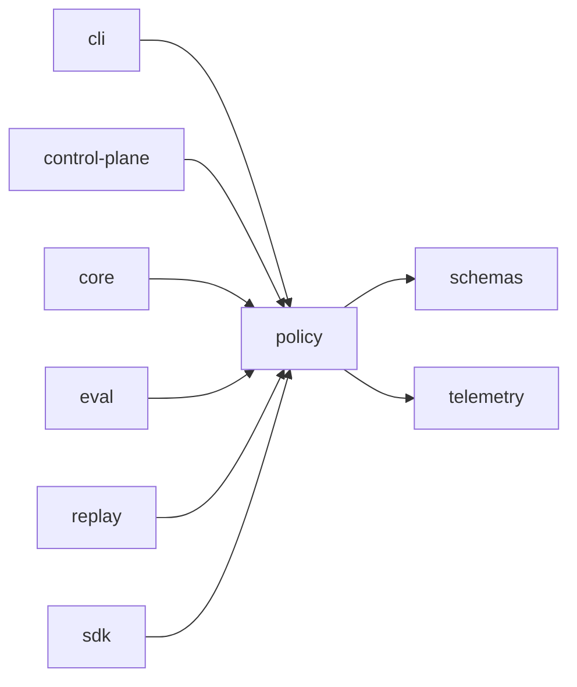
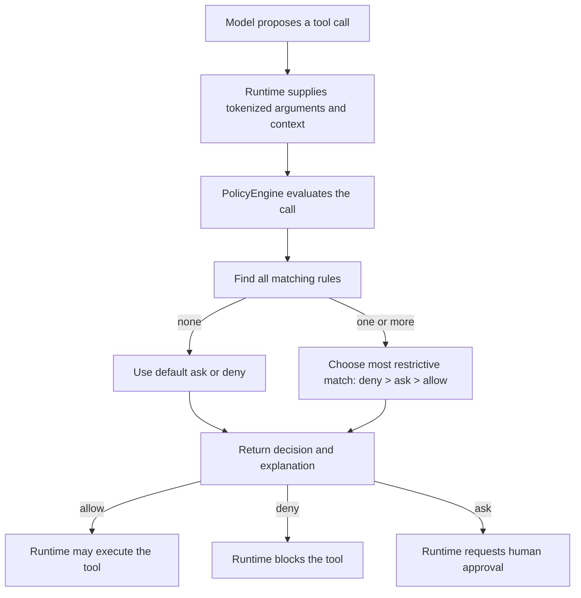
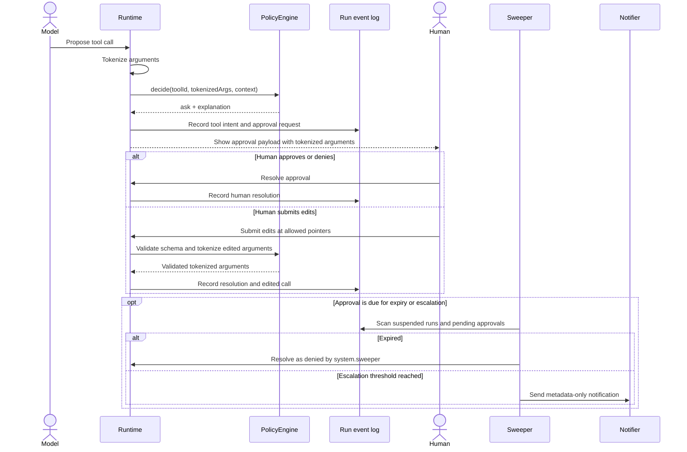

<!-- package-readme: v1 -->

# `@rovinos/policy`

## Purpose

`@rovinos/policy` is the deterministic authorization layer for harness tool calls. It validates policy documents, evaluates calls using tokenized arguments, and turns `ask` decisions into approval requests that a human—not the model—can resolve.

## Where it fits

<!-- BEGIN GENERATED: readme-deps (yarn gen:readmes) -->

<!-- END GENERATED: readme-deps -->

The package sits between call preparation and tool execution: it consumes schema-validated policy and tokenized call data, then returns a decision and explanation. Its pure evaluator and injected store, clock, and notifier ports keep policy independent of runtime orchestration. It imports only `@rovinos/schemas` and `@rovinos/telemetry`; see [`layers.json`](../../docs/engineering/layers.json), [`src/index.ts`](./src/index.ts), and [`src/engine.ts`](./src/engine.ts). This package is private. The published `@rovinos/sdk` build bundles the harness runtime, including policy through `@rovinos/core`; the CLI also uses the package for its policy commands. Neither consumer makes `@rovinos/policy` a supported standalone import.

## How it works

The runtime prepares a tool call with tokenized arguments before asking the policy engine for a decision. Every matching rule is reported; the most restrictive decision wins (`deny` > `ask` > `allow`), and the first matching rule wins ties. If nothing matches, the document's default (`ask` or `deny`) applies.



For `ask`, the runtime records a pending approval with a payload containing the call ID, tool ID, tokenized arguments, rule ID, reason, UI resource and fallback text, editable pointers, and optional expiry. A human can approve, deny, or submit allowed edits. Edits are checked against the rule's pointers and optional tool input schema, then tokenized again at the `tool_input` boundary. Core owns event recording and run suspension/resumption; the policy package supplies the evaluator, payload and edit helpers, notifier, and sweeper.



Expiry takes precedence over escalation at the expiry boundary. Escalation uses a durable claim and sent marker; webhook delivery is at least once, so receivers should deduplicate by approval ID. The implementation is in [`src/evaluate.ts`](./src/evaluate.ts), [`src/approval-payload.ts`](./src/approval-payload.ts), [`src/approval-edits.ts`](./src/approval-edits.ts), and [`src/sweeper.ts`](./src/sweeper.ts).

## Public API

The package is private and its exports are workspace interfaces, not a semver-stable external API. The entry point exports `PolicyDocumentSchema` and related schemas/types, `loadPolicy`, `compilePolicy`, `evaluate`, `PolicyEngine`, `policyVersion`, and `lintPolicy`; approval payload/edit helpers; webhook and log notifiers; and `sweepApprovals`. The supported programmatic harness API is `@rovinos/sdk`.

For example, a contributor can compile a policy once and evaluate only tokenized call data:

```ts
import { compilePolicy, type PolicyDocument } from "@rovinos/policy";

const policy: PolicyDocument = {
  version: 1,
  defaultDecision: "deny",
  rules: [
    {
      id: "ask_for_external_email",
      match: {
        tools: ["mail.send"],
        args: [{ pointer: "/to", op: "tokenType", value: "email" }],
      },
      decision: "ask",
      reason: "external_email",
    },
  ],
};

const explanation = compilePolicy(policy).evaluate({
  toolId: "mail.send",
  args: { to: "<EMAIL_1>" },
  context: { subagent: false },
});
```

The returned explanation includes the selected decision, rule ID, reason code, all matching rules, and any approval settings. For runnable policy fixtures, see [`examples/policy.yaml`](../../examples/policy.yaml) and [`examples/policy-tests/`](../../examples/policy-tests/).

## Inputs and outputs

| Boundary | Input | Output | Tokenization and exposure |
| --- | --- | --- | --- |
| Policy loading | YAML or JSON file with a version-1 policy document | Strict `PolicyDocument` | The schema checks shape and rule constraints; policy descriptions stay out of telemetry. |
| Evaluation | Tool ID, JSON arguments, and subagent/server/app context | `Explanation` with decision, rule, reason, and match list | Arguments must already be tokenized by the caller. The evaluator does not detokenize or perform PII detection. |
| Approval request | Call ID, tool ID, tokenized arguments, rule metadata, optional clock value | Versioned `ApprovalPayload` with UI resource, editable pointers, and optional expiry | The payload retains the tokenized arguments and contains no raw-argument conversion. |
| Approval edits | Payload, pointer edits, optional tool input schema, tokenizer adapter | Schema-checked and tokenized arguments, or a closed edit error | Edits must target rule-approved pointers; accepted edits are tokenized at `tool_input`. Without a tool schema, schema validation is skipped. |
| Lint | Untrusted policy value and optional tool metadata | Severity/code/rule-ID diagnostics | Diagnostics do not include policy descriptions or argument values. |
| Approval sweep | Suspended-run event histories, injected clock, notifier, and store operations | Counts of examined, expired, escalated, and failed approvals | Notifications carry run, approval, tool, and rule IDs plus age; arguments are excluded. |

## Configuration, telemetry and errors

The runtime configuration is under `policy`: `file` selects the YAML or JSON policy; `approvals.separationOfDuties` applies a global self-approval restriction; and `approvals.notifier` selects `log` (the default) or `webhook`. A webhook accepts `url`, `secretRef`, and optional positive `timeoutMs`; URLs use HTTPS, except localhost HTTP when `approvals.allowInsecureLocalhost` is enabled. Per-rule `approvalTtlMs` and `escalateAfterMs` control expiry and escalation, and rule-level `separationOfDuties` overrides the global setting. `HARNESS__POLICY__FILE` and `HARNESS__POLICY__APPROVALS__...` environment overrides follow the standard [`HARNESS__` configuration rules](../../docs/configuration.md#file-selection-and-environment-overrides).

This package defines no spans or metrics. Its closed `HarnessError` codes are `approval_webhook_failed`, `approval_sweep_failed`, `edit_not_allowed`, and `edit_invalid`. Policy schema validation attaches these stable refinement codes: `policy_match_value_unexpected`, `policy_match_value_required`, `policy_match_value_invalid`, `policy_pattern_unsafe`, `policy_pattern_invalid`, `policy_token_type_invalid`, `policy_rule_id_reserved`, `policy_allow_all`, `policy_editable_requires_ask`, `policy_escalation_requires_ask`, `policy_escalation_after_expiry`, and `policy_rule_id_duplicate`. `lintPolicy` returns diagnostic codes instead of throwing for policy defects: `policy_invalid`, `missing_reason`, `policy_metadata_invalid`, `duplicate_matcher`, `rule_shadowed`, `allow_fully_denied`, `allow_destructive_wildcard`, and `unused_editable_pointer`.

## Security and privacy

Policy decisions are made in code over tokenized arguments; model-generated tool requests do not grant themselves authority. The schema limits defaults to `ask` or `deny`, rejects a blanket allow rule, and validates regex patterns before evaluation. Approval edits are constrained to configured JSON Pointers and are re-tokenized before returning. Notifier payloads contain metadata only, and webhook secrets are resolved through a `SecretRef`; webhook redirects are rejected.

These guarantees depend on callers tokenizing arguments before evaluation and keeping human approval identity/authentication in the runtime or host. The policy schema cannot detect raw PII embedded in arbitrary strings. If a tool provides no input schema, the edit helper cannot validate edits against that external schema, though it still enforces editable pointers and tokenizes the result. See [`docs/policy.md`](../../docs/policy.md) and [`docs/security/prompt-injection.md`](../../docs/security/prompt-injection.md) for operational guidance.

## Testing

Policy unit tests cover schema validation, decision precedence, token-type matching, payload construction, edits, sweeper expiry/idempotency, notifications, and lint diagnostics. Run them with:

```sh
yarn test:unit packages/policy
```

The unit suite runs in the GitHub Actions `unit` job. [`src/notifier.canary.test.ts`](./src/notifier.canary.test.ts) runs as a canary in `gates`; the same gate also runs replay tests. The CI jobs are `static`, `unit`, `integration`, and `gates`.

## Related docs

- [Policy format and approvals](../../docs/policy.md)
- [Configuration](../../docs/configuration.md)
- [Approval wait runbook](../../docs/runbooks/approval-wait.md)
- [Policy and API compatibility](../../docs/api-policy.md)
- [Policy implementation](./src/index.ts)
- [Policy schema](./src/schema.ts)
- [Policy evaluator](./src/evaluate.ts)
- [Approval sweeper](./src/sweeper.ts)
