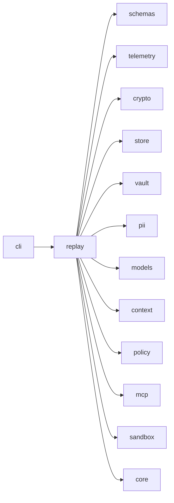
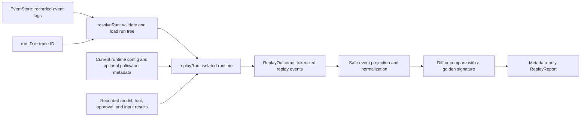
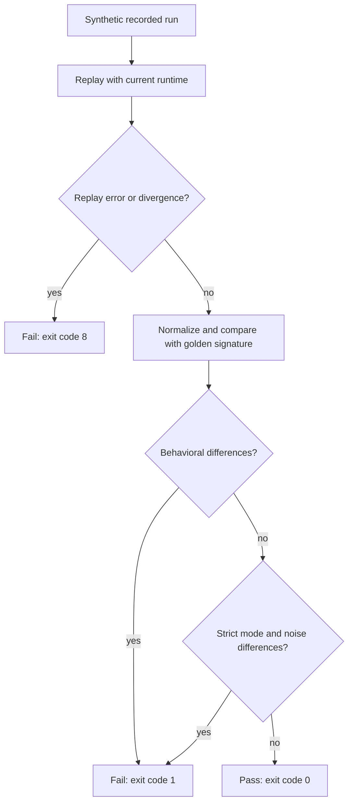

<!-- package-readme: v1 -->

# @rovinos/replay

## Purpose

`@rovinos/replay` reproduces a recorded agent run offline so contributors can check whether current runtime behavior still matches the recording. It supplies recorded model responses, tool results, approvals, and human inputs to an isolated runtime, then creates content-free diffs and reports for debugging and regression gates.

## Where it fits

<!-- BEGIN GENERATED: readme-deps (yarn gen:readmes) -->

<!-- END GENERATED: readme-deps -->

Replay sits at the runtime integration layer because it reconstructs the `@rovinos/core` run loop while substituting deterministic clocks and IDs, recorded model/tool/human responses, and isolated storage and vaults. The package is private and is bundled into the published `@rovinos/cli` package, which exposes the `harness replay` command.

## How it works

Replay resolves one run or the runs in a trace, validates their event logs, and rebuilds the run with recorded results. The replay runtime writes to a fresh in-memory event store and a transient vault; live sandbox execution is rejected. Its output includes replay events and metadata about drift or divergence.



`diffRuns` projects events through the telemetry-safe allowlist, removes volatile run and trace envelope values, aliases identifiers, and classifies differences as behavioral or noise. A regression gate uses a committed synthetic golden signature and can also assert a nonzero result after a deliberate behavior mutation.



The default gate fails on behavioral differences but accepts noise-only differences; strict mode also fails on noise. `yarn test:replay` runs the golden scenario and a mutation check that reverses tool-call order to prove behavioral changes fail. Baselines are updated only through an explicit command, and CI updates are refused unless forced.

## Public API

`@rovinos/replay` is an internal package bundled into the published `@rovinos/cli` package. Its source exports run/trace resolution, isolated replay runtime construction and execution, metadata-only diffing, report rendering, and synthetic golden-signature helpers from [`src/index.ts`](./src/index.ts).

For example, assuming `store` contains a synthetic recording:

```ts
import { RunConfigSchema } from "@rovinos/schemas";
import {
  createReplayReport,
  diffRuns,
  replayReportExitCode,
  replayRun,
  resolveRun,
} from "@rovinos/replay";

const resolved = await resolveRun({ store, runId: "01J00000000000000000000000" });
const outcome = await replayRun(resolved, {
  config: { run: RunConfigSchema.parse({}) },
});
const recordedRoot = resolved.runs[0];
if (recordedRoot === undefined) {
  throw new Error("Synthetic recording has no root run.");
}
const report = createReplayReport({
  originalRunId: resolved.rootRunId,
  outcome,
  diff: diffRuns(recordedRoot.events, outcome.events),
});
const exitCode = replayReportExitCode(report);
```

`createGoldenSignature(outcome.events)` creates a schema-validated signature marked `containsRealData: false`; `compareGoldenSignature` compares replay events to a parsed baseline. Reports can be rendered as deterministic JSON or text with `renderReplayReportJson` and `renderReplayReportText`.

## Inputs and outputs

| Boundary | Comes in | Goes out | Tokenization |
| --- | --- | --- | --- |
| Run resolution | An event store and exactly one run ID or trace ID/traceparent | Validated root and related run event logs | Event payloads retain the tokens stored at the storage boundary; selectors are identifiers, not content |
| Replay execution | Resolved logs, current runtime config, and optional read-only policy/tool metadata | Replay status, tokenized events, trace ID, config/policy drift flags, and optional divergence code/sequence | Replay ports treat recorded values as already tokenized; PII remains enabled at the replay storage boundary |
| Diff and report | Validated original/replay events or a parsed golden signature | Safe normalized fields, difference counts, metadata-only report, and gate exit code | Only allowlisted metadata is included; the report does not include event content |
| Golden baseline | Synthetic event log or normalized signature | Stable JSON signature with `containsRealData: false` | Golden signatures contain safe normalized metadata, not raw event content |

Resolved event logs are capped at one million events. The resolver requires contiguous sequence numbers beginning with `run_created`.

## Configuration, telemetry and errors

- **Programmatic configuration:** `replayRun` accepts `RuntimeConfig` and optional `PolicyPort` and read-only tool metadata. Replay uses the supplied run configuration, forces PII handling on, and selects a transient SQLite vault. `@rovinos/replay` does not read environment variables directly.
- **CLI options:** `harness replay` accepts `--run` or `--trace`, `--strict`, `--golden`, `--update-baseline`, `--force-in-ci`, and `--report`. The CLI treats `CI=1` or a case-insensitive `true` value for `CI` or `GITHUB_ACTIONS` as CI and refuses baseline updates there unless `--force-in-ci` is given.
- **Telemetry:** defines the `harness.replay` span with the `harness.replay.original_run_id` ID attribute and a link to the source trace. The package defines no metrics. Recorded content and diff fields are not span attributes.
- **Closed error codes:** `replay_input_invalid`, `run_not_found`, `trace_ambiguous`, `replay_too_large`, `corrupt_log`, `replay_divergence`, `replay_missing_result`, `replay_external_access`, and `baseline_update_refused`.
- **Gate exit codes:** `0` for accepted results, `1` for behavioral differences (or noise in strict mode), and `8` for replay failure.

## Security and privacy

The replay runtime reads recorded model, tool, and human responses rather than invoking live providers, executors, or people; sandbox execution fails closed. It uses a fresh in-memory event store and transient vault, so it does not update the source run's store or vault. Diffs and reports operate on safe metadata projections, and golden signatures require `containsRealData: false`.

Replay expects recordings to obey the harness's tokenization guarantees; it validates event schemas and request/result consistency, but is not a sanitizer for arbitrary logs containing raw sensitive data. Replay outcome events may contain the recording's tokenized payloads, so callers should handle them under the same privacy rules as stored events. Golden fixtures and cassettes must use synthetic data.

## Testing

- `yarn test:unit packages/replay` runs package unit tests in the CI `unit` job.
- `yarn test:replay` runs replay and golden regression tests in the CI `gates` job, including the mutation check.
- `yarn workspace @rovinos/replay build` builds the package.

## Related docs

- [Replay regression gate](../../docs/replay-regression.md)
- [Replay example](../../examples/replay/README.md)
- [CLI replay command](../cli/README.md)
- [Layer boundaries](../../docs/engineering/layers.json)
