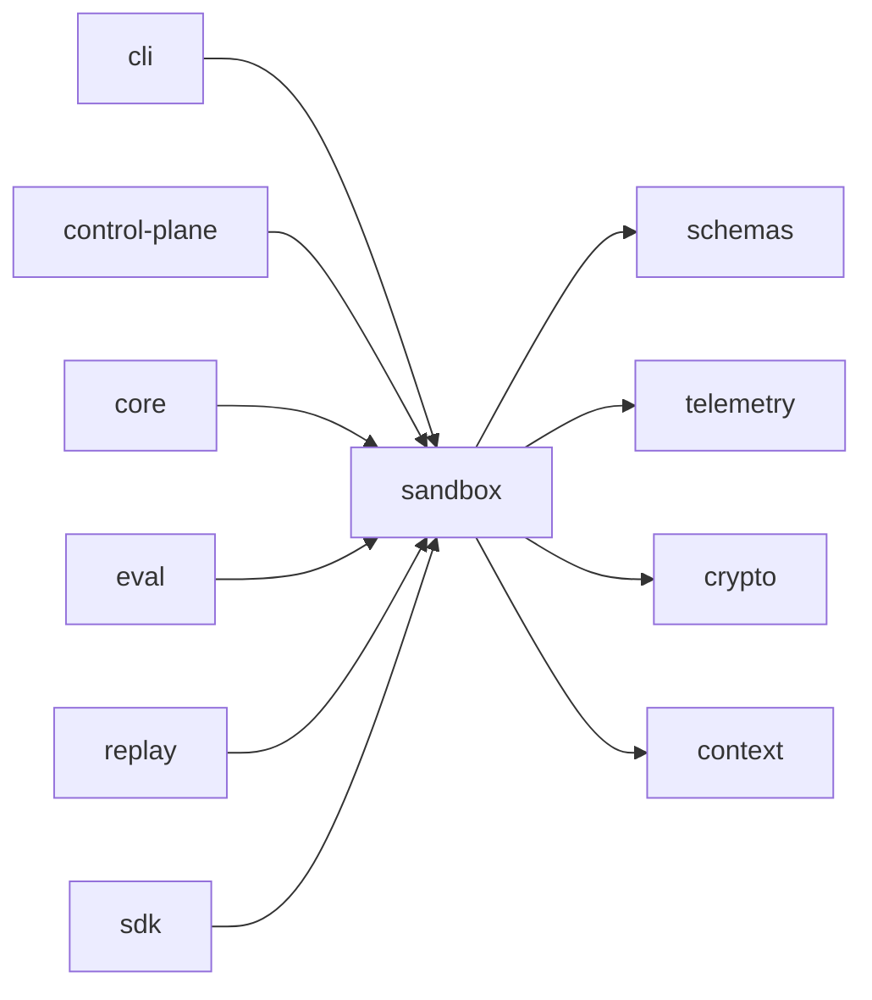
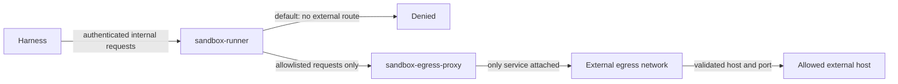
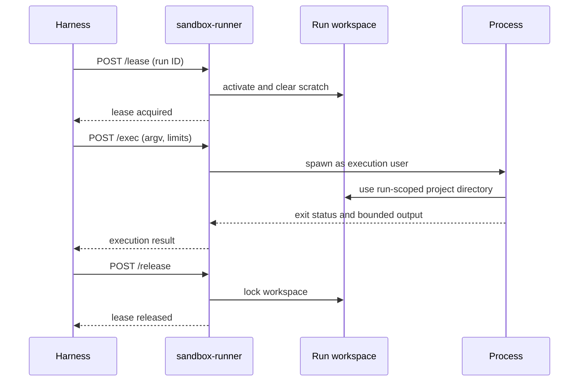

<!-- package-readme: v1 -->

# `@rovinos/sandbox`

## Purpose

`@rovinos/sandbox` provides the harness with bounded command execution, per-run files and workspace snapshots. It supports a development-only in-process backend and a remote runner service; the runner's default network access is denied, and explicitly allowlisted web requests pass through a separate egress proxy.

## Where it fits

<!-- BEGIN GENERATED: readme-deps (yarn gen:readmes) -->

<!-- END GENERATED: readme-deps -->

This private package is a runtime boundary used by core, replay, evaluation, and the CLI. It depends on schemas, telemetry, crypto, and context, keeping process execution and workspace details below the packages that orchestrate runs. The published `@rovinos/sdk` and `@rovinos/cli` bundle their internal workspace dependencies; this package is not published separately. See [`package.json`](./package.json) and the [publish-surface decision](../../docs/decisions/0001-publish-surface.md).

## How it works

The harness selects an in-process backend when no runner is configured, a single remote backend for `runner`, or a pool when `runners` is configured. The remote runner is a separate service, not a container started by this package. The runner has no direct internet route. When egress is enabled, only the proxy is attached to the externally routed network; it checks the exact host and port allowlist, resolves destinations, and blocks private and special-use addresses.



One run holds a runner-wide lease. Acquiring it activates that run's workspace; the lease is released after the run suspends or reaches a terminal state. Each command is passed as an argv array and runs as the execution user, with host-controlled resource limits.



The built-in `web.fetch` tool exists only when a non-empty egress allowlist is configured. It sends requests through the runner and proxy, checks redirects against the allowlist, and returns fetched content as untrusted. Workspace snapshots are bounded archives with content-addressed references; restore validates limits and uses safe tar extraction before replacing the workspace. Snapshot encryption is optional and uses AES-256-GCM when enabled with a key provider.

The file tools are `fs.read`, `fs.write`, `fs.edit`, `fs.list`, and `fs.search`. They operate on paths relative to a run's `project/` directory and reject traversal and symlinks. `Dockerfile.sandbox` builds the hardened runner and proxy image: its runtime omits Docker, package managers and compilers, strips setuid/setgid bits, and runs without a writable root filesystem or Linux capabilities. Compose applies the service-specific resource limits.

Open [`factory.ts`](./src/factory.ts), [`remote.ts`](./src/remote.ts), [`runner/src/server.ts`](./runner/src/server.ts), [`runner/src/lease.ts`](./runner/src/lease.ts), [`egress-proxy/src/proxy.ts`](./egress-proxy/src/proxy.ts), and [`Dockerfile.sandbox`](../../Dockerfile.sandbox) for the corresponding implementation.

## Public API

`@rovinos/sandbox` is private and is not a separately supported npm API. Its package entrypoint, [`src/index.ts`](./src/index.ts), exports the internal runtime API used by the bundled SDK and CLI. The `runner/` and `egress-proxy/` directories are service entrypoints built with the package, not exports from that entrypoint.

The common backend contract is `SandboxBackend`. A contributor can create a configured backend and execute a shell-free command; `runId` and `signal` below are supplied by the active harness run:

```ts
const backend = await createSandboxBackend(config, dependencies);
const result = await backend.exec(
  runId,
  {
    argv: ["node", "-e", "process.stdout.write('hello')"],
    timeoutMs: 5_000,
    limits: { memoryMb: 128, pids: 32, outputBytes: 16_384, cpuSeconds: 2 },
  },
  signal,
);
```

The entrypoint also exports `SandboxExecTool`, `createWebFetchTool`, filesystem tool schemas and types, `WorkspaceSnapshotter`, workspace helpers, `RemoteSandboxBackend`, `RunnerPool`, and Docker-process utilities. `createWebFetchTool` returns `undefined` if the allowlist is missing or empty:

```ts
const fetchTool = createWebFetchTool(
  [{ host: "docs.example.test", ports: [443] }],
  backend,
);
```

These are internal implementation exports, not a guarantee of compatibility for direct imports. Prefer the public `@rovinos/sdk` API when building an application.

## Inputs and outputs

| Boundary | Inputs | Outputs | Tokenization |
| --- | --- | --- | --- |
| Backend execution | Run ID, argv, optional cwd/env/stdin, timeout and resource limits | Exit status, signal/timeout metadata, duration, bounded stdout/stderr | The backend validates structure and bounds but does not tokenize command input or output. The runtime's tool decorators handle model-visible results. |
| `fs.*` tools | Run ID and relative workspace paths; file contents, edits or search criteria | Bounded text/list/search results, binary metadata, write hashes or closed error codes | File content is not tokenized by this package; model-facing tools use the runtime's PII and output-offloading decorators. |
| `web.fetch` | URL, optional request headers, response-size and timeout bounds | Untrusted text or binary response with status/content metadata | The proxy counters omit URLs and hostnames. Fetched content remains untrusted and is handled by the normal runtime boundary. |
| Snapshot and restore | Run ID, snapshot reference, workspace files and optional encryption key provider | Content-addressed `WorkspaceRef`, archive or restored workspace | Snapshot files are not tokenized. Encryption is optional; use it when the storage boundary requires confidentiality. |
| Backend configuration | Runner URL(s), secret references, allowlisted host/port pairs and workspace options | Selected backend, authenticated service calls, workspace state | Runner credentials are configured as secret references and resolved by the host; the runner deletes token environment variables after bootstrap. |

Execution accepts a non-empty argv array, never a shell string. Environment variables are opt-in, limited to 32 entries, and reject loader/interpreter controls, `PATH`, proxy variables, `LD_*`, and `DYLD_*`. Execution timeouts are capped at five minutes. See [`types.ts`](./src/types.ts), [`fs-tools.ts`](./src/fs-tools.ts), and [`web-fetch-contracts.ts`](./src/web-fetch-contracts.ts) for schemas and limits.

## Configuration, telemetry and errors

The strict `sandbox` configuration supports these keys:

| Key | Meaning |
| --- | --- |
| `runner` | One remote runner `{ url, token }`; `token` is a secret reference. |
| `runners` | A pool of 1–16 remote runners, each with a URL and secret reference. Mutually exclusive with `runner`. |
| `egress.allow` | Exact host and port pairs permitted by the egress proxy. Wildcards are not allowed. |
| `allowUnsafeInProcess` | Explicitly permits the in-process backend in production; intended for development only. |
| `restoreOnResume` | Controls workspace restore on run resume. |
| `snapshotEncryption` | Enables snapshot encryption; a key provider must be available. |

The service environment is set by the deployment. The runner reads `SANDBOX_RUNNER_TOKEN` or `SANDBOX_RUNNER_TOKEN_FILE` (not both), `SANDBOX_RUNNER_PORT` (default `8080`), `SANDBOX_ALLOWED_HOSTS`, and `SANDBOX_WORKSPACE_ROOT` (default `/workspaces`). With egress enabled it also reads `SANDBOX_EGRESS_ALLOW` and `SANDBOX_EGRESS_PROXY_URL`. The proxy reads `SANDBOX_EGRESS_ALLOW` and `SANDBOX_EGRESS_PROXY_PORT` (default `3128`). Compose uses `SANDBOX_RUNNER_UID` and `SANDBOX_RUNNER_GID` to select the command execution identity. See [`config/sandbox.ts`](../schemas/src/config/sandbox.ts), [`docker-compose.yml`](../../infra/compose/docker-compose.yml), and [`docker-compose.egress.yml`](../../infra/compose/docker-compose.egress.yml).

This package does not define OpenTelemetry spans or general-purpose metrics. The development backend logs only `sandbox_inprocess_unsafe` and `sandbox_inprocess_limits_unenforced`. The egress proxy emits only bounded `egress_allowed`/`egress_denied` counter records with a closed reason (`allowed`, `invalid_request`, `not_allowlisted`, `private_address`, `resolution_failed`, or `connect_failed`); records contain no destination hostname or URL.

Closed error codes are defined next to each boundary. Remote operations use `sandbox_unavailable`, `sandbox_busy`, `sandbox_timeout`, `sandbox_runner_config_invalid`, and `snapshot_too_large`. Execution uses `sandbox_exec_unknown_tool`, `sandbox_exec_invalid`, `sandbox_exec_failed`, `sandbox_exec_spawn_failed`, `sandbox_env_forbidden`, and `sandbox_inprocess_production`. Fetch errors use `sandbox_fetch_unknown_tool`, `sandbox_fetch_invalid`, `sandbox_fetch_denied`, `sandbox_fetch_egress_disabled`, `sandbox_fetch_redirect_limit`, and `sandbox_fetch_failed`. File operations use `edit_ambiguous`, `edit_no_match`, `fs_file_exists`, `fs_file_not_found`, `fs_invalid_input`, `fs_not_directory`, `fs_not_file`, `fs_operation_failed`, `fs_path_invalid`, `workspace_quota_exceeded`, and `precondition_failed`; workspace path validation reports `sandbox_workspace_path_invalid`. Snapshot errors are `workspace_snapshot_invalid`, `workspace_snapshot_unsafe`, and `snapshot_too_large`. Docker process helpers use `docker_process_failed` and `docker_process_cancelled`. Runner endpoints may also return `sandbox_workspace_failed` and `sandbox_workspace_not_found`. Runner startup uses `sandbox_runner_config_invalid`, `proxy_url_without_allowlist`, and `allowlist_without_proxy_url`; the proxy startup codes are `allowlist_missing`, `allowlist_empty`, `allowlist_invalid`, `allowlist_host_invalid`, `allowlist_port_invalid`, and `proxy_port_invalid`. These closed unions are implemented in [`remote-errors.ts`](./src/remote-errors.ts), [`types.ts`](./src/types.ts), [`fs-tools.ts`](./src/fs-tools.ts), [`snapshot-archive.ts`](./src/snapshot-archive.ts), [`docker-process.ts`](./src/docker-process.ts), [`runner/src/server.ts`](./runner/src/server.ts), and [`egress-proxy/src/contracts.ts`](./egress-proxy/src/contracts.ts).

## Security and privacy

The remote runner is the isolation boundary. The harness must not mount `docker.sock` or spawn the runner itself. In the default Compose topology, the runner is attached only to an internal network; the optional proxy is the only service connected to external egress. The proxy uses exact host/port allowlisting, revalidates redirects, pins DNS resolution to the validated connection, and blocks private and special-use addresses.

Runner executions use argv, a cleared child environment with explicitly allowed variables, resource limits, a non-root execution identity, a read-only container root, dropped capabilities, and per-run workspace directories. Workspace path resolution rejects traversal and symlinks; archive restore uses a safe extraction filter. Logs and egress counters use bounded codes and reasons rather than command output, URLs, hostnames, or exception messages.

The in-process backend is not an operating-system isolation boundary: commands may access host files through absolute paths, so it is rejected in production unless explicitly enabled. Container isolation still trusts the host kernel, container runtime, image supply chain, and deployment configuration. Workspace volume permissions and quotas also depend on the volume driver and do not continuously constrain arbitrary writes made by a running command. Review the [sandbox threat model](../../docs/security/sandbox-threat-model.md), [image hardening notes](../../docs/security/images.md), and [workspace limits](../../docs/sandbox-workspace.md) before deployment.

## Testing

Unit tests for package code run in the `unit` CI job; runner and proxy service tests run in `integration`; canary and replay suites run in `gates`. The `static` job validates package README structure, links, Mermaid diagrams, and sandbox threat-test coverage. This maps the retired Azure test stages to same-named GitHub Actions jobs. Run the package unit tests with:

```sh
yarn test:unit packages/sandbox
```

Runner, proxy, and image hardening integration tests require the Compose services. See [`packages/sandbox` tests](./src/) and the service tests under [`runner/src`](./runner/src/) and [`egress-proxy/src`](./egress-proxy/src/).

## Related docs

- [Sandbox egress and allowlists](../../docs/sandbox-egress.md)
- [Sandbox workspace layout and file tools](../../docs/sandbox-workspace.md)
- [Sandbox threat model](../../docs/security/sandbox-threat-model.md)
- [Container image hardening](../../docs/security/images.md)
- [Configuration reference](../../docs/configuration.md)
- [Telemetry guarantees](../../docs/telemetry/guarantees.md)
