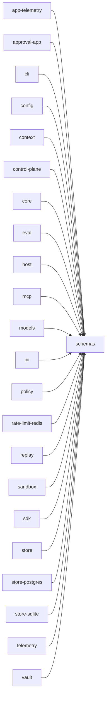
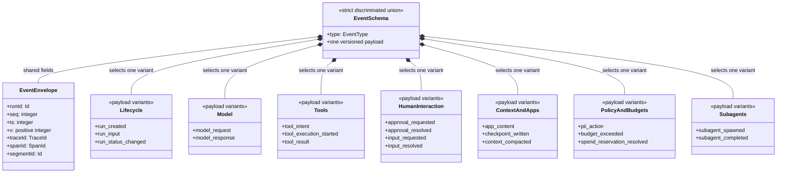
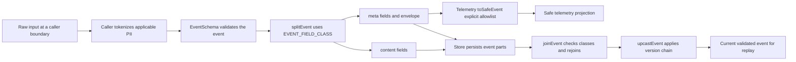

# @rovinos/schemas

<!-- package-readme: v1 -->

## Purpose

`@rovinos/schemas` is the harness’s shared contract library. It defines strict Zod schemas and inferred TypeScript types for run events, model messages, configuration fragments, MCP Apps payloads, and other data that crosses package boundaries, so producers and consumers agree on validated shapes.

## Where it fits

<!-- BEGIN GENERATED: readme-deps (yarn gen:readmes) -->

<!-- END GENERATED: readme-deps -->

This package is an internal leaf with no internal dependencies: other harness packages may depend on it, and it imports no other `@rovinos/*` package. It is not a separately published API. The published `@rovinos/sdk` and `@rovinos/cli` bundle their internal workspace imports, including schemas. The dependency direction and publishing policy are maintained in `docs/engineering/layers.json` and `docs/decisions/0001-publish-surface.md`.

## How it works

`EventSchema` is a strict discriminated union. Every event has a common envelope and a versioned payload selected by `type`; the family boxes below group variants for readability and are not separate exported schemas. `EVENT_FIELD_CLASS` classifies each payload field as `meta` or `content`, and its exhaustiveness check makes an unclassified field a test failure.



The field class guides how event data is separated and consumed. Tokenization happens at the caller’s PII boundary, not in this package. Stores use the separated values, telemetry projects only its own explicit safe-event allowlist, and replay reassembles and upcasts stored events before validating the current schema.



`splitEvent` and `joinEvent` do not tokenize, encrypt, or decide telemetry safety. `joinEvent` rejects duplicate or misclassified fields, then delegates to event upcasting and validation. See `src/events.ts`, `src/event-versions.ts`, and `src/classification.ts` for the event contract, migrations, and classification map; telemetry’s projection is implemented in `packages/telemetry/src/safe-event.ts`.

## Public API

This is a private workspace package rather than a supported npm import surface. Within the repository, `src/index.ts` exports event and snapshot contracts, primitives, parser helpers, model messages, configuration fragments, and CLI and app payload schemas. `src/browser.ts` is the browser-safe subpath; it exposes app-facing schemas and excludes the Node-oriented external JSON Schema compiler. Browser consumers should use `@rovinos/schemas/browser`.

`parseJson` and `parseYaml` are the bounded text entry points: each parses untrusted text, validates it with the supplied Zod schema, and returns the inferred type. Both enforce a default 1 MiB UTF-8 limit and report failures as value-free `ContractError`s; `safeParseJson` returns JSON contract failures as a result instead of throwing.

`Id` validates a ULID, `Code` a bounded lowercase code, and `Traceparent` a W3C version-00 traceparent. Schemas are strict Zod contracts, with inferred types exported where applicable:

```ts
import { EventSchema, parseJson, RunStatus, splitEvent } from "@rovinos/schemas";

const event = EventSchema.parse({
  runId: "01H00000000000000000000000",
  seq: 1,
  ts: 1_800_000_000_000,
  v: 1,
  traceId: "0123456789abcdef0123456789abcdef",
  spanId: "0123456789abcdef",
  segmentId: "01H00000000000000000000000",
  type: "run_status_changed",
  from: "pending",
  to: "running",
  reason: "scheduler_started",
});
const parts = splitEvent(event);
const status = parseJson(RunStatus, '"running"');
```

For browser-safe app contracts, use the browser subpath, for example `ApprovalAppInputSchema` or `InputAnswerRequestSchema`. Provider-neutral `MessageSchema`, `ModelRequestSchema`, and `ModelResponseSchema` describe model messages and are exported from the package root. The defining files are `src/messages.ts`, `src/approval-tools.ts`, and `src/app-span.ts`.

## Inputs and outputs

| Boundary | Comes in | Goes out | Tokenization at this boundary |
| --- | --- | --- | --- |
| Event validation | An event-shaped value | A validated `Event` with a strict envelope and payload | None; callers must apply any required PII tokenization before recording content. |
| Event classification | A validated `Event`, or separate meta/content records | `splitEvent` returns classified records; `joinEvent` validates the merged, upcast event | None; classification is not redaction or encryption. |
| JSON and YAML parsing | Untrusted text and a Zod schema | Inferred, validated data or a value-free `ContractError` | None; parsing does not remove sensitive values. |
| Model contracts | Provider-neutral request, response, message, or tool values | Strict message and model-contract values | None; message text and tool data can contain content and must be handled by the caller. |
| Configuration fragments | Config-shaped objects or text passed to a parser | Validated config-fragment types | None; secret resolution and environment overrides belong to `@rovinos/config` and runtime callers. |
| Browser app contracts | Approval, human-input, or app-span values | Validated browser-safe payloads | None; validation does not sanitize values or replace host authorization. |

`src/primitives.ts` supplies `Id`, `Code`, `TraceId`, `SpanId`, `Traceparent`, `Sha256Hex`, and related schemas. `src/parse.ts` bounds text input and reports paths and codes without retaining parser messages or submitted values. These contracts do not perform storage, encryption, PII detection, or authorization.

## Configuration, telemetry and errors

The package exports config fragments for run and budget settings, model providers and routing, stores and retention, keys, vaults, PII, policy and approvals, telemetry, servers, roles, quotas, sandboxing, deployment, control plane, host, elicitation, CLI attribution, rate limits, and tool profiles. Examples of keys owned by these fragments include `run.budgets.maxSteps`, `models.providers`, `store.retention`, `pii.enabled`, `policy.approvals`, and `telemetry.metrics.enabled`. The schemas validate fragments; they do not load configuration files or read environment variables. `@rovinos/config` handles `HARNESS_CONFIG` and `HARNESS__...` overrides; see the [configuration guide](../../docs/configuration.md).

This package defines no telemetry spans or metrics. `AppSpanSchema` validates the bounded UI span records accepted from MCP Apps; it does not emit them. Event metadata classification is not itself a telemetry allowlist: `@rovinos/telemetry` creates safe events from an explicit projection. See the [telemetry attribute catalog](../../docs/telemetry/attribute-catalog.md) and [telemetry guarantees](../../docs/telemetry/guarantees.md).

`ContractError` has stable code `contract_invalid`; its issues carry paths and codes only. Parser failures use codes such as `invalid_json`, `invalid_yaml`, and `size_limit_exceeded`. `RateLimitStoreUnavailableError` uses `rate_limit_store_unavailable`. Spend-reservation consumers can validate the closed `SpendReservationErrorCodeSchema` set: `spend_reservation_invalid`, `spend_reservation_conflict`, `spend_reservation_not_found`, `spend_reservation_transition_invalid`, `spend_reservation_quota_exceeded`, `spend_reservation_pricing_missing`, `spend_reservation_estimate_missing`, `spend_reservation_usage_incomplete`, `spend_reservation_uncertain`, `spend_reservation_worker_lease_expired`, and `spend_reservation_storage_unavailable`. See `src/parse.ts`, `src/errors.ts`, `src/rate-limit.ts`, and `src/spend-reservation.ts`.

## Security and privacy

The schemas package is responsible for strict runtime shape validation, event-field classification, parser byte limits, and value-free contract errors. Its strict objects reject unknown fields, and the classification exhaustiveness test requires every event payload field to have a class. New event fields default to `content`; only values explicitly classified as metadata should be considered for downstream safe projections.

The package does not detect or tokenize PII, encrypt content, authorize actions, or guarantee that a schema-valid value is safe to disclose. Callers must tokenize content at the appropriate boundary and enforce storage, telemetry, UI, and authorization policy. Content may still be sensitive even when it is valid or tokenized. See [PII and telemetry guarantees](../../docs/telemetry/guarantees.md) and [the no-telemetry runbook](../../docs/runbooks/no-telemetry.md).

## Testing

Schemas package tests are unit tests, including round trips, event-field classification exhaustiveness, and primitive validation tables. Run them with `yarn test:unit packages/schemas`; GitHub Actions runs them in the `unit` job. The README, relative-link, and Mermaid checks run in the `static` job and can be run locally with `yarn check:readmes`, `yarn check:links`, and `yarn check:mermaid`. No schemas-specific integration, canary, or replay test files are defined.

## Related docs

- [Configuration](../../docs/configuration.md)
- [Telemetry guarantees](../../docs/telemetry/guarantees.md)
- [Telemetry attribute catalog](../../docs/telemetry/attribute-catalog.md)
- [No-telemetry runbook](../../docs/runbooks/no-telemetry.md)
- [Human input](../../docs/human-input.md)
- [MCP Apps UX](../../docs/apps-ux.md)
- [Published package boundaries](../../docs/decisions/0001-publish-surface.md)
