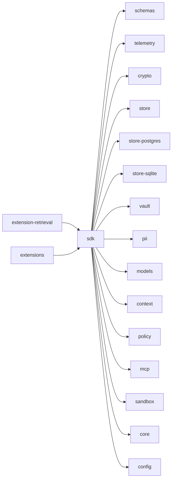
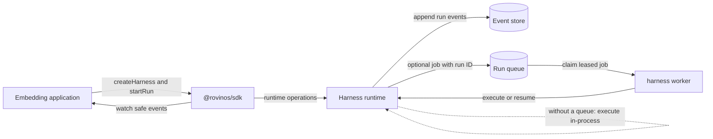
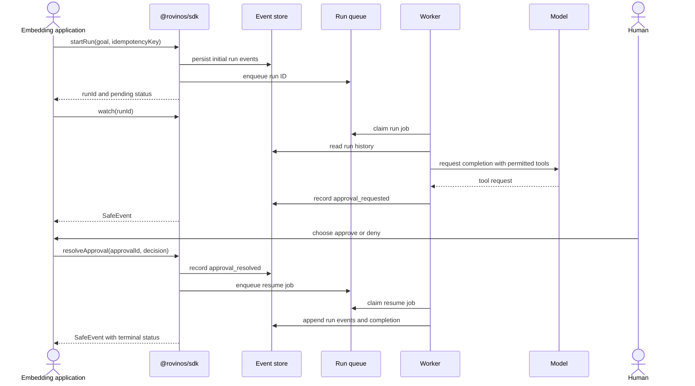

# @rovinos/sdk

<!-- package-readme: v1 -->

<!-- BEGIN GENERATED: readme-deps (yarn gen:readmes) -->

<!-- END GENERATED: readme-deps -->

## Purpose

`@rovinos/sdk` is the stable programmatic interface for embedding Rovinos in an application. It creates a validated harness runtime and provides run lifecycle, safe event, approval, and human-input operations without exposing the internal implementation packages as separate APIs.

## Where it fits

The SDK sits between an embedding application and the harness runtime. It composes the event store, PII handling, model gateway, policy engine, MCP client, sandbox, and run loop; the event log remains the source of truth for run state. The SDK is the published programmatic API, while its internal implementation packages are bundled rather than independently imported by applications.

MCP server onboarding uses the harness configuration and existing CLI and policy surfaces; ordinary MCP use does not require an extension or per-tool routing glue. The SDK is the public API, its internal helpers and implementations are bundled, and optional application extensions are separate from both. Extensions do not replace the runtime’s policy, approval, or privacy boundaries.

## How it works

Without a durable queue, the runtime continues execution in-process. With a queue, the event store records the run input before a job is queued; queue rows contain identifiers and scheduling metadata, and workers execute or resume runs against the event log.



In the queued path, a run may suspend for a policy approval. The application resolves the human decision through the SDK; the queue can then schedule a worker to resume the run.



## Public API

Import the supported surface from `@rovinos/sdk`. The factory is `createHarness`; its returned `Harness` supports `startRun`, `continueRun`, `resumeRun`, `cancelRun`, `getRun`, `listRuns`, `watch`, `getRunContent`, `resolveApproval`, `answerInput`, and `close`. The package also exports the related option and result types, `Principal` and `PrincipalSchema`, `SafeEvent`, `InputResolutionResultSchema`, and `SdkError`.

```ts
import { createHarness } from "@rovinos/sdk";

const harness = await createHarness({ configPath: "harness.config.yaml" });
const { runId } = await harness.startRun({
  goal: "Summarize the synthetic project status.",
  idempotencyKey: "synthetic-status-summary",
});
const run = await harness.getRun(runId);
// `run` contains metadata and safe events, not message content.
await harness.close();
```

`startRun` returns after the initial events are durable; without a queue, execution continues detached in-process. `continueRun` and `resumeRun` wait for execution to finish or suspend. With a queue, run jobs are processed by `harness worker` using the same store configuration. See the [worker guide](../../docs/workers.md) for lease and shutdown behavior.

Idempotency keys apply to `startRun` and deduplicate requests across harness instances sharing a store, including after restarts. Use opaque, non-sensitive keys: the store retains a domain-separated, unsalted SHA-256 hash, so low-entropy keys may be guessed.

For an MCP-backed run, add the server and its `toolAllowlist` to configuration, inspect reachability and authorization with `harness doctor` (and use `harness servers login` for an authorization-code session), then restrict the role’s tools and configure policy. The model uses the permitted tools through the runtime; policy decisions of `ask` suspend the run for a human. Resolve that approval with `resolveApproval`, answer a human-input request with `answerInput`, inspect safe run events with `getRun` or `watch` and metadata-only telemetry through the configured exporter, then close the harness. The SDK does not expose a separate MCP registration API.

The exported declaration surface is guarded by the snapshot in `src/__golden__/public-api.d.ts.snap` and `src/public-api.test.ts`; public API changes should update that snapshot.

## Inputs and outputs

| Boundary | Comes in | Goes out | Tokenization |
| --- | --- | --- | --- |
| Harness creation | A validated config object or config path, plus optional runtime overrides | A `Harness` instance | Secret references are resolved by configuration/runtime adapters; do not put secret values in configuration files. |
| Run start or continuation | Goal, optional metadata, role, requester principal, and (for start) an idempotency key | Run ID and status | Run content is tokenized at the applicable PII boundary before it is stored or sent to a model. Metadata is restricted to codes, numbers, and booleans. |
| Run reads and subscriptions | Run ID, filters, cursor, or watch sequence | Metadata summaries, usage totals, approval IDs, and `SafeEvent`s | Safe events omit content; requester and approver principals are excluded by default and pseudonymized when correlation is enabled. |
| Approval or human-input resolution | Decision or schema-validated answer, plus a principal | Metadata-only resolution result | Accepted human-input content is tokenized before durable recording. Approval edits pass through runtime tool validation. |
| Explicit content read | Run ID and `{ reveal: false }` | Content fields projected from stored events | Values remain tokenized and are sensitive; this operation never detokenizes them and requires PII to be enabled. |
| Queue and worker | Run IDs and scheduling/lease data | Claimed jobs and execution outcomes | Queue rows contain identifiers and scheduling metadata, not run input or message content. |

## Configuration, telemetry and errors

`createHarness` accepts either a validated `config` object or `configPath`. Configuration file selection can also use `HARNESS_CONFIG`; nested `HARNESS__...` environment values override file values. Common SDK-related settings include `run.autoResume`, `run.shutdownGraceMs`, `pii.enabled`, `telemetry.correlation.enabled`, and `telemetry.metrics.enabled` / `telemetry.metrics.ownership`. MCP servers, tool exposure, policy, model routes, and store selection are configured in the harness config. The [configuration guide](../../docs/configuration.md) documents all keys and secret references.

The SDK defines no SDK-specific spans or metrics. Its runtime uses registered spans such as `harness.run`, `harness.model_call`, `harness.tool_call`, `harness.approval_wait`, and `harness.input_wait`; metric names and allowed attributes are listed in the [telemetry attribute catalog](../../docs/telemetry/attribute-catalog.md). OTLP metric export uses `OTEL_EXPORTER_OTLP_METRICS_ENDPOINT` or `OTEL_EXPORTER_OTLP_ENDPOINT`. `close()` releases runtime resources, including SDK-managed telemetry resources.

`SdkError` exposes a closed code set: `sdk_run_not_found`, `sdk_closed`, `sdk_content_unavailable`, `sdk_input_unavailable`, and `sdk_input_ambiguous`. Input and configuration validation may also fail at their respective schema boundaries; errors must be handled by code, not by inspecting untrusted messages.

## Security and privacy

The SDK validates public operation inputs, returns metadata and safe events by default, tokenizes accepted human-input content before storage, and makes content access an explicit operation. A run’s `requestedBy` principal is recorded as metadata, not an authorization mechanism; authorization comes from policy and human decisions. `getRunContent` returns tokenized values that should still be treated as sensitive. The application is responsible for authenticating its users and supplying the correct principal and policy.

Idempotency hashes are unsalted, so keys must not contain secrets or low-entropy personal data. PII detection and tokenization are boundary controls, not a guarantee that every sensitive value will be detected; see the documented [telemetry guarantees and known gaps](../../docs/telemetry/guarantees.md). Multi-instance deployments require the configured Postgres-backed store, vault, and queue; startup validation enforces this requirement.

## Testing

Run the SDK unit tests with `yarn test:unit packages/sdk`. The package also has a Postgres idempotency integration test and a safe-watch canary test; run them with `yarn test:integration packages/sdk` and `yarn test:canary packages/sdk`. GitHub Actions runs unit tests in the `unit` job, integration tests in `integration`, and canary checks in `gates`. The repository’s packed-package smoke test also installs the SDK outside the workspace, checks the public SDK documentation examples’ types, and runs them.

## Related docs

- [Public SDK guide](../../docs/sdk.md)
- [Configuration](../../docs/configuration.md)
- [MCP server setup and authorization](../../docs/mcp-servers.md)
- [Policy and tool authorization](../../docs/policy.md)
- [Workers and queues](../../docs/workers.md)
- [Telemetry guarantees](../../docs/telemetry/guarantees.md)
- [Telemetry attribute catalog](../../docs/telemetry/attribute-catalog.md)
- [Telemetry collector and export](../../docs/telemetry/collector.md)
- [Published package boundaries](../../docs/decisions/0001-publish-surface.md)
