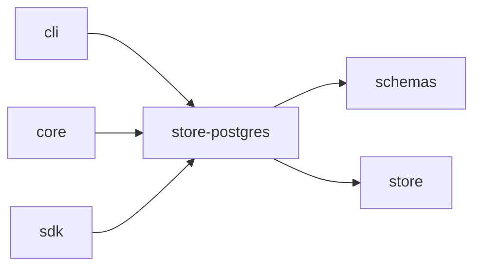
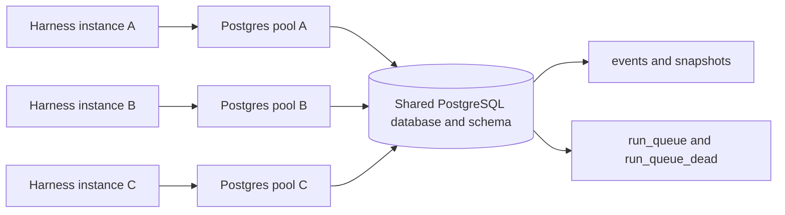

# @rovinos/store-postgres

<!-- package-readme: v1 -->
<!-- BEGIN GENERATED: readme-deps (yarn gen:readmes) -->

<!-- END GENERATED: readme-deps -->

## Purpose

`@rovinos/store-postgres` provides durable PostgreSQL adapters for the harness event store, run
queue, and rate-limit store. It lets multiple harness workers coordinate through shared database
state, while keeping event validation, sequence checks, queue leases, and transactional usage
updates in the persistence layer.

## Where it fits

This package implements contracts from `@rovinos/store` and uses shared identifiers and event
schemas from `@rovinos/schemas`. The generated dependency diagram below shows its allowed imports
and known consumers. It sits below the runtime so storage-specific SQL and migrations remain
separate from run orchestration. A multi-instance deployment also needs the Postgres vault and a
configured run queue; see [deployment guidance](../../docs/deployment.md).

## How it works

Each store or queue instance owns a connection pool, but instances configured with the same
connection URL and schema share durable tables. Event appends lock the run row, compare its
`next_seq` with the caller's `expectedSeq`, and commit the event batch and related state in one
transaction. Queue workers claim eligible rows with `FOR UPDATE SKIP LOCKED`, so concurrent
workers do not lease the same job. The migrations create the event, snapshot, usage, queue,
reservation, and rate-limit tables; queue jobs move to `run_queue_dead` after their attempts are
exhausted.



For two writers appending to the same run, the row lock serializes the sequence check. The second
writer receives `seq_conflict` if its expected sequence became stale while it waited.

```mermaid
sequenceDiagram
  participant A as Instance A
  participant B as Instance B
  participant DB as PostgreSQL
  A->>DB: append(runId, expectedSeq=N)
  DB->>DB: lock run row; next_seq is N
  B->>DB: append(runId, expectedSeq=N)
  Note over B,DB: B waits for the same run row
  DB->>DB: commit A's batch; next_seq becomes N+1
  DB-->>A: append succeeds
  DB->>DB: lock row for B; read next_seq N+1
  DB-->>B: seq_conflict(expected=N, actual=N+1)
```

## Public API

The package is published as `@rovinos/store-postgres`. Its root entry point exports
`PostgresEventStore` and `PostgresEventStoreOptions`, `openPostgresEventStore`,
`migratePostgresConnection` and `StoreFileMigrationOptions`, `PostgresRunQueue`,
`PostgresRateLimitStore`, and `PostgresRateLimitStoreError`.

The examples use a synthetic local database URL and run identifier. In production, pass a
secret-resolved connection URL from the caller's configuration.

```ts
import { Id } from "@rovinos/schemas";
import {
  PostgresEventStore,
  PostgresRunQueue,
  migratePostgresConnection,
} from "@rovinos/store-postgres";

const databaseUrl = "postgresql://localhost/harness";
const runId = Id.parse("00000000000000000000000001");

await migratePostgresConnection(databaseUrl);
const store = new PostgresEventStore(databaseUrl, { schema: "harness", poolSize: 8 });
const nextSeq = await store.head(runId);
await store.close();

const queue = new PostgresRunQueue(databaseUrl, { schema: "harness", maxAttempts: 5 });
const job = await queue.enqueue({ kind: "start", runId });
await queue.close();
```

`PostgresRateLimitStore.take(key, limit, cost?)` applies an atomic token-bucket update using
PostgreSQL time. `migratePostgresConnection(url, { dryRun: true })` returns pending migrations
without applying them.

## Inputs and outputs

| Boundary | Comes in | Goes out | Tokenized or protected values |
| --- | --- | --- | --- |
| Event store | Schema-validated events, snapshots, run IDs, and sequence numbers | Stored event metadata and content, run summaries, snapshots, and typed conflicts | Event content is encoded by the configured `ContentCodec`; the default `JsonContentCodec` does not encrypt. This package does not tokenize content. |
| Run queue | Validated job kind, run ID, scheduling and retry values, and optional idempotency key | Leased job metadata, retry/dead-letter results, and queue status | Optional idempotency keys are SHA-256 hashed before storage. Other values are not tokenized here. |
| Rate-limit store | A `Code` key, capacity, refill rate, and optional cost | Whether the request is allowed, remaining tokens, and retry delay | The key is persisted as supplied; callers must use a non-sensitive code or token. |
| Migration helper | A secret-resolved PostgreSQL URL and optional dry-run/timestamp options | Applied or pending migration version strings | Connection credentials are used to connect and are not written to store tables by the helper. |

Event metadata and content are stored separately. If event content can contain personal or
sensitive data, tokenize it before calling this package; encryption at rest is a separate choice
from tokenization.

## Configuration, telemetry and errors

`PostgresEventStore` accepts a PostgreSQL connection URL and these options: `poolSize` (1–100,
default 10), `schema` (default `public`), `snapshotKeep` (default 5), and `skipMigrations`
(default `false`; validates that migrations are current and rejects writes). The worker helper
`openPostgresEventStore` accepts the connection URL, pool size, snapshot retention, and schema.
`PostgresRunQueue` accepts `poolSize` (1–100, default 10), `schema` (`public`), `maxAttempts`
(default 5), and `readOnly` (default `false`; skips automatic migrations). The rate-limit store
accepts pool size and schema. The migration helper accepts `dryRun` and optional `appliedAt`.

The package does not read production environment variables; callers supply connection URLs.
`TEST_POSTGRES_URL` is used by the package's integration tests only.

No harness spans or metrics are defined here. PostgreSQL `NOTIFY` on `harness_events` is an
internal event-store wake-up signal, not exported telemetry. Errors use the closed contracts from
the store and schema packages, including `seq_conflict`, `run_execution_lease_lost`,
`event_invalid`, `store_unavailable`, `store_read_only`, `store_encryption_mismatch`,
`content_decrypt_failed`, `key_not_found`, `quota_exceeded`, migration codes
`migration_checksum_mismatch`, `migration_set_invalid`, `schema_migration_pending`, and
`schema_newer_than_code`, plus `rate_limit_store_unavailable` and `run_queue_input_invalid`.
Spend-reservation operations preserve the `spend_reservation_*` codes defined by the shared store
contract.

## Security and privacy

All SQL values are parameterized, and configured schema names are validated before being added to
the pool search path. Event and queue inputs are schema-validated. The adapter does not log
connection details or export event content as telemetry. Queue idempotency keys are stored only as
hashes. Event content encryption depends on the caller-supplied codec; the default codec stores
content without encryption. This package does not detect or tokenize PII, sanitize caller-provided
metadata, or encrypt the database connection itself. Apply tokenization upstream, use a protected
connection and database, and configure an encrypted codec and key provider when at-rest content
encryption is required. See [store content encryption](../store/README.md#security-and-privacy)
and [secret handling](../../docs/secrets.md).

## Testing

Unit tests run with the `unit` test project; PostgreSQL-backed conformance tests run with the
`integration` project and require the Compose PostgreSQL service. The integration suites exercise
the shared event-store, concurrency, watch, and spend-reservation conformance contracts, as well as
the run-queue and rate-limit conformance contracts.

```sh
yarn test:unit packages/store-postgres
yarn test:integration packages/store-postgres
```

## Related docs

- [Event-store package](../store/README.md)
- [Deployment and multi-instance mode](../../docs/deployment.md)
- [Deployment recovery](../../docs/deployment-recovery.md)
- [Quotas and spend limits](../../docs/quotas.md)
- [Configuration](../../docs/configuration.md)
- [Secrets](../../docs/secrets.md)
