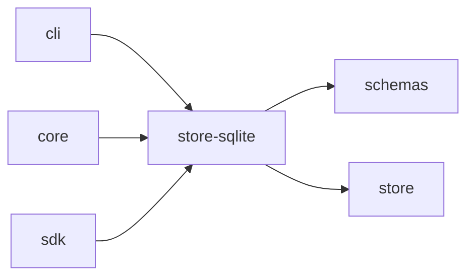
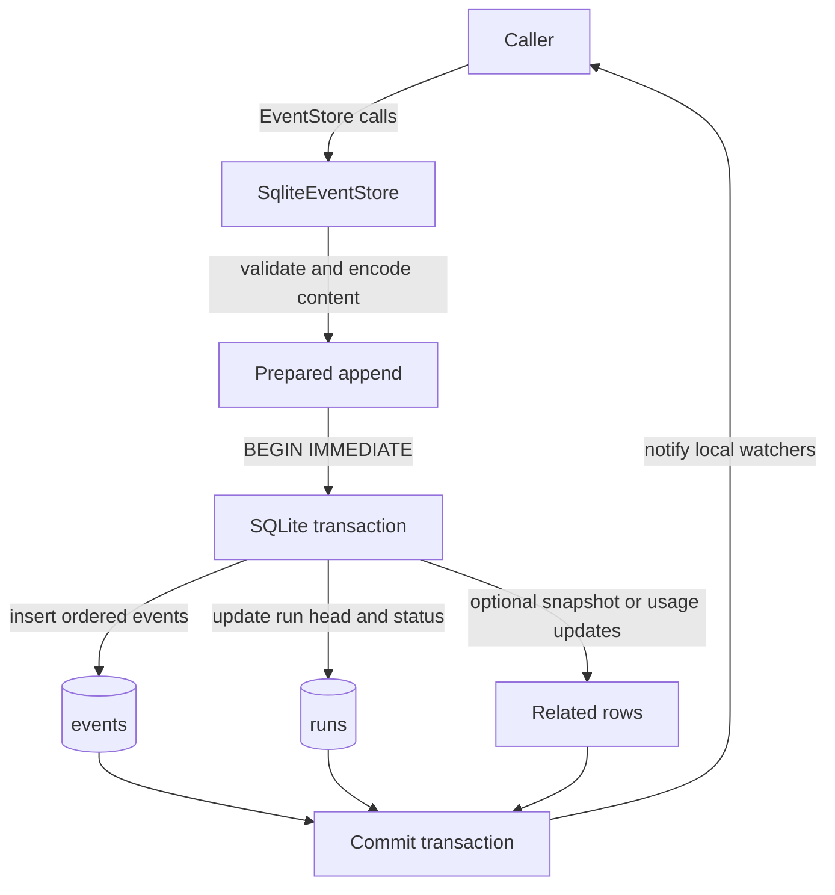
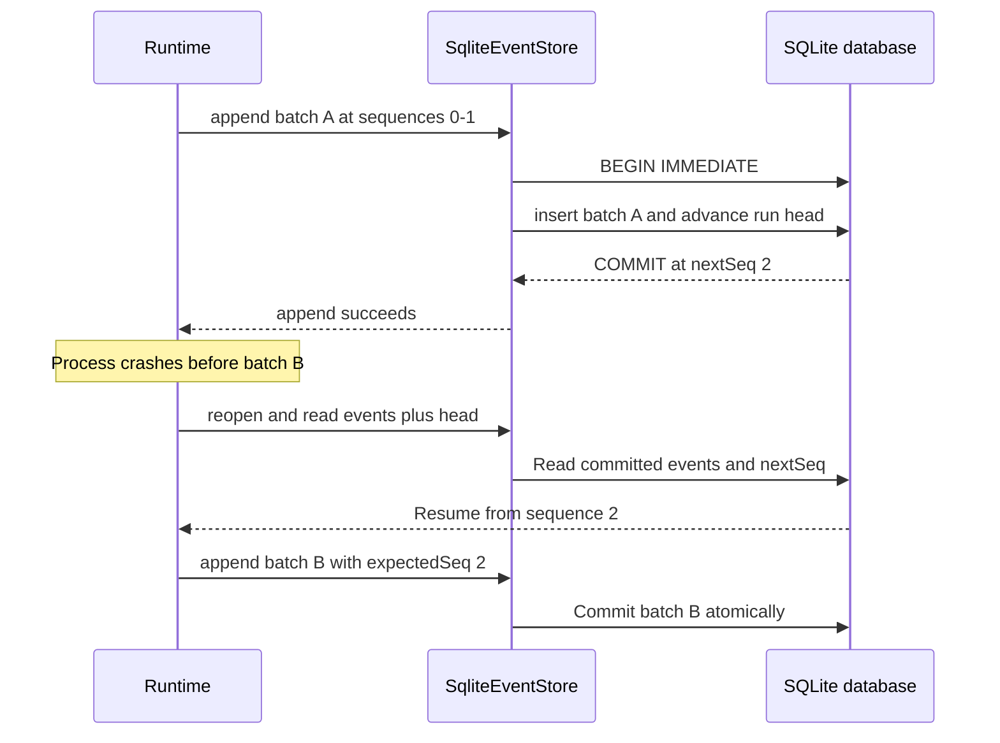

<!-- package-readme: v1 -->

<!-- BEGIN GENERATED: readme-deps (yarn gen:readmes) -->

<!-- END GENERATED: readme-deps -->

# @rovinos/store-sqlite

## Purpose

`@rovinos/store-sqlite` is the published SQLite adapter for the harness event store and run queue.
It persists ordered run events, snapshots, queue state, usage records, and related coordination data
in SQLite files, while implementing the contracts defined by `@rovinos/store`.

## Where it fits

This package is the database-specific adapter at the persistence layer. It depends only on
`@rovinos/schemas` and `@rovinos/store`; SDK and CLI callers select it when they want a local
single-instance store rather than the Postgres adapter.

## How it works

The adapter implements the shared event-store contract. It validates and encodes event content
before opening a write transaction, then atomically writes event rows and updates the run head. With
`appendWithSnapshot` or `appendWithUsage`, the snapshot or usage-ledger changes join the same
transaction. The shared store package supplies the contract and conformance scenarios; SQLite owns
the database representation and transactions.



Each append batch is all-or-nothing. If the process stops before commit, SQLite rolls the
transaction back and the next reader sees the previous committed sequence. A committed append is
available to the next process that opens the database. The store does not recreate a lost
in-memory run; the caller reads the log and head, then resumes from the committed sequence.



Writable connections use WAL mode and `synchronous=NORMAL`, with a 5-second busy timeout. SQLite
can recover a transaction interrupted by a process crash; with `NORMAL`, a sudden power loss can
still lose a recent committed transaction. The adapter does not provide backups or a
power-loss-proof durability guarantee. The append transaction and connection setup are in
[`src/sqlite/append-writer.ts`](src/sqlite/append-writer.ts) and
[`src/sqlite/connection.ts`](src/sqlite/connection.ts).

For single-instance deployments, `openSqliteInstanceHeartbeat` acquires an exclusive lock for the
database path and maintains a heartbeat in an adjacent SQLite file. The helper returns `undefined`
when another live owner holds the lock; if ownership can no longer be proved, the returned signal
aborts so the runtime can stop writes.
This is local file coordination, not a distributed lock. The implementation is in
[`src/instance-heartbeat.ts`](src/instance-heartbeat.ts); the SDK owns when to use it.

Writable opens apply ordered, checksummed SQL migrations transactionally. Read-only opens do not
modify the database and fail if migrations are pending. `migrateSqliteFile` can apply migrations
explicitly or list pending versions in dry-run mode. The migration runner is in
[`src/migrate-file.ts`](src/migrate-file.ts), and SQL files live in [`migrations/sqlite/`](migrations/sqlite/).

## Public API

The published entry point in [`src/index.ts`](src/index.ts) exports `SqliteEventStore`,
`SqliteRunQueue`, `migrateSqliteFile`, `openSqliteInstanceHeartbeat`, and the related option and
handle types. Callers import `ContentCodec` implementations such as `JsonContentCodec` and
`AesGcmContentCodec` from `@rovinos/store`.

Open an event store and inspect a synthetic run:

```ts
import { Id } from "@rovinos/schemas";
import { SqliteEventStore } from "@rovinos/store-sqlite";

const runId = Id.parse("00000000000000000000000001");
const store = new SqliteEventStore("./data/events.sqlite");

try {
  const nextSeq = await store.head(runId);
} finally {
  await store.close();
}
```

Check for pending migrations without changing a database:

```ts
import { migrateSqliteFile } from "@rovinos/store-sqlite";

const pendingVersions = migrateSqliteFile("./data/events.sqlite", { dryRun: true });
```

For encrypted content, pass an `AesGcmContentCodec` from `@rovinos/store` as the second
`SqliteEventStore` argument, with a configured key provider. The encryption mode is recorded when
the database is first opened and cannot later be changed in place. See the
[`@rovinos/store` README](../store/README.md) for codec and key-provider details.

## Inputs and outputs

| Boundary | Comes in | Goes out | Tokenization at this boundary |
| --- | --- | --- | --- |
| Event-store append | Schema-typed events, run IDs, expected sequence, and optional snapshot or usage updates | Committed event rows, updated run head/status, and the next sequence | User-derived content must already be tokenized by the caller. The adapter validates and stores it but does not tokenize or detokenize. |
| Event-store read | Run ID and optional sequence range | Schema-validated events and snapshots with decoded content | Tokens remain tokens; the adapter does not resolve them through the vault. |
| Run queue | Run IDs and queue options, including an optional idempotency key | Queue jobs, claims, and dead-letter records | The queue hashes idempotency keys before persistence; callers should supply tokenized identifiers and error codes, not raw user content. |
| Migration and heartbeat helpers | SQLite paths, migration options, and an instance ID/time source | Applied or pending migration versions, or a heartbeat handle | These helpers do not process user content. |

Event metadata and run identifiers remain queryable in SQLite. Event content is kept separately
through a codec: the default JSON codec is not encrypted, while an encrypted codec protects content
blobs but not database metadata. See [`src/sqlite/event-encoding.ts`](src/sqlite/event-encoding.ts)
and [`src/sqlite/serialization.ts`](src/sqlite/serialization.ts).

## Configuration, telemetry and errors

`SqliteEventStore(path, codec?, options?, clock?)` takes a database path or `:memory:`, an optional
content codec, store options, and an optional clock. The options are `readOnly` (default `false`),
`snapshotKeep` (default `5`), and `pollIntervalMs` (default `250`; minimum `1`) for observing writes
made through another adapter instance. No environment variables are read by this package.

`SqliteRunQueue(path, options?, clock?, ids?)` accepts `maxAttempts` (default `5`) and `readOnly`
(default `false`). `migrateSqliteFile(path, options?)` accepts `dryRun` (default `false`) and
`appliedAt`. `openSqliteInstanceHeartbeat` accepts `databasePath`, `instanceId`, an injected `now`
function, and `heartbeatIntervalMs` (default `10000`).

This package defines no telemetry spans or metrics. It persists event trace identifiers for callers
and downstream telemetry, but does not emit telemetry itself.

Typed store errors use the closed codes from `@rovinos/store`: `event_invalid`, `seq_conflict`,
`run_execution_lease_lost`, `quota_exceeded`, `store_unavailable`, `store_read_only`,
`content_encrypt_failed`, `content_decrypt_failed`, `key_not_found`, and
`store_encryption_mismatch`. Queue input validation uses `run_queue_input_invalid`; queue failure
labels are caller-provided `Code` values, not an adapter-owned closed set. Migration failures use
`migration_checksum_mismatch`,
`migration_set_invalid`, `schema_migration_pending`, or `schema_newer_than_code`. Spend-reservation
codes are `spend_reservation_invalid`, `spend_reservation_conflict`, `spend_reservation_not_found`,
`spend_reservation_transition_invalid`, `spend_reservation_quota_exceeded`,
`spend_reservation_pricing_missing`, `spend_reservation_estimate_missing`,
`spend_reservation_usage_incomplete`, `spend_reservation_uncertain`,
`spend_reservation_worker_lease_expired`, and `spend_reservation_storage_unavailable`. SQLite busy
errors are normalized to `store_unavailable`; errors are defined in
[`@rovinos/store`](../store/src/errors.ts) and its queue contract.

## Security and privacy

The adapter separates queryable metadata from codec-encoded event and snapshot content, supports
opt-in content encryption, validates stored JSON on read, and records only hashed queue
idempotency keys. Encryption keys are provided by the caller and are not stored in the database.
The caller is responsible for tokenizing user-derived content before storage; the adapter does not
verify that content contains tokens. With the default JSON codec, content blobs are plaintext.
Metadata, database files, WAL files, and backups require appropriate filesystem permissions and
operator-managed backup and key-retention practices.

## Testing

Run the package's unit tests, including the shared plaintext and encrypted event-store conformance
suites, queue conformance, concurrency, and spend-reservation scenarios:

```sh
yarn test:unit packages/store-sqlite
```

These `*.test.ts` suites run in the GitHub Actions `unit` job. The event-store and queue scenarios
are imported from `@rovinos/store/testing`; package-specific setup is in
[`src/sqlite.conformance.test.ts`](src/sqlite.conformance.test.ts) and
[`src/queue/sqlite.conformance.test.ts`](src/queue/sqlite.conformance.test.ts).

## Related docs

- [`@rovinos/store` contract and codec guide](../store/README.md)
- [Store configuration](../../docs/configuration.md)
- [Deployment recovery and migration limits](../../docs/deployment-recovery.md)
- [Published package boundaries](../../docs/decisions/0001-publish-surface.md)
