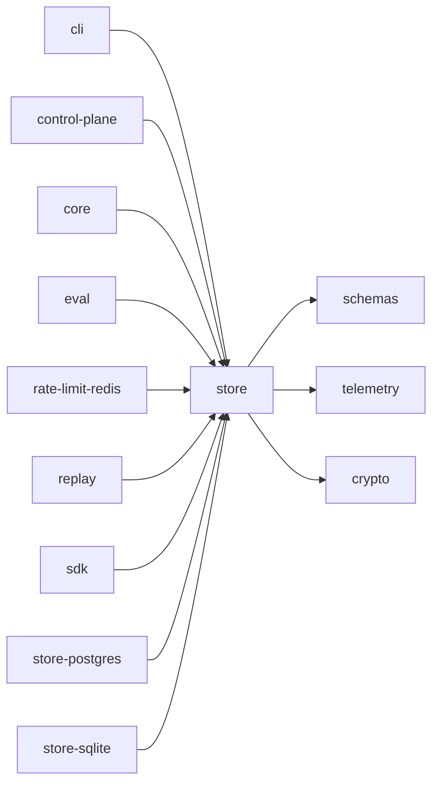
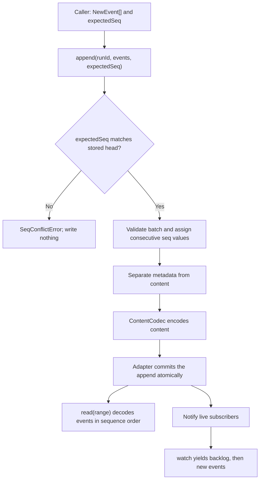
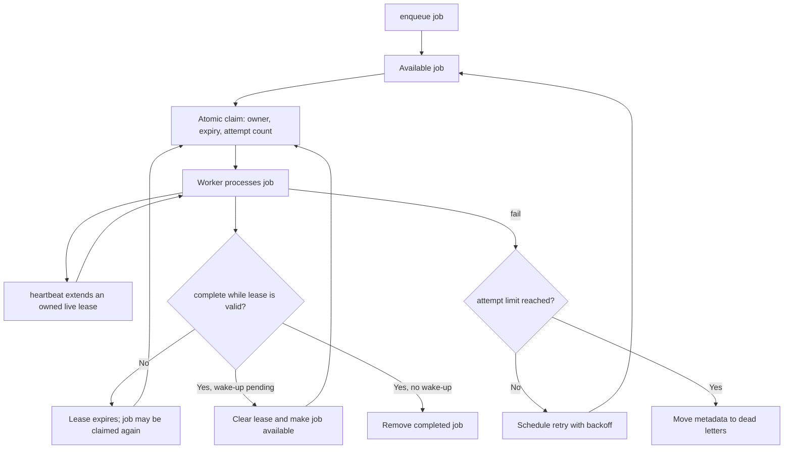

# @rovinos/store

<!-- package-readme: v1 -->
<!-- BEGIN GENERATED: readme-deps (yarn gen:readmes) -->

<!-- END GENERATED: readme-deps -->

## Purpose

`@rovinos/store` defines the validated, append-only event-log contract used to recover and inspect
harness runs. It also provides shared content codecs, an in-memory reference store, snapshot and
outbox behavior, retention helpers, and the run-queue contract used by durable adapters.

## Where it fits

The generated dependency diagram shows this package's allowed imports and workspace consumers.
The package sits between run orchestration and persistence adapters: it owns shared store
semantics, while `@rovinos/store-sqlite` and `@rovinos/store-postgres` own their database-specific
implementations and drivers. Its contract depends on schema types and codecs rather than application
orchestration, so both the SDK and CLI can bundle it without requiring consumers to install an
internal package.

## How it works

An append supplies events without `seq` and the caller's expected next sequence. The store validates
the whole batch, assigns consecutive sequence numbers, stores event metadata separately from
codec-encoded content, and commits atomically. If the actual head differs from `expectedSeq`, the
store raises `SeqConflictError` and writes nothing. Callers should read the head again and make an
explicit decision rather than hiding a conflict in a retry loop.



`read` supports inclusive sequence ranges. `watch(runId, { fromSeq, signal })` first yields stored
events from `fromSeq`, then follows new appends until a terminal status event or abort. `watchRuns`
yields current run summaries and later status transitions, optionally filtered by status. SQLite
uses in-process notifications plus a cross-process polling fallback.



The durable run queues claim available jobs atomically, set an owner and expiry, and increment the
attempt count. A worker can heartbeat its lease. Completion removes the job unless an enqueue during
the lease requested a wake-up, in which case the job is made available again. Failures are retried
with backoff or moved to dead letters when the attempt limit is reached; expired leases can be
claimed by another worker.

Snapshots are written atomically with exactly one matching `checkpoint_written` event. Their
`context` and `plan` use the content codec; the latest and a bounded number of retained snapshots
can be read. Each sink has an independent outbox cursor: `fetchOutbox` returns the next ordered
batch at least once, and `ackOutbox` advances that sink's cursor.

Database schemas evolve through ordered SQL migrations. The migration runner stores each version and
SHA-256 checksum in `schema_migrations`, applies pending migrations transactionally, and rejects
changed checksums or a database newer than the running code. Event payload versions are separate:
`@rovinos/schemas` upcasts old event and snapshot versions when reading; this does not rewrite stored
rows. Open next: [`types.ts`](src/types.ts), [`codec.ts`](src/codec.ts),
[`subscriptions.ts`](src/subscriptions.ts), [`migrate.ts`](src/migrate.ts), and the adapter
migrations in `@rovinos/store-sqlite` and `@rovinos/store-postgres`.

## Public API

This is a private workspace package, not a package to install directly. The published `@rovinos/sdk`
and `@rovinos/cli` bundle internal workspace imports. Consumers selecting durable storage install
one of the separately published adapter packages; see the [published package
surface](../../docs/releasing.md#npm-publish-surface).

The root export provides `EventStore` and its option/result types, `InMemoryEventStore`,
`JsonContentCodec`, `AesGcmContentCodec`, typed store errors, run-queue contracts, spend-reservation
contracts and implementations, retention helpers, and key-rotation types. The `/testing` subpath
exports deterministic event builders and reusable adapter conformance suites. The
`/adapter-internal` subpath is for adapter implementations, not the SDK-facing API.

```ts
import { InMemoryEventStore } from "@rovinos/store";
import { createEventBuilders } from "@rovinos/store/testing";

const store = new InMemoryEventStore();
const builders = createEventBuilders();
const runId = builders.nextRunId();
const { nextSeq } = await store.append(runId, [builders.runCreated(runId)], 0);

for await (const event of store.read(runId, { fromSeq: 0, toSeq: nextSeq - 1 })) {
  // Consume a synthetic event.
}
```

`InMemoryEventStore` is useful for tests and ephemeral runs; use a durable adapter for persistence.
The `ContentCodec` interface allows adapters to encode and decode content independently of event
metadata. `JsonContentCodec` is the default. `AesGcmContentCodec` encrypts content with AES-256-GCM
using a `KeyProvider` from `@rovinos/schemas`.

`RunQueue` adapters expose `enqueue`, `claim`, `heartbeat`, `complete`, `fail`, `release`, and
`getDeadLetter`. `SpendReservationStore` adds atomic reservation, dispatch, settlement, and usage
ledger operations to an `EventStore`; `InMemorySpendReservationStore` is intended for tests, not
durable production storage.

## Inputs and outputs

| Boundary | Comes in | Goes out or is stored | Tokenization at this boundary |
| --- | --- | --- | --- |
| Event append/read | Schema-typed `NewEvent` batches and `expectedSeq`; reads take an optional inclusive `seq` range. | Events with store-assigned `seq`, summaries, snapshots, and typed conflicts. | The caller must tokenize user- or model-derived content before appending. The store validates and separates metadata/content; it does not tokenize. |
| Content codec | Content-classified JSON plus run/sequence context; an optional key ID for re-encryption. | A serialized or encrypted blob, then decoded content on read. | Tokenization remains the producer's responsibility; encryption is not tokenization. |
| Snapshot | A snapshot matching one `checkpoint_written` event. | A bounded retained snapshot with content encoded separately from metadata. | Snapshot context and plan must already contain the intended tokens. |
| Outbox | Sink ID and batch limit; acknowledgement uses the returned cursor. | Ordered decoded events and a per-sink cursor, delivered at least once. | The consumer must apply the appropriate safe projection before export; outbox reads can include event content. |
| Run queue | Job kind, run ID, scheduling/priority options and optional idempotency key. | Queue job and dead-letter metadata; the idempotency key is stored as a SHA-256 hash. | Raw keys are not persisted; the queue stores identifiers, status, timestamps and codes, not prompts or tool payloads. |

## Configuration, telemetry and errors

The host configuration uses `store.dialect` (`sqlite` by default), `store.connectionString` (a
secret reference required for Postgres), optional `store.retention.completedRunsDays` and
`store.retention.failedRunsDays`, and `store.snapshotKeep`. Retention is disabled unless configured;
cancelled runs use the failed-run window. Snapshot retention defaults to five snapshots. SQLite
options also include `readOnly` (default `false`) and `pollIntervalMs` (default `250`); Postgres
options include `poolSize` (default `10`), `schema` (default `public`), and `skipMigrations`
(default `false`). The store packages do not read runtime environment variables directly.
`TEST_POSTGRES_URL` is used by Postgres integration tests.

The store package defines no spans or metrics. Events retain trace and span identifiers and
`findRunsByTrace` supports trace lookup. The retention helper accepts an optional logger whose
fields are restricted to IDs, numbers and booleans.

Package-defined stable error codes are `seq_conflict`, `event_invalid`,
`run_execution_lease_lost`, `store_unavailable`, `store_read_only`, `content_encrypt_failed`,
`content_decrypt_failed`, `key_not_found`, `store_encryption_mismatch`, `migration_checksum_mismatch`,
`migration_set_invalid`, `schema_migration_pending`, `schema_newer_than_code`, `quota_exceeded`,
and `run_queue_input_invalid`. Spend-reservation errors are
`spend_reservation_invalid`, `spend_reservation_conflict`, `spend_reservation_not_found`,
`spend_reservation_transition_invalid`, `spend_reservation_quota_exceeded`,
`spend_reservation_pricing_missing`, `spend_reservation_estimate_missing`,
`spend_reservation_usage_incomplete`, `spend_reservation_uncertain`,
`spend_reservation_worker_lease_expired`, and `spend_reservation_storage_unavailable`. Queue
failure results are `retry`, `dead`, or `lease_lost`; caller-supplied queue error codes are validated
as `Code` values rather than a package enum.

## Security and privacy

Events are schema-validated and split into metadata and content before persistence. The default JSON
codec leaves content unencrypted. When configured, `AesGcmContentCodec` encrypts content and snapshot
content, binding ciphertext to its run and sequence (and snapshot purpose); metadata remains
available in plaintext. Persistent stores keep the selected encryption mode fixed after the first
open. The caller supplies and retains the key provider and required historical keys.

The store does not discover or tokenize personal data. Producers must pass tokenized content and
must not assume encryption prevents exposure through application memory or authorized reads. Queue
idempotency keys are hashed before persistence, but IDs, codes and scheduling metadata remain
visible. Retention skips active runs; deletion from the store and any dependent cleanup hook are not
one transaction. The in-memory implementation is neither durable nor a production persistence
boundary. See the [security guarantees](../../docs/guarantees.md#vault-and-event-log-separation) and
[operational recovery limits](../../docs/deployment-recovery.md#coverage-and-ownership).

## Testing

The shared conformance suites verify append/read, sequence conflicts, snapshots, outbox,
subscriptions, queue behavior, and adapter concurrency. Run core store unit tests with:

```sh
yarn test:unit packages/store
```

The SQLite adapter's unit tests run in the `unit` job with
`yarn test:unit packages/store-sqlite`. Postgres adapter and queue tests run in the `integration` job
with `yarn test:integration packages/store-postgres`; the test database URL is supplied through
`TEST_POSTGRES_URL`. Repository-wide static checks include build, lint and typecheck. The store
package has no separate canary or replay test suite.

## Related docs

- [Harness configuration](../../docs/configuration.md)
- [Security guarantees and known gaps](../../docs/guarantees.md)
- [Operational recovery and migration limits](../../docs/deployment-recovery.md)
- [Published package surface](../../docs/releasing.md#npm-publish-surface)
