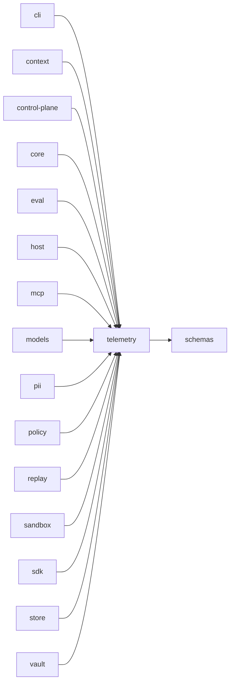
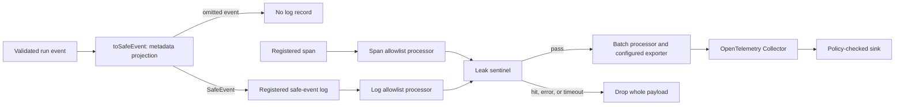

# @rovinos/telemetry

<!-- package-readme: v1 -->

<!-- BEGIN GENERATED: readme-deps (yarn gen:readmes) -->

<!-- END GENERATED: readme-deps -->

## Purpose

`@rovinos/telemetry` is the harness's internal boundary for creating, validating, and exporting traces, logs, and metrics. It provides registered span and log schemas, metadata-only event projection, export processors, a leak sentinel, bounded metric labels, and the sanctioned structured logger.

## Where it fits

This package sits below the runtime packages that define spans, emit safe events, and record metrics. It may import `@rovinos/schemas` and no other `@rovinos/*` package; the generated diagram shows that dependency and its importers. It is private and is bundled into the published `@rovinos/sdk`, not a separate user-facing package.

## How it works

Events are projected to a closed `SafeEvent` schema before becoming log records. Registered spans and log records are rebuilt from their declared attribute shapes, then checked against the sentinel before an exporter receives them. The Collector applies another generated allowlist and sink policy downstream.



The sentinel scans only the sanitized representation. Its fail-closed result prevents the checked span or log record from reaching the downstream exporter; a trip queues bounded metadata, not matched text.

```mermaid
sequenceDiagram
  participant Processor as Allowlist processor
  participant Gate as SentinelGate
  participant Vault as Run-scoped vault view
  participant Queue as TripQueue
  participant Exporter as Downstream exporter
  Processor->>Gate: Check sanitized payload and optional run ID
  Gate->>Vault: Read values for the run or active runs
  Vault-->>Gate: Versioned in-memory values
  Gate->>Gate: Normalize and scan within time and size budgets
  alt No hit and scan completes
    Gate-->>Processor: ok
    Processor->>Exporter: Forward sanitized copy
  else Hit, error, or timeout
    Gate->>Queue: Queue run ID and entity counts only
    Gate-->>Processor: not ok
    Processor->>Processor: Count drop reason
    Note over Processor,Exporter: Drop the entire payload; do not forward partial data
  end
```

The trip queue emits a registered metadata-only `harness.sentinel.trip` log record; that record is not scanned again. Preparation or scan errors and timeouts are treated like a match. See `src/processors/allowlist-span-processor.ts`, `src/processors/allowlist-log-processor.ts`, `src/sentinel/gate.ts`, and `src/sentinel/trips.ts`.

## Public API

The package is internal. Runtime contributors import its supported surface from `@rovinos/telemetry`; application developers use `@rovinos/sdk`, which bundles it. The entry points are listed in `src/index.ts`.

Register a span with attribute schemas built from `attr` helpers, then use the returned definition to create a span. `spanOwner` is validated owner metadata supplied by the defining package.

```ts
import { attr, defineSpan, withSpan } from "@rovinos/telemetry";

const operation = defineSpan(
  "harness.example.operation",
  { "harness.example.outcome": attr.enum(["ok", "error"]) },
  spanOwner,
);

await withSpan(operation, { "harness.example.outcome": "ok" }, async () => {
  // Perform the synthetic example operation.
});
```

Project a previously validated event before emitting it; content-bearing event kinds may return `null`.

```ts
import { emitSafeEventToDefaultLogger, toSafeEvent } from "@rovinos/telemetry";

const safeEvent = toSafeEvent(validatedEvent);
if (safeEvent !== null) {
  emitSafeEventToDefaultLogger(safeEvent);
}
```

Use the sanctioned logger for structured application diagnostics. It accepts a bounded event code and typed scalar fields, not a free-text message.

```ts
import { createLogger } from "@rovinos/telemetry";

const logger = createLogger();
logger.info("worker_finished", { "worker.outcome": "completed" });
```

Other supported exports include the span and log registries, allowlist processors, `SafeEvent`, `SentinelGate`, `CardinalityGuard`, metric allowlists and recorders, and `createTelemetrySdk`. See `src/index.ts` for the complete surface and `src/testing.ts` for test-only helpers.

## Inputs and outputs

| Boundary | Comes in | Goes out | Tokenization at this boundary |
| --- | --- | --- | --- |
| Span and log creation | Registered names and schema-checked scalar attributes | Spans and log records with registered attributes | This package does not tokenize arbitrary input. Callers must provide codes, opaque IDs, bounded values, or already-tokenized values; free-text content is not an allowed attribute. |
| Event projection | A validated stored event and optional pseudonyms | A strict `SafeEvent`, or `null` for excluded event kinds | Content fields are omitted, not tokenized here. Any content retained in storage must already follow the upstream PII tokenization boundary. |
| Export processing | Finished spans and log records from the OpenTelemetry SDK | A sanitized copy or a dropped-payload count | Only registered, schema-valid attributes are copied; the processors do not detokenize. The sentinel reads known values in memory for scanning, but queued trips contain only an optional run ID and entity counts. |
| Metrics | Registered metric calls and bounded attributes | Counters and histograms through the configured metric provider | Labels are restricted to the metric allowlist and declared bounds; raw sensitive strings are not a supported metric value. |
| Structured logger | Event code and typed scalar fields | JSON log line (stderr by default), or no output from `NoopLogger` | Invalid fields are discarded; callers must not pass content or secrets. |

## Configuration, telemetry and errors

The strict `telemetry` configuration is validated by `TelemetryConfigSchema` in `@rovinos/schemas`:

| Key | Behavior |
| --- | --- |
| `sentinel.minValueLength` | Minimum vault-value length to scan; defaults to `6`. |
| `sentinel.enabled` | Explicit opt-out is honored only outside production; a gate is otherwise required. |
| `correlation.enabled` | Opts into registered correlation attributes; defaults to `false`. |
| `metrics.enabled`, `metrics.ownership`, `metrics.maxSeries` | Defaults to enabled, `harness`, and `100`; series cap is bounded from `1` to `1,000`. Host ownership leaves provider controls to the host. |
| `sinks[]` | Declares sink `id`, `kind`, `maxClassification`, and `enabled`; the default classification is `metadata`. |
| `unsafe.allowContentSinks` | Explicitly opts into content-capable sinks; defaults to `false`. |

The SDK reads `OTEL_INSTRUMENTATION_GENAI_CAPTURE_MESSAGE_CONTENT` and rejects values other than `false` (setting it to `false` if unset). It defaults `OTEL_SEMCONV_STABILITY_OPT_IN` to `http` without replacing an operator's value. Harness-owned OTLP metrics export can be enabled with `OTEL_EXPORTER_OTLP_METRICS_ENDPOINT` or `OTEL_EXPORTER_OTLP_ENDPOINT`; trace and log exporters are supplied to `createTelemetrySdk`.

The package provides the `mcp.client.call` semantic-convention span name and admits registered harness spans; calling `defineSpan` does not enable automatic instrumentation. Metric names are in the closed `METRIC_ALLOWLIST`: `harness.host.app_rejected`, `harness.host.app_spans_accepted`, `harness.model.cache_read_tokens`, `harness.model.cache_write_tokens`, `harness.model.tokens`, `harness.model.cost_micros`, `harness.model.latency_ms`, `harness.policy.decisions`, `harness.quota.rejections`, `harness.pii.blob_hit`, `harness.pii.detector_degraded`, `harness.sentinel.scope_reduced`, `harness.sentinel.short_values_skipped`, `harness.telemetry.dropped`, `harness.mcp.discovery_failed`, `harness.mcp.input_requests`, `harness.worker.jobs`, `harness.rate_limit.denied`, `harness.rate_limit.degraded`, `harness.worker.queue_lag_ms`, `harness.run.completed`, `harness.approval.wait_ms`, and `harness.tool.calls`. The [attribute catalog](../../docs/telemetry/attribute-catalog.md) documents their allowed attributes and bounds.

Public errors expose closed codes: `SpanRegistryError` (`span_name_invalid`, `span_attr_name_invalid`, `span_attr_unconstrained`, `span_duplicate`, `span_attr_invalid`, `span_attr_reserved`, `span_owner_task_invalid`, and test-only reset/registration errors); `LogRegistryError` (`log_name_invalid`, `log_attr_name_invalid`, `log_attr_unconstrained`, `log_duplicate`, `log_registry_reset_forbidden`); `TelemetrySdkError` (`telemetry_content_capture_enabled`); `TelemetryMetricsConfigError` (`telemetry_metrics_config_conflict`); `SentinelRequiredError` (`sentinel_required`); and `SinkPolicyError` (`sink_policy_violation`, `sink_policy_version_mismatch`, `content_sink_forbidden`). Handle errors by code, not message.

## Security and privacy

The registry requires attribute schemas and validates values before span or log creation. Export processors create sanitized copies, drop unregistered or malformed records, and forward nothing when sentinel matching hits or the scan fails or times out. Metric views retain only allowlisted labels, while the cardinality guard limits distinct attribute combinations per metric and counts rejected samples. `createLogger` validates event codes and scalar fields and has no message argument.

These controls apply when telemetry uses the configured SDK and processors. Custom exporters or direct OpenTelemetry providers can bypass them. The sentinel detects known vault values and supported normalized or encoded variants, not arbitrary encryption, compression, steganography, translation, or transformations outside its supported set; minimum-length values are intentionally skipped. The package is a telemetry export boundary, not a general-purpose PII detector or tokenizer. See the [telemetry guarantees and known gaps](../../docs/telemetry/guarantees.md).

## Testing

Run the package unit and registry-lint tests with `yarn test:unit packages/telemetry`. They run in the GitHub Actions `unit` job. Telemetry canary tests use the `*.canary.test.ts` suffix and run in the `gates` job. The source tests cover span/log allowlists, SafeEvent projection, sentinel matching and failures, metric bounds/cardinality, and logger validation.

## Related docs

- [Harness-wide guarantees](../../docs/guarantees.md)
- [Telemetry guarantees and known gaps](../../docs/telemetry/guarantees.md)
- [Telemetry attribute catalog](../../docs/telemetry/attribute-catalog.md)
- [Telemetry sink policies](../../docs/telemetry/sinks.md)
- [Collector and metric export](../../docs/telemetry/collector.md)
- [Correlation](../../docs/telemetry/correlation.md)
- [MCP trace propagation](../../docs/telemetry/mcp-propagation.md)
- [`SafeEvent` projection](src/safe-event.ts)
- [Span registry](src/registry.ts)
- [Allowlist processors](src/processors/)
- [Sentinel gate](src/sentinel/gate.ts)
- [Metrics and cardinality](src/metrics.ts)
