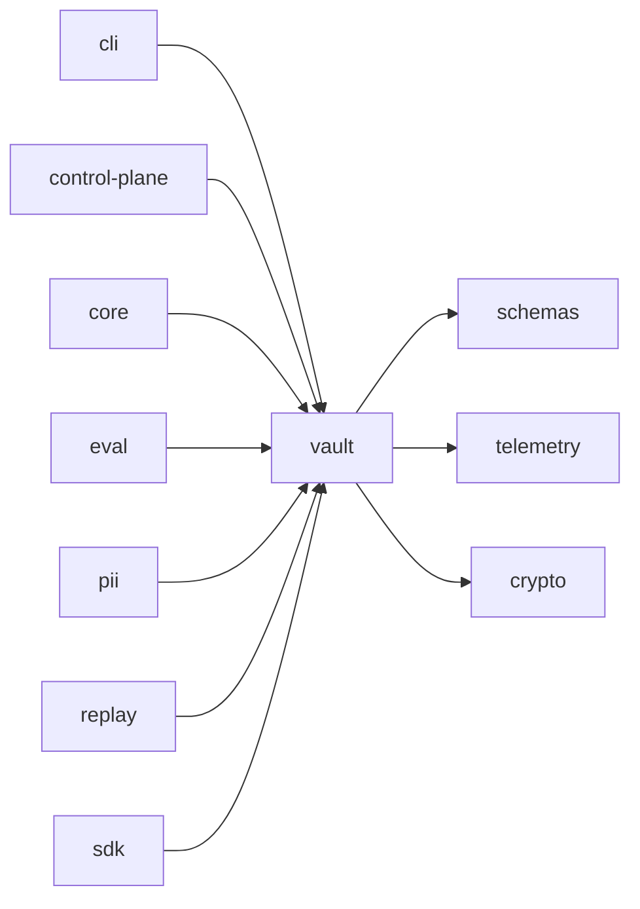
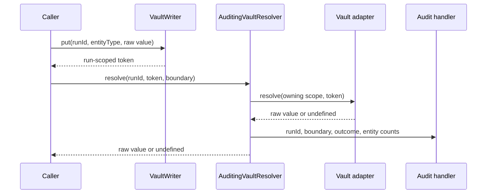
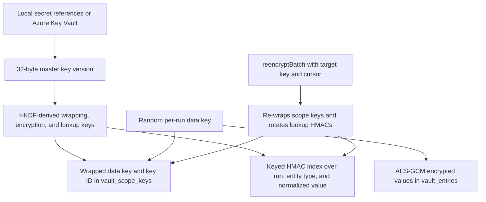

# `@rovinos/vault`

## Purpose

`@rovinos/vault` keeps raw sensitive values out of run events and other durable harness data. It stores a run-scoped mapping from opaque tokens to values, lets authorized consumers resolve tokens at named trust boundaries, and supports retention, audit, and keyed pseudonyms.

## Where it fits

<!-- package-readme: v1 -->

<!-- BEGIN GENERATED: readme-deps (yarn gen:readmes) -->

<!-- END GENERATED: readme-deps -->

The vault sits below PII handling and the run loop: tokenizers write through `VaultWriter`, while consumers receive only the narrow resolver, reader, or admin interface they need. The encrypted adapters depend on `@rovinos/schemas`, `@rovinos/telemetry`, and `@rovinos/crypto`; the allowed dependency graph is generated above.

This is an internal package, not a separately published API. The published `@rovinos/sdk` bundles the harness runtime that uses it, but does not re-export the vault's low-level API. Open [`src/index.ts`](src/index.ts) for exports and [`src/types.ts`](src/types.ts) for the narrow interfaces.

## How it works

Tokenization stores a trimmed value and returns a stable, run-scoped token. Resolution is scoped to the owning run. Route reveals through `AuditingVaultResolver` to record metadata-only audit actions; the storage adapters themselves do not create audit records.



`InMemoryVault` is for tests and ephemeral use. `SqliteVault` keeps its own SQLite database file; `PostgresVault` stores entries in its configured schema and checks that it is separate from the event store. Encrypted adapters use per-run data keys and keyed HMAC indexes for value lookup.

`LocalKeyProvider` lazily resolves configured secret references through the supplied resolver and caches the 32-byte key versions in memory. `AkvKeyProvider` uses `AkvSecretResolver` and Azure's default credential chain to load secrets named `harness-key-<keyId>`; the secret resolver caches values for five minutes by default. Both providers zero cached key bytes when disposed. See [`src/local-key-provider.ts`](src/local-key-provider.ts) and [`src/akv.ts`](src/akv.ts).



Rotation is bounded and resumable: `reencryptBatch` returns an optional cursor, and `countRowsByKey` reports rows still using each encryption or lookup key. The scope data key remains the value-encryption key while its wrapping key and lookup HMAC key are rotated. See [`src/scope-crypto.ts`](src/scope-crypto.ts), [`src/sqlite-rotation.ts`](src/sqlite-rotation.ts), and [`src/postgres-rotation.ts`](src/postgres-rotation.ts).

## Public API

The package exports storage implementations, narrow vault interfaces, token helpers, audit adapters, purge and rotation operations, key providers, and `pseudonymize`. The package is private; these exports are for internal harness composition, not a compatibility promise to external consumers.

```ts
import { Code, Id } from "@rovinos/schemas";
import { AuditingVaultResolver, InMemoryVault } from "@rovinos/vault";

const runId = Id.parse("00000000000000000000000000");
const vault = new InMemoryVault();
const token = await vault.put(runId, Code.parse("email"), "alice@example.test");
const audits = [];
const resolver = new AuditingVaultResolver(vault, (audit) => audits.push(audit));
const value = await resolver.resolve(runId, token, { boundary: "ui" });
```

The example uses synthetic data. The audit handler receives metadata, not the token or resolved value. See [`src/auditing-resolver.ts`](src/auditing-resolver.ts) and [`src/pseudonym.ts`](src/pseudonym.ts) for audit and pseudonym behavior.

## Inputs and outputs

| Operation | Input | Output | Boundary handling |
| --- | --- | --- | --- |
| `put` (`VaultWriter`) | Run ID, entity type, raw string | Run-scoped token such as `<EMAIL_1>` | Raw input is trimmed and retained only in the vault; encrypted adapters store it encrypted. |
| `resolve` (`VaultResolver`) | Owning run ID, token, and `model_input`, `tool_input`, or `ui` context | Original trimmed value, or `undefined` if not found | Reveals the raw value to the caller; use `AuditingVaultResolver` for metadata-only success and blocked audit records. |
| `listRawValues` / `listRawValueEntries` (`VaultReader`) | Run ID | Raw values, optionally with entity types | Deliberately returns raw values for internal leak detection; do not pass this interface to general consumers. |
| `purgeExpired` (`VaultAdmin`) | Vault admin, clock, and retention days | Counts of examined runs and removed entries | Deletes mappings for expired terminal runs; tokens left in other data no longer resolve. |
| `pseudonymize` | Identifier, global or run scope, and key provider | Keyed pseudonym (`p_` plus base32) | Does not return the input; global scope is linkable while the same key remains selected. |

`put` rejects empty values, values over 8 KiB, unrepresentable entity types, and exhausted token space. Normalization affects token identity and lookup, not the returned trimmed original.

## Configuration, telemetry and errors

Harness configuration uses these keys:

| Key | Meaning |
| --- | --- |
| `vault.backend` | `sqlite` (default) or `postgres`. |
| `vault.purgeAfterDays` | Positive retention grace period for terminal runs; defaults to `7`. |
| `vault.postgres.url` | Required `SecretRef` when `backend` is `postgres`; must be absent for SQLite. |
| `keys.currentKeyId` and `keys.keys[]` | Active and historical key IDs with secret references. Key material is canonical base64 for 32 bytes. |

For example, the following configuration uses a database URL and key value resolved from environment references; the variable names are deployment-specific:

```yaml
vault:
  backend: postgres
  postgres:
    url: env:VAULT_DATABASE_URL
  purgeAfterDays: 14
keys:
  currentKeyId: primary
  keys:
    - id: primary
      secret: env:HARNESS_VAULT_KEY_PRIMARY
```

There is no vault-specific runtime environment variable for its database or key settings. Provide database URLs and key values through the configured secret-reference mechanism, such as `env:VAULT_DATABASE_URL` or `akv:team-vault/harness-key-primary`; these names are deployment choices. `NODE_ENV=production` prevents `LocalKeyProvider` from creating an ephemeral key when keys are not configured. The Postgres integration tests use `TEST_VAULT_POSTGRES_URL` when set, and the optional live Azure test reads `HARNESS_LIVE_AKV`.

`PostgresVaultOptions` also accepts adapter-level `schema`, `storeSchema`, `storeConnectionString`, and `poolSize` settings; the schema names default to `public`, and the pool size defaults to `10`. The event-store connection information is used to enforce database separation, not to place vault tables in the event store. See [`src/postgres.ts`](src/postgres.ts).

The vault defines no OpenTelemetry spans or metrics. `AuditingVaultResolver` can emit `pii_action`-compatible metadata with the run ID, boundary, outcome, tool ID, and entity counts; it never includes raw values or tokens.

Closed vault operation codes are `vault_encrypt_failed`, `vault_decrypt_failed`, `vault_unavailable`, `vault_migration_checksum_mismatch`, `vault_migration_newer_than_code`, `schema_migration_pending`, `vault_purge_stalled`, and `vault_shares_store_database`. Value validation codes are `vault_value_empty`, `vault_value_too_large`, `vault_entity_type_invalid`, and `vault_token_space_exhausted`. Local key-provider codes are `key_config_invalid`, `key_config_required`, `key_current_missing`, `key_invalid_length`, `key_not_found`, `key_provider_disposed`, and `key_secret_unavailable`. Azure secret-resolver codes are `secret_access_denied`, `secret_not_found`, `secret_ref_invalid`, `secret_resolution_cancelled`, and `secret_resolver_unavailable`; pseudonym codes are `pseudonym_input_invalid`, `pseudonym_key_invalid`, and `pseudonym_key_unavailable`. Errors do not expose secret material or raw vault values. See [`src/errors.ts`](src/errors.ts), [`src/types.ts`](src/types.ts), [`src/local-key-provider.ts`](src/local-key-provider.ts), [`src/akv.ts`](src/akv.ts), and [`src/pseudonym.ts`](src/pseudonym.ts).

## Security and privacy

- Encrypted adapters use AES-GCM, per-run data keys wrapped by configured master-key versions, and keyed HMACs for lookup; the raw lookup value is not stored as an unkeyed digest.
- SQLite is a dedicated vault database file with secure deletion enabled. Postgres rejects configurations that use the event-store database with the same schema or role. Neither adapter belongs in the event store.
- Key providers resolve secret references lazily, cache key bytes in memory, and zero cached key material on disposal. Keep historical keys available until rotation is complete.
- Keep interfaces narrow: writers tokenize, resolvers reveal, readers serve leak detection, and admins purge. The in-memory backend is not encrypted and is only suitable for tests or ephemeral use.
- Purging removes mappings, not token strings already present elsewhere. SQLite secure deletion does not guarantee old database pages are physically reclaimed; after a large purge, stop writers and run `VACUUM` separately if file-level reclamation is required.
- Global pseudonyms permit cross-run correlation for the same normalized identifier and key. Low-entropy inputs are protected from guessing only while the HMAC key remains secret; run-scoped pseudonyms avoid cross-run linkability.

## Testing

Unit and shared conformance tests run in the GitHub Actions `unit` job. Postgres integration tests run in the `integration` job when its Compose service is available. The Azure Key Vault live test is separate and requires its live-test setup.

Run the unit tests with:

```sh
yarn test:unit packages/vault
```

For the Postgres integration tests, run `yarn test:integration packages/vault`. The live Azure check is `yarn test:live:akv`.

## Related docs

- [Configuration](../../docs/configuration.md) — vault backend and retention settings.
- [Secret references](../../docs/secrets.md) and [Azure Key Vault secrets](../../docs/secrets-azure.md) — key and database secret references.
- [Pseudonymous telemetry correlation](../../docs/telemetry/correlation.md) — pseudonym derivation and linkability limits.
- [Harness guarantees](../../docs/guarantees.md) — privacy and storage guarantees.
