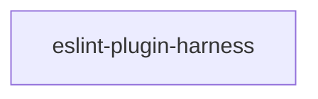
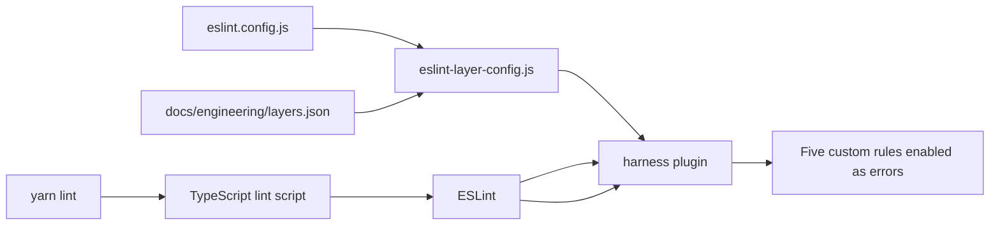

<!-- package-readme: v1 -->

# @rovinos/eslint-plugin-harness

## Purpose

`@rovinos/eslint-plugin-harness` is a private repository tool that provides custom ESLint rules for
the harness's package boundaries, schema-derived types, metric registry, and telemetry span
conventions. It helps contributors catch violations while editing code, before runtime.

## Where it fits

<!-- BEGIN GENERATED: readme-deps (yarn gen:readmes) -->

<!-- END GENERATED: readme-deps -->

This tool sits outside the runtime package layers: it is used by the root ESLint configuration and
does not import or ship with runtime packages. It is private workspace tooling; no published package
bundles it. ESLint and TypeScript-ESLint dependencies, TypeScript, and Vitest are used only for
repository linting, typechecking, and tests.

## How it works

The rules enforce these repository guarantees:

```mermaid
flowchart TD
  direction TB
  imports["harness/import-direction"] --> graph["Imports follow the approved package graph"]
  relative["harness/no-relative-packages"] --> names["Cross-package imports use package names"]
  schemas["harness/schema-inferred-types"] --> contracts["Exported contracts derive from schemas"]
  metrics["harness/metric-registry-only"] --> registry["Metric instruments stay in the typed registry"]
  spans["harness/no-raw-tracer"] --> telemetry["Spans use the registered telemetry API"]
```

`yarn lint` runs `yarn lint:ts`, which invokes ESLint with the root configuration. The root
configuration loads this plugin, passes it the validated package-layer map, and enables every
custom rule as an error:



The rules are:

| Rule | What it protects |
| --- | --- |
| `harness/import-direction` | Checks `@rovinos/*` imports against the canonical package allowlist in [`layers.json`](../../docs/engineering/layers.json). |
| `harness/no-relative-packages` | Requires package-name imports instead of relative paths across package boundaries. |
| `harness/schema-inferred-types` | Prevents exported interfaces from duplicating an exported `*Schema`; use `z.infer<typeof Schema>` for the contract type. |
| `harness/metric-registry-only` | Keeps metric instrument creation in `packages/telemetry/src/metrics.ts` and restricts it to reviewed attribute types. |
| `harness/no-raw-tracer` | Prevents raw OpenTelemetry SDK imports, tracer access, raw span creation, and span mutation outside its allowlist. Use `defineSpan(...).start(...)`, `withSpan(...)`, or `setActiveSpanAttribute` from `@rovinos/telemetry`. |

All `harness/*` rules are errors and cannot be disabled with inline ESLint comments. Changing that
restriction requires a reviewed configuration change.

## Public API

This package is internal and has no supported public or semver-stable API. Its named export,
`createHarnessPlugin`, is used by the repository's
[`eslint-layer-config.js`](../../eslint-layer-config.js) to build the plugin instance. For example,
a small synthetic layer map can initialize it as follows:

```js
import { createHarnessPlugin } from "@rovinos/eslint-plugin-harness";

const plugin = createHarnessPlugin({
  schemas: [],
  telemetry: ["schemas"],
});
```

The returned plugin provides the five rules documented above under the `harness` namespace.

## Inputs and outputs

| Input | Output | Tokenized at this boundary |
| --- | --- | --- |
| JavaScript or TypeScript source parsed by ESLint, including its AST and filename | Rule diagnostics with a rule ID, source location, and guidance | No. This is repository source and static-analysis metadata, not runtime harness data. |
| Validated package-layer map supplied by the root config | Import-direction decisions | No. The map contains package names and allowed dependency names. |
| Optional `allowedFiles` array for `harness/no-raw-tracer` | Files exempted from that rule's checks | No. The values are repository-relative path patterns. |

The plugin does not accept or produce runtime prompts, model output, tool arguments, events, or
telemetry payloads.

## Configuration, telemetry and errors

The root configuration validates `docs/engineering/layers.json` and supplies the resulting map to
`createHarnessPlugin`. `harness/no-raw-tracer` also accepts an optional `allowedFiles` array; by
default it uses the narrow allowlist in `src/rules/no-raw-tracer.ts`. The plugin reads no
environment variables. The root lint pipeline's `LINT_PULL_IMAGES` and `LINT_SKIP_CONTAINERS`
variables affect container-backed linters, not these rules; see the
[linting guide](../../docs/engineering/linting.md).

This static-analysis package defines no spans or metrics. It is not a runtime library and has no
application error codes; violations are ordinary ESLint diagnostics from the corresponding rule.

## Security and privacy

The rules help maintain package dependency direction, schema-derived contracts, centralized bounded
metric definitions, and the registered telemetry API. They inspect checked-in source during lint;
they are not runtime enforcement or a proof that code is safe. The analysis process receives source
text and filenames, and lint diagnostics may identify source locations. No tokenization is needed
because these inputs are repository code and metadata rather than harness user data. The raw-tracer
rule has explicit exceptions for approved implementation and test files; maintain that allowlist
narrowly and review changes to it.

## Testing

The plugin's `*.test.ts` suites run in the CI `unit` job. `src/config.test.ts` exercises the root
ESLint configuration, and `src/rules/no-raw-tracer.test.ts` tests that rule with `RuleTester`.
Static checks also lint and typecheck the plugin in CI's `static` job.

Run the focused tests with:

```sh
yarn test:unit tools/eslint-plugin-harness
```

## Related docs

- [Linting and suppression policy](../../docs/engineering/linting.md)
- [Engineering conventions](../../docs/engineering/CONVENTIONS.md)
- [Canonical package dependency layers](../../docs/engineering/layers.json)
- [Telemetry guarantees](../../docs/telemetry/guarantees.md)
- [Static analysis guidance](../../docs/security/static-analysis.md)
- Source: [`src/index.js`](./src/index.js), [`src/rules/no-raw-tracer.ts`](./src/rules/no-raw-tracer.ts),
  [`eslint.config.js`](../../eslint.config.js), and
  [`eslint-layer-config.js`](../../eslint-layer-config.js)
